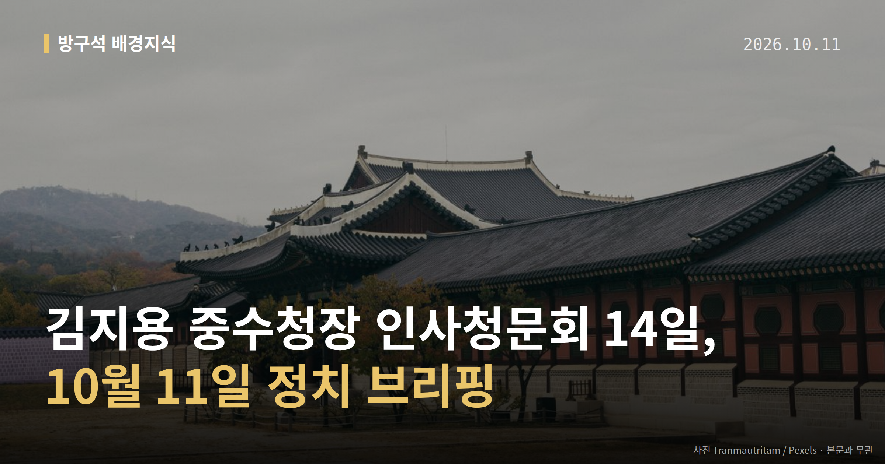
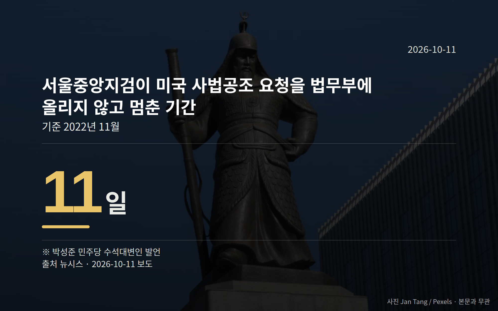

*이 글은 2026년 10월 11일 기준으로 정리한 내용입니다.*
**3줄 요약**

- 14일 김지용 중수청장 인사청문회가 행안위에서 열립니다.
- 민주당이 제시한 수사 지연 기간은 11일·열흘로 엇갈립니다.
- 12~16일 법사위·정무위·행안위 국감 일정을 확인해 보세요.
14일 김지용 중수청장 인사청문회가 열립니다. 중수청은 중대범죄수사청의 줄임말로, 검찰 개혁 논의 과정에서 새로 만들어지는 수사기관입니다. 이 인선을 두고 여권 내부에서 서로 다른 목소리가 이어지고 있습니다.

[이미지: 국회 본청 외부 전경 사진]

## 김지용 중수청장 인사청문회, 14일 행정안전위원회에서

국회 행정안전위원회는 12일 경찰청과 한국도로교통공단을 상대로 국정감사를 진행하고, 14일 김지용 중대범죄수사청장 후보자 인사청문회를 엽니다. 인사청문회는 국회가 고위 공직 후보자의 자격을 공개적으로 검증하는 절차입니다.

같은 주 다른 상임위도 움직입니다. 법제사법위원회는 12~16일 감사원, 헌법재판소, 서울고법·서울중앙지법, 공수처를 상대로 국정감사를 진행합니다.

정무위원회는 12일 국무조정실과 국무총리비서실을, 과학기술정보방송통신위원회는 같은 날 방송미디어통신위원회 등을 감사합니다. 국방위원회는 12일 병무청 감사와 국방과학연구소 현장 시찰, 13일 방위사업청 감사를 예정했습니다.

14일 김지용 중수청장 인사청문회 결과는 중수청 출범 논의의 다음 단계로 이어집니다.

## 여권 안에서는 어떤 말이 나왔나

청문회가 다가오면서 여권 내부 이견도 드러났습니다. 이재명 대통령은 SNS에 "사심으로 인사와 구체적 수사공소 업무까지 좌지우지하려 해서는 안 될 것"이라고 적었고, 9일에는 "능력도 안 되면서...내부 공격하는 것이 더 문제"라고 밝혔습니다.

김민석 민주당 대표는 "절제가 필요하다", "당에서 조금 제어를 할 때도 됐다"고 말했습니다. 김 대표는 8일 기자들과 만나 "큰 방향으로 지지율 하강세를 멈추고 안정적으로 가기 위한 변화 과정에 있다"고 했습니다.

박원석 전 정의당 의원은 9일 CBS 라디오에서, 추미애 경기도지사가 후보자 철회를 요구하는 상황을 두고 "선을 넘어도 한참 넘었다", "일종의 팀킬"이라고 말했습니다. 이는 박 전 의원 개인의 주장이며, 추 지사 본인의 반론은 확인되지 않았습니다.

[이미지: 국정감사가 열리는 국회 상임위 회의장 사진]

## 한동훈 의원 '딸 수사 무마' 의혹 공방

민주당은 10일 "한동훈 의원이 딸 사건을 덮었나"라고 했습니다. 박성준 민주당 수석대변인은 2022년 11월 경찰이 한 의원 딸의 '허위 스펙' 의혹 수사를 위해 미국에 사법 공조를 요청했으나, 서울중앙지검이 이를 법무부에 올리지 않고 멈춰 세웠다고 주장했습니다.

다만 민주당이 제시한 기간은 대변인에 따라 다르게 언급됐습니다.

| 주장 주체 | 언급한 기간 |
|---|---|
| 박성준 수석대변인 | 11일 |
| 이주희 원내대변인 | 열흘 |

한동훈 무소속 의원은 페이스북에 "민주당이 한동훈 잡겠다고 떼거지로 덤볐던 소위 '0.99달러 저작권' 마타도어는 외국인 저작권자로부터 '승낙'까지 받은 사안"이라며 "민주당의 '망상'"이라고 반박했습니다.

민주당은 송경호 전 서울중앙지검장, 공봉숙 검사의 설명과 국가수사본부의 진상 규명을 요구했습니다. 두 사람 측 입장은 확인되지 않았고, 수사나 조사로 사실이 확인된 단계는 아닙니다.

## 그 밖의 오늘 소식

- 김민석 대표, 국감 기간 벼베기·농업인 간담회 등 현장 방문
- 민주당, 국가수사본부에 의혹 전모 규명 요구
- 법사위 국감 쟁점에 재판 독립성·수사기관 중립성 포함

**그래서 나는?**

- 국정 일정 챙기는 유권자라면, 12~16일 상임위 국감 일정을 확인해 보세요.
- 수사기관 개편이 궁금한 분이라면, 14일 청문회가 다음 단계 기준점입니다.
- 뉴스 속 공방이 헷갈린다면, 지금은 의혹 제기·반박 단계임을 기억하세요.

**직접 센 숫자 — 국회·여론조사 (최근 7일)**

국회의원 발의 법률안 **69건**. 최근 발의: 지능형 로봇 개발 및 보급 촉진법 전부개정법률안(백혜련의원 등 10인)

본회의 처리 법률안 **3건** — 철회 3건

이번 주 등록된 선거 여론조사 6건

- 전국 정기(정례)조사 정당지지도 — 한국갤럽조사연구소 · 한국갤럽 자체 조사 의뢰 · 2026-10-06~08 · 1,000명 · 무선전화면접 · 응답률 9.7% · 95% 신뢰수준에 ±3.1%p
- 전국 정기(정례)조사 대통령선거 정당지지도 국정현안 등 — (주)코리아정보리서치 · 천지일보 의뢰 · 2026-10-05~06 · 1,003명 · 무선 ARS · 응답률 4.3% · 95% 신뢰수준에 ±3.1%p
- 전국 정기(정례)조사 정당지지도 — 미디어토마토 · 뉴스토마토 의뢰 · 2026-10-05~06 · 1,033명 · 무선 ARS · 응답률 2.3% · 95% 신뢰수준에 ±3.0%p

*열린국회정보·중앙선거여론조사심의위원회 자료를 직접 셌습니다. 여론조사의 자세한 사항은 중앙선거여론조사심의위원회 홈페이지를 참조하세요.*
**여러분은 이번 주 국정감사 일정 가운데 어느 상임위를 먼저 챙겨 보실 생각인가요?**

---

### 참고한 기사

1. **민생 챙기며 내부 단속까지…김민석, 두 마리 토끼 잡을까**
   - [뉴시스·정치](https://www.newsis.com/view/NISX20261008_0003819814)
2. **국회 국정감사 2주차…공수처·경찰 수사 공정성, 법원 재판 독립성 등 쟁점**
   - [뉴시스·정치](https://www.newsis.com/view/NISX20261008_0003819881)
3. **"민주당의 망상" 발끈한 한동훈…'딸 수사 무마' 의혹 반박**
   - [한국경제·정치](https://www.hankyung.com/article/2026101035567)
   - [뉴시스·정치](https://www.newsis.com/view/NISX20261010_0003820657)
4. **정치(10월11일 일요일)**
   - [뉴시스·정치](https://www.newsis.com/view/NISX20261010_0003820688)
   - [뉴스1](https://news.google.com/rss/articles/CBMiWkFVX3lxTE1YOTZfLUtVbnRCNHFvUEUwZk0wZHIyUzk0NWhKTmtfUTVCVTFVaE9LUDQ2dXllZkpub0IycGN4bTlwdU9EaXUwS1IyTkxuMjhINzVXUTdXd0V6QQ?oc=5)
5. **박원석 "추미애, 文때도 대통령 비난…경고만 할 단계를 넘어섰다"**
   - [뉴시스·정치](https://www.newsis.com/view/NISX20261010_0003820566)

---

*본 글은 공개된 언론 보도를 정리한 것이며, 특정 정당·후보·인물을 지지하거나 반대하지 않습니다. 인용한 여론조사의 자세한 사항은 중앙선거여론조사심의위원회 홈페이지를 참조하세요.*
