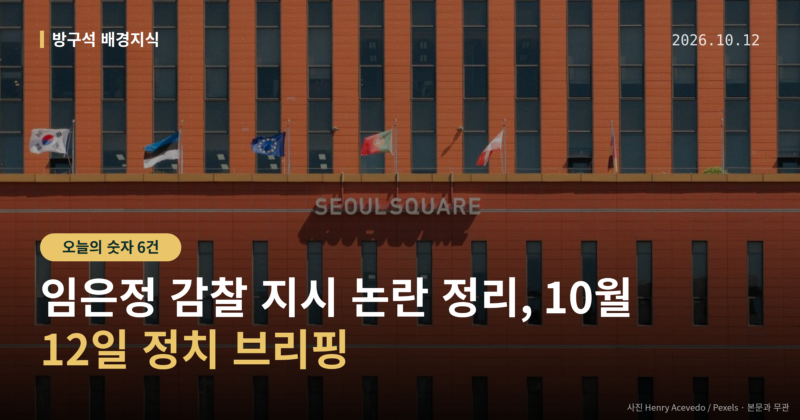
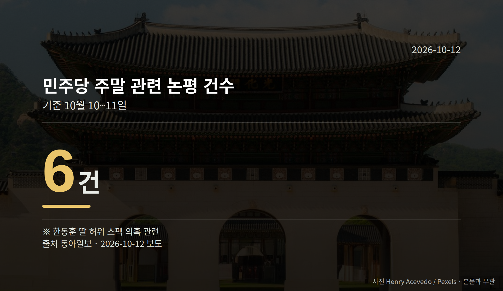

*이 글은 2026년 10월 12일 기준으로 정리한 내용입니다.*
**3줄 요약**

- 윤호중 행안부 장관이 임은정 광주지방중수청장 감찰을 지시했습니다
- 주말 사이 민주당 논평 6건, 대통령 SNS 글 2건이 나왔습니다
- 13일 경기도 국감, 14일 김지용 후보자 청문회를 보면 됩니다
**오늘 요약 3줄**

- 윤호중 행안부 장관이 임은정 광주지방중수청장 감찰을 지시했습니다
- 주말 사이 민주당 논평 6건, 대통령 SNS 글 2건이 나왔습니다
- 13일 경기도 국감, 14일 김지용 후보자 청문회를 보면 됩니다

---

10월 11일 **임은정 감찰 지시**가 나왔습니다. 윤호중 행정안전부 장관이 임은정 광주지방중수청장에 대한 감찰을 지시한 것입니다.

감찰은 소속 기관이 공무원의 직무 수행을 따져 보는 내부 조사 절차입니다. 이 지시를 계기로 중수청장 인선을 둘러싼 여권 내부의 이견이 공개적으로 드러났습니다.

[이미지: 정부 부처 브리핑룸과 마이크를 담은 자료 사진]

## 임은정 감찰 지시, 11일 무슨 일이 있었나

임 청장은 김지용 중수청장 후보자를 두고 "반면교사로 삼아야 될 사람"이라고 공개 비판해 왔습니다.

윤 장관은 X에 "임 청장은 중수청을 수사하는 기관이 아니라 정치하는 기관으로 착각하고 있는 것 같다"고 썼습니다. 임 청장은 감찰 지시에 대해 "사명감을 가지고 잘 대처할 것"이라고 밝혔습니다.

청와대는 김지용 후보자를 재검증한 뒤 10월 2일 국회에 인사청문요청안을 제출했습니다. 인사청문회는 국회가 후보자의 자격을 공개 검증하는 절차로, 14일로 예정돼 있습니다.

## 양쪽 입장은 이렇게 갈립니다

더불어민주당 조계원 대변인은 감찰 지시를 "상식적인 조치"라며 "상사의 인사 문제를 두고 왈가왈부하는 것 자체가 어불성설"이라고 말했습니다. 김민석 대표는 "대통령의 리더십 자체에 훼손이 될 수 있다는 우려가 있다면 당에서 조금 제어를 할 때도 됐다"고 말했습니다.

반면 조국혁신당은 감찰 지시 직후 "김지용 후보자의 그간 이력이 근본적 문제"라는 입장을 냈습니다. 민주당 김용민 의원은 SNS에 "내가 정치를 시작한 것은 이루고자 한 과제가 있어서이지 자리를 탐하기 위해서가 아니다"라는 글을 올렸습니다.

조국혁신당을 뺀 다른 야당의 구체적인 반응은 확인되지 않았습니다.

주말 하루 사이 여러 채널에서 메시지가 동시에 나온 점도 눈에 띕니다.

| 항목 | 수치 |
| --- | --- |
| 윤호중 장관 감찰 지시 | 1건 |
| 민주당 주말 논평(한동훈 의원 딸 의혹 관련) | 6건 |
| 이재명 대통령 SNS 발언 | 2건 |

## 임은정 감찰 지시 이후, 무엇을 보면 되나

12일부터 2주차 국정감사가 시작됩니다. 민주당은 민생 의제를, 국민의힘은 농지 전수조사와 중수청·공소청 출범 등을 고리로 삼을 태세입니다.

13일에는 국회 행정안전위원회의 경기도 국정감사가, 14일에는 김지용 후보자 인사청문회가 열립니다. 임은정 감찰 지시로 드러난 이견이 청문회장에서 어떻게 정리되는지가 관전 지점입니다.

[이미지: 국회 상임위원회 회의장 전경 사진]

## 그 밖의 오늘 소식

- 경찰, 한동훈 의원 딸 의혹 압수수색 영장 신청 0건
- 한 의원 배우자는 서면조사 1회만 받은 것으로 확인
- 이재명 대통령 '고관대작' SNS 글, 대상 두고 해석 엇갈림

**그래서 나는?**

- 뉴스 흐름을 챙기는 분이라면, 14일 청문회 일정을 메모해 두세요
- 수사기관 개편이 궁금한 분이라면, 중수청장 인선 절차를 따라가 보세요
- 경기도에 사는 분이라면, 13일 경기도 국정감사 중계를 확인해 보세요

**직접 센 숫자 — 국회·여론조사 (최근 7일)**

국회의원 발의 법률안 **69건**. 최근 발의: 지능형 로봇 개발 및 보급 촉진법 전부개정법률안(백혜련의원 등 10인)

본회의 처리 법률안 **3건** — 철회 3건

이번 주 등록된 선거 여론조사 9건

- 전국 정기(정례)조사 정당지지도 — (주)여론조사꽃 · 2026-10-09~10 · 1,004명 · 무선전화면접 · 응답률 9.3% · 95% 신뢰수준에 ±3.1%p
- 전국 정기(정례)조사 정당지지도 — (주)여론조사꽃 · 2026-10-09~10 · 1,007명 · 무선 ARS · 응답률 2% · 95% 신뢰수준에 ±3.1%p
- 전국 정기(정례)조사 정당지지도 — 한국갤럽조사연구소 · 한국갤럽 자체 조사 의뢰 · 2026-10-06~08 · 1,000명 · 무선전화면접 · 응답률 9.7% · 95% 신뢰수준에 ±3.1%p

오늘 이슈에 나온 법안은 지금 어디에

- 저작권법 — 제22대 발의 35건(계류 22) · 최근 「저작권법 일부개정법률안」(임오경의원 등 10인, 2026-09-17) · 소관위 회부

*열린국회정보·중앙선거여론조사심의위원회 자료를 직접 셌습니다. 여론조사의 자세한 사항은 중앙선거여론조사심의위원회 홈페이지를 참조하세요.*
**여러분은 새로 생기는 수사기관의 수장을 정할 때, 어떤 기준이 가장 먼저 확인돼야 한다고 보시나요?**

---

### 참고한 기사

1. **행안장관, 임은정 감찰 지시… 강경파와 충돌 확산**
   - [동아일보·정치](https://www.donga.com/news/Politics/article/all/20261012/134822488/2)
   - [MBC 뉴스](https://news.google.com/rss/articles/CBMieEFVX3lxTFBUd05kVklsTS1jRTd4bVBsZEdKbEFYdHhTdkJBSURLZUwxN0cwVExQNkE4MnhtVmJtTFA1NnExR3RkNUhMTGdOM2toSW9JZVBCY0RVeTVoLVRUUlFCc0s4czlBMU5TbVR0LW4zdUxCTlVxb1o0Ml9JVtIBeEFVX3lxTE4yNzU2c2xlNzJ2MFh5dEcwa20tVmJKc24yaEFCekxCelh0b3NnejFHb1BwaGRTN3J1clp0ak9mZVZvd1FpNW00ME9ndGkyLURxRndIYXgwOXUyUkxjSU1QSW5DMGdZT1JPbm9EbVNuMmNROGlHekprcQ?oc=5)
2. **(12일·월)**
   - [연합뉴스·정치](https://www.yna.co.kr/view/AKR20261011042900001)
   - [뉴시스·정치](https://www.newsis.com/view/NISX20261011_0003820865)
3. **한동훈 딸 ‘허위 스펙 의혹’ 경찰 수사, 압색영장 신청 전무…배우자만 1회 ‘서면 조사’**
   - [경향신문·정치](https://www.khan.co.kr/article/202610120600071)
   - [동아일보·정치](https://www.donga.com/news/Politics/article/all/20261012/134822522/2)
4. **與, 2주 차 국감서 '민생' 강조…김지용 둘러싼 내부 논란 고심**
   - [뉴시스·정치](https://www.newsis.com/view/NISX20261011_0003821065)
5. **李 “호의호식 고관대작, 서민 삶 이해 못해”…추미애 겨냥했나**
   - [동아일보·정치](https://www.donga.com/news/Politics/article/all/20261011/134819782/1)
   - [조선일보·정치](https://www.chosun.com/politics/politics_general/2026/10/11/TZ7I6Q2JHFDIZK7SUY4DRAYDLQ)

---

*본 글은 공개된 언론 보도를 정리한 것이며, 특정 정당·후보·인물을 지지하거나 반대하지 않습니다. 인용한 여론조사의 자세한 사항은 중앙선거여론조사심의위원회 홈페이지를 참조하세요.*
