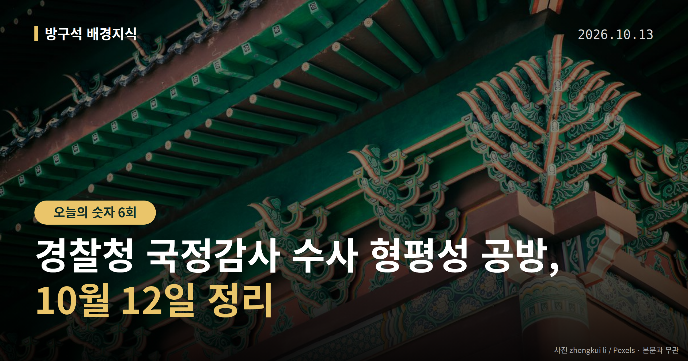
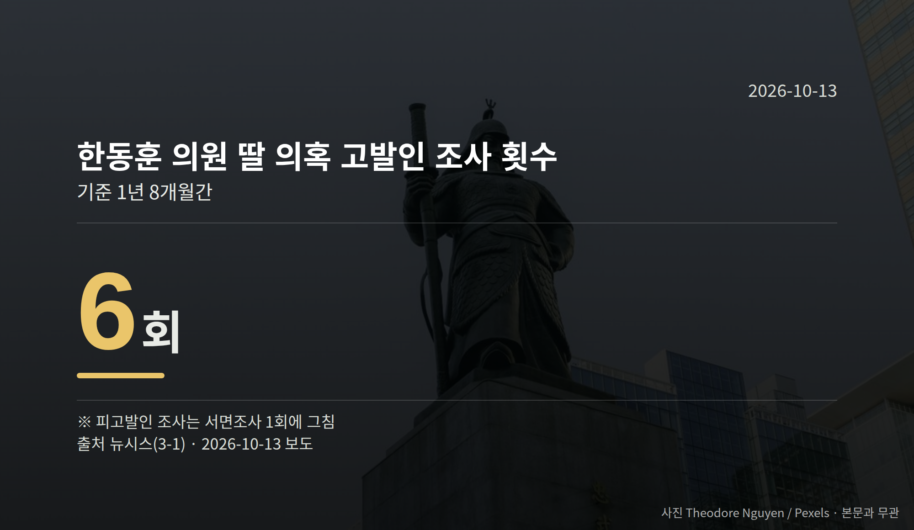

*이 글은 2026년 10월 13일 기준으로 정리한 내용입니다.*
**3줄 요약**

- 경찰청 국정감사에서 수사 형평성 공방이 이어졌습니다
- 고발인 조사 6회, 소환조사 16시간대 등 수치가 거론됐습니다
- 재수사 착수 여부와 13일 12개 상임위 국감을 보면 됩니다
10월 12일 열린 경찰청 국정감사(국회가 정부 기관의 업무를 따져 묻는 절차)에서는 수사 형평성을 둘러싼 여야 공방이 이어졌습니다.

한동훈 무소속 의원 딸의 '허위 스펙' 의혹 수사와 김재섭 국민의힘 의원 소환조사가 동시에 쟁점이 됐습니다. 두 사안 모두 이날 결론이 나지는 않았습니다.

[이미지: 국회 상임위원회 국정감사장 전경 사진]

## 경찰청 국정감사에서 나온 한동훈 의원 딸 의혹 지적

윤건영 더불어민주당 의원은 "1년 8개월 동안 고발인만 여섯 번 조사하고 피고발인 조사는 서면조사 한 번으로 그쳤다"며 "압수수색영장 청구도 한 번 없었다"고 지적했습니다.

김종철 경찰청장 직무대행은 "실체적 진실을 규명하기 위해 좀 더 적극적으로 노력했어야 하지 않나 생각한다"고 답했습니다. 새로운 사실관계가 확인되면 재수사를 검토하겠다고도 밝혔습니다.

이 의혹은 아직 수사가 진행 중인 사안이며, 혐의가 확정된 단계는 아닙니다.

## 김재섭 의원 소환조사 시간은 왜 쟁점이 됐나

강명구 국민의힘 의원은 국정감사 기간 중 이뤄진 김재섭 의원 조사 시간과 김경 전 서울시의원의 첫 조사 시간을 비교하며 "야당에는 혹독한 수사, 여당에는 따뜻한 수사"라고 주장했습니다.

김종철 직무대행은 이 형평성 지적에 대해 "위원님 말씀에 동의하지 않는다", "저희가 일방적으로 요청한 사실이 없다"고 반박했습니다.

| 항목 | 수치 |
| --- | --- |
| 한동훈 의원 딸 의혹 고발인 조사 | 6회(1년 8개월간) |
| 같은 사건 피고발인 조사 | 서면조사 1회 |
| 김재섭 의원 소환조사 시간 | 16시간 40분~46분 |
| 김경 전 서울시의원 첫 조사 | 3시간 30분 |

김재섭 의원 조사 시간은 보도 매체에 따라 16시간 40분과 16시간 46분으로 다르게 적혀 있습니다. 표기가 엇갈리는 만큼 이 숫자 하나만으로 판단하기는 어렵습니다.

[이미지: 경찰청 건물 외관 사진]

## 경찰청 국정감사 다음에 볼 지점

경찰청이 재수사 '검토' 입장을 밝힌 만큼, 실제 착수 여부가 다음 단계로 남아 있습니다. 소환조사 시간을 둘러싼 지적에 대해 경찰청이 추가 설명을 내놓을지도 지켜볼 부분입니다.

13일에는 12개 상임위에서 국정감사가 이어진다고 보도됐습니다. 법제사법위원회에서는 조희대 대법원장의 대법관 후보자 재제청 거부를 둘러싼 공방이 예상됩니다.

국민의힘은 이재명 대통령의 손봉기 대법관 후보자 임명동의안 미제출과 재제청 요구가 국회 권한을 침해했다며 헌법재판소에 권한쟁의심판(국가기관 사이 권한 다툼을 헌재가 가리는 절차)을 청구했습니다. 민주당은 헌법에 따라 조 대법원장이 재제청해야 한다는 입장입니다.

## 그 밖의 오늘 소식

- 인권위, 윤 전 대통령 방어권 권고 사과 의결(찬성 6·반대 4)
- 감사원 국감, 대법관 격려금·중립성 논란 공방
- 정무위, 쿠팡의 공정위 현장조사 거부 여야 공동 규탄

**그래서 나는?**

- 뉴스를 처음 따라가는 분이라면, 국감은 결론이 아니라 질의 단계입니다
- 수사 절차가 궁금한 분이라면, '검토'와 '착수'는 다른 단계입니다
- 이번 국감을 지켜볼 유권자라면, 13일 상임위 일정을 확인해 보세요

**직접 센 숫자 — 국회·여론조사 (최근 7일)**

최근 발의: 주세법 일부개정법률안(안도걸의원 등 10인)

이번 주 등록된 선거 여론조사 9건

- 전국 전체 정기(정례)조사정당지지도 — (주)여론조사꽃 · 2026-10-09~10 · 1,004명 · 무선전화면접 · 응답률 9.3% · 95% 신뢰수준에 ±3.1%p
- 전국 전체 정기(정례)조사정당지지도 — (주)여론조사꽃 · 2026-10-09~10 · 1,007명 · 무선 ARS · 응답률 2% · 95% 신뢰수준에 ±3.1%p
- 전남광주통합특별시 전체 정당지지도대통령선거 — 한국갤럽조사연구소 · KBS광주방송총국 의뢰 · 2026-10-07~08 · 1,204명 · 무선전화면접 · 응답률 13.7% · 95% 신뢰수준에 ±2.8%p

*열린국회정보·중앙선거여론조사심의위원회 자료를 직접 셌습니다. 여론조사의 자세한 사항은 중앙선거여론조사심의위원회 홈페이지를 참조하세요.*
**여러분은 기관의 중립성 논란을 판단할 때 어떤 자료를 먼저 찾아보시나요?**

---

### 참고한 기사

1. **국감 2주차 첫날…여야, 경찰 수사 공정성·감사원 중립성 공방(종합)**
   - [뉴시스·정치](https://www.newsis.com/view/NISX20261012_0003822928)
   - [연합뉴스·정치](https://www.yna.co.kr/view/AKR20261012100052001)
2. **행정안전부(10월13일 화요일)**
   - [뉴스핌](https://news.google.com/rss/articles/CBMiXEFVX3lxTE1KLVZjRTNXVmE3SklSbFEtUkhGUWF2SmJkRElvOVkybGxFNnVWSDFxcFUzVDd3OC16Z0hqX0lyZzhQb2l2Y3dXUkFmVHVEZ2lzV2lmTm44T0p4WjRn?oc=5)
   - [뉴시스·정치](https://www.newsis.com/view/NISX20261012_0003822856)
3. **경찰 국감서 한동훈 딸·김재섭 수사 공방…"올공 공권력 투입 검토"(종합2보)**
   - [뉴시스·정치](https://www.newsis.com/view/NISX20261012_0003822961)
4. **국감서 대법관 재제청 등 공방 예고…경기도는 추미애 첫 검증대**
   - [연합뉴스·정치](https://www.yna.co.kr/view/AKR20261012180100001)
   - [뉴시스·정치](https://www.newsis.com/view/NISX20261012_0003822868)
5. **인권위, ‘내란 혐의 尹방어권 보장 권고’ 사과**
   - [동아일보·정치](https://www.donga.com/news/Society/article/all/20261012/134829519/2)
   - [연합뉴스·정치](https://www.yna.co.kr/view/AKR20261012142652004)

---

*본 글은 공개된 언론 보도를 정리한 것이며, 특정 정당·후보·인물을 지지하거나 반대하지 않습니다. 인용한 여론조사의 자세한 사항은 중앙선거여론조사심의위원회 홈페이지를 참조하세요.*
