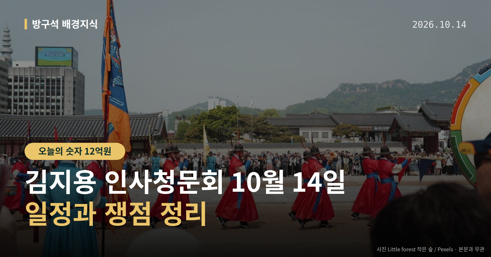
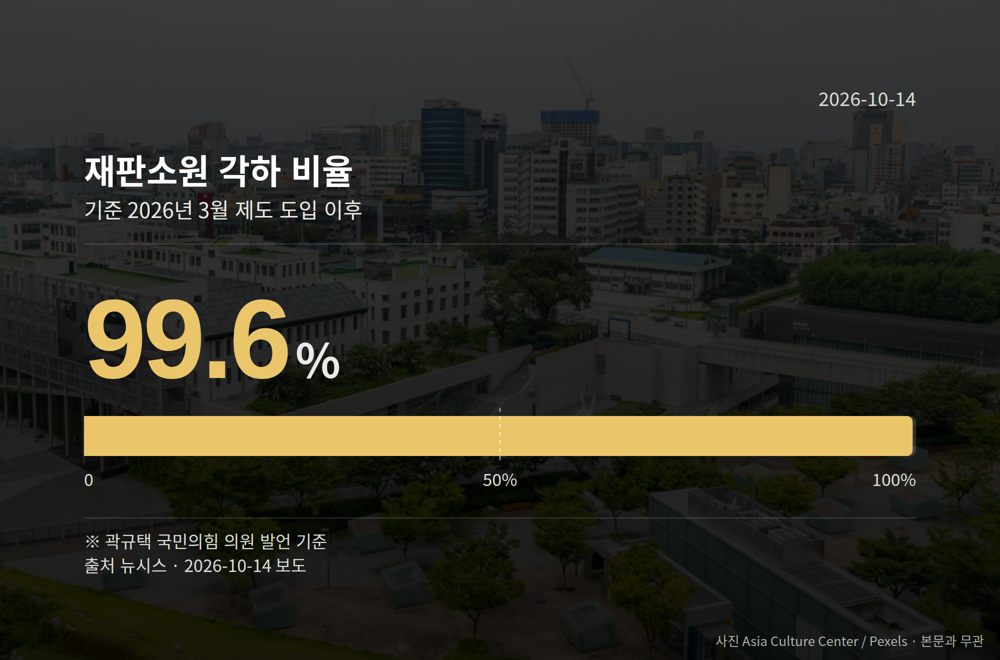

*이 글은 2026년 10월 14일 기준으로 정리한 내용입니다.*
**3줄 요약**

- 김지용 중수청장 후보자 인사청문회가 14일 국회에서 열립니다
- 13일 국감에서는 재판소원 각하 99.6% 등 숫자 공방이 나왔습니다
- 다음 절차는 행안위의 청문경과보고서 채택 여부입니다
**오늘 3줄 요약**
- 김지용 중수청장 후보자 인사청문회가 14일 국회에서 열립니다.
- 13일 국감에서는 재판소원 각하 99.6% 등 숫자 공방이 나왔습니다.
- 다음 절차는 행안위의 청문경과보고서 채택 여부입니다.

김지용 인사청문회가 10월 14일 국회 행정안전위원회에서 열립니다. 하루 전인 13일에는 야당 의원들의 질의와 여당 내부 발언이 동시에 이어졌습니다.

김 후보자 본인의 반박이나 해명은 제공된 자료에서 확인되지 않았습니다.

[이미지: 국회 본관 외관을 담은 사진]

## 김지용 인사청문회, 언제 어디서 열리나

14일 서울 여의도 국회 본관에서 행정안전위원회가 김지용 중대범죄수사청장(중대 범죄 수사를 맡는 새 수사기관의 수장) 후보자 청문회를 엽니다.

이재명 대통령은 재검증을 거쳐 지난 1일 인사청문요청안을 재가했습니다. 청문회 뒤에는 상임위가 청문경과보고서(후보자 적격 여부에 대한 국회 의견을 담는 문서)를 채택할지가 남습니다.

## 양쪽에서 나온 말들

민주당 소속 추미애 경기지사는 13일 경기도청 국감에서 권영진 국민의힘 의원의 질의에 "친윤 검사일뿐 아니라 공직자로서 그 자리에는 부적합하다고 생각한다"고 말했습니다.

박상웅 국민의힘 의원이 입장 변화를 묻자 추 지사는 "개인적인 정치 소신은 다른 기회에 말씀드리겠다"고 답했습니다. 호화 관사 논란에는 12억원 전세라며 "사치라 보기 어렵다"고 반박했습니다.

여당 내에서는 김용민 민주당 의원이 지난달 기자회견에서 "친윤석열 검사로 검찰개혁 반대를 주도했던 김지용 후보가 초대 수장이 되면 중수청이 무력화될 가능성이 있다"며 지명 철회를 촉구했습니다.

반면 김민석 민주당 대표는 6일 "당에서 제어할 때"라고 했고, 12일에는 "논리나 타깃을 바꿔가며 끊임없이 대통령이나 당을 끌어가는 데 대한 비판이 있어 왔다"고 말했습니다.

## 13일 국정감사에서 나온 숫자

| 수치 | 내용 | 말한 사람 |
|---|---|---|
| 99.6% | 재판소원 도입 후 각하 비율 | 곽규택 국민의힘 의원 |
| 1만5000건 | 연간 소송 추정치(대법원 측 주장) | 박은정 조국혁신당 의원 전언 |
| 8만 건 | 영장 없이 조회 가능하다는 금융거래 정보 | 신동욱 국민의힘 의원 |

세 수치는 모두 의원들이 국감에서 제시한 것으로, 기관이 확정한 통계로 소개된 것은 아닙니다.

## 그 밖의 오늘 소식

[이미지: 수도권 아파트 단지 전경 사진]

- 임기근 국무조정실장 "올 코트 프레싱" 발언에 야당 반발
- 14일 '1억 공천헌금 혐의' 강선우 1심 선고 예정
- 44개 기관 세종 이전, 공무원 1만명 이동 보도

**그래서 나는?**

- 뉴스를 따라가는 유권자라면, 14일 청문회와 보고서 절차를 함께 보세요
- 수사기관 개편에 관심 있다면, 중수청 초대 수장 인선 절차를 확인해 보세요
- 부동산 정책이 궁금하다면, 정무위 국감 후속 질의를 지켜보시면 됩니다

**직접 센 숫자 — 국회·여론조사 (최근 7일)**

국회의원 발의 법률안 **66건**. 최근 발의: 이재명 대통령 일가의 황제 골프 특혜 및 특수활동비 등 국가 예산의 사적 유용 의혹 진상규명을 위한 특별검사 임명 등에 관한 법률안(주진우의원 등 10인)

본회의 처리 법률안 **2건** — 철회 2건

이번 주 등록된 선거 여론조사 9건

- 전남광주통합특별시 전체 정당지지도 — 한국갤럽조사연구소 · KBS광주방송총국 의뢰 · 2026-10-07~08 · 1,204명 · 무선전화면접 · 응답률 13.7% · 95% 신뢰수준에 ±2.8%p
- 전국 전체 정기(정례)조사정당지지도 — (주)여론조사꽃 · 2026-10-09~10 · 1,004명 · 무선전화면접 · 응답률 9.3% · 95% 신뢰수준에 ±3.1%p
- 전국 정기(정례)조사 정당지지도 — (주)에브리리서치 · (주)에브리뉴스 의뢰 · 2026-10-09~10 · 1,000명 · 무선 ARS · 응답률 3.1% · 95% 신뢰수준에 ±3.1%p

오늘 이슈에 나온 법안은 지금 어디에

- 외교법 — 제22대 발의 8건 · 최근 「우주외교법안」(김건의원 등 12인, 2026-09-07) · 소관위 회부

*열린국회정보·중앙선거여론조사심의위원회 자료를 직접 셌습니다. 여론조사의 자세한 사항은 중앙선거여론조사심의위원회 홈페이지를 참조하세요.*
**여러분은 새 수사기관의 첫 수장을 고를 때 무엇을 가장 먼저 확인하고 싶으신가요?**

---

### 참고한 기사

1. **국감장서도 김지용 때린 추미애 “친윤 검사…중수청장 부적합”**
   - [경향신문·정치](https://www.khan.co.kr/article/202610132141015)
   - [연합뉴스TV](https://news.google.com/rss/articles/CBMiZ0FVX3lxTE01eGUxN0x1QlJ4VE9CNk9tQ0xOZFRHRXEyYWNaU2hUQTVQS1QxaDh2Y1pmWjkzSmM1dm54QVBEa1A1cFNFUHRiYWhfbDNZMkN2dzgwSGI2VEl5RHMzR25Ya1VMNzNUVUU?oc=5)
2. **행정안전부(10월14일 수요일)**
   - [뉴시스·정치](https://www.newsis.com/view/NISX20261013_0003824657)
   - [뉴스핌](https://news.google.com/rss/articles/CBMiXEFVX3lxTE5iYkZMaW10bFE5ZDBobFZKT0RncXB2SEVqYnUyUFdiOFIxMVA3YV9CQ3V5azVmYzk4bEIyclZIaHRMMWdRc2pvVmtFY0M3NWhGaTFfbmdua2FwUXNK?oc=5)
3. **국조실장 “부동산, 국민이 노력해야 해결” 논란**
   - [동아일보·정치](https://www.donga.com/news/Politics/article/all/20261014/134837220/2)
   - [뉴시스·정치](https://www.newsis.com/view/NISX20261013_0003824615)
4. **국정감사 2주차…여야, 李대통령 골프·재판소원 등 곳곳서 공방(종합)**
   - [뉴시스·정치](https://www.newsis.com/view/NISX20261013_0003824684)
5. **김지용 중수청장 후보 오늘 청문회…'친윤' 논란, 임은정 감찰 쟁점 전망**
   - [뉴시스·정치](https://www.newsis.com/view/NISX20261013_0003823845)

---

*본 글은 공개된 언론 보도를 정리한 것이며, 특정 정당·후보·인물을 지지하거나 반대하지 않습니다. 인용한 여론조사의 자세한 사항은 중앙선거여론조사심의위원회 홈페이지를 참조하세요.*
