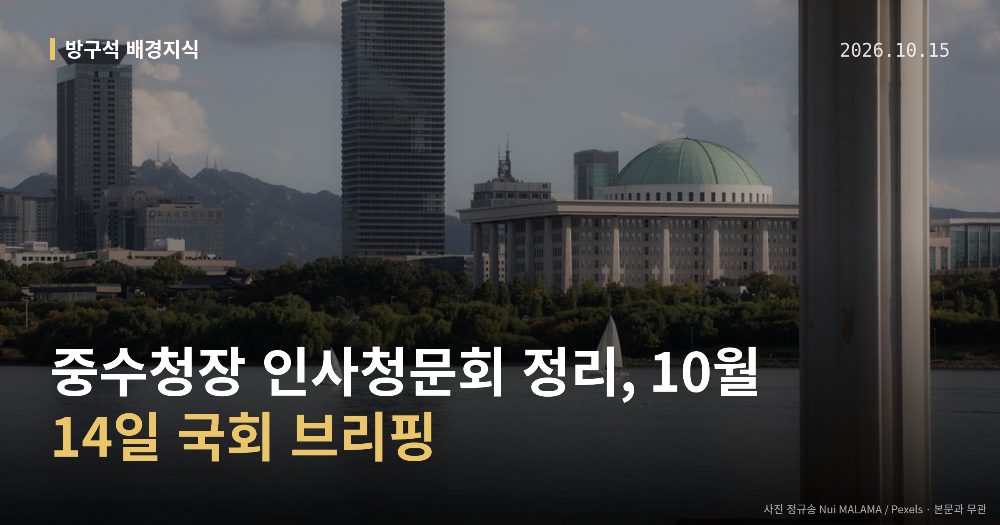
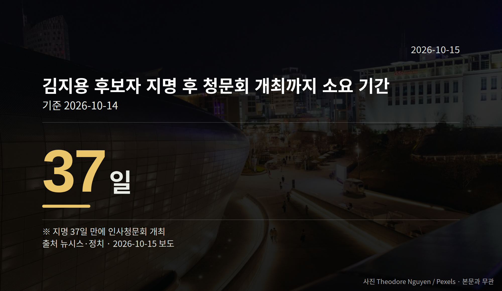

*이 글은 2026년 10월 15일 기준으로 정리한 내용입니다.*
**3줄 요약**

- 10월 14일 김지용 중수청장 후보자 청문회가 열렸습니다
- 지명 37일 만에 개회, 약 12시간 동안 진행됐습니다
- 15일 청문경과보고서 채택 여부가 다음 절차입니다
10월 14일 국회에서 김지용 초대 중대범죄수사청장 후보자 **중수청장 인사청문회**가 열렸습니다. 지명 37일 만에 개회해 약 12시간 만에 마무리됐습니다.

여당인 더불어민주당 안에서도 비판과 엄호가 함께 나왔고, 다음 절차는 15일 청문경과보고서 채택 여부입니다.

[이미지: 국회 상임위원회 인사청문회 회의장 전경]

## 중수청장 인사청문회, 숫자로 보면

중수청(중대범죄수사청)은 검찰 개혁 과정에서 새로 만들어진 수사기관입니다. 이번이 초대 청장을 뽑는 첫 청문회였습니다.

인사청문회는 대통령이 지명한 사람을 국회가 불러 자격을 따져 묻는 자리입니다. 표결로 임명을 막는 절차는 아니고, 의견을 담은 보고서를 내는 단계입니다.

| 항목 | 수치 |
|---|---|
| 지명 후 청문회 개최까지 | 37일 |
| 청문회 진행 시간 | 약 12시간 |

## 여당 안에서 갈린 평가

김 후보자는 2020년 추미애 당시 법무부 장관이 윤석열 당시 검찰총장의 직무정지와 징계를 청구했을 때, 이에 반대하는 성명에 동참한 적이 있습니다. 이 때문에 '친윤 검사' 논란이 제기됐고, 김 후보자는 청문회에서 이를 부인했습니다.

민주당 윤건영·박주민·김영배 의원 등은 정진웅 전 부장검사 독직폭행 기소, 김학의 전 법무부 차관 출국금지 사건 처리 등을 들어 "비겁하다", "정치검사의 공범"이라고 비판했습니다.

같은 당 채현일 의원은 김 후보자가 과거 윤석열 전 대통령 장모 최은순씨 사건의 재기수사를 지시했던 점을 들어 "소신파"라고 반박했습니다. 야당에서는 "여권 집안싸움이 났다"는 반응이 나왔습니다.

국민의힘 등 야당의 공식적인 찬반 입장은 이번 자료에서 뚜렷하게 확인되지 않았습니다.

## 후보자 본인은 무슨 말을 했나

박덕흠 국민의힘 의원이 "정치 검사 1호로 누구를 뽑겠느냐"고 묻자, 김 후보자는 윤석열 전 대통령을 지목했습니다. 한동훈 무소속 의원도 포함되느냐는 질문에는 "부정하기 어려울 것 같다"고 답했습니다.

김 후보자는 "수사의 정치화를 반드시 막겠다", "중수청이 검찰청과 다시 한 몸이 되는 일은 없을 것"이라고 밝혔고, 책임수사제를 강력 시행하겠다고 말했습니다.

이번 중수청장 인사청문회의 결과물인 청문경과보고서가 15일 채택되는지가 다음 관문입니다.

[이미지: 검찰청과 새 수사기관의 관계를 상징하는 법률 서류와 저울 사진]

## 그 밖의 오늘 소식

- 이재명 대통령, 임광현 국세청장을 신임 비서실장으로 임명
- 국민의힘 장동혁 대표, 해당 인사를 "보은 인사"라고 비판(대통령실 반박은 확인되지 않음)
- 15일 법사위·행안위 등 다수 상임위 국정감사 진행 예정

**그래서 나는?**

- 뉴스를 처음 접한 분이라면, 중수청이 어떤 기관인지부터 확인해 보세요
- 수사 제도에 관심 있는 유권자라면, 15일 보고서 채택 절차를 지켜보시면 됩니다
- 국정감사를 챙기는 분이라면, 15일 상임위 일정이 몰려 있습니다

**직접 센 숫자 — 국회·여론조사 (최근 7일)**

최근 발의: 농지법 일부개정법률안(강승규의원 등 29인)

이번 주 등록된 선거 여론조사 9건

- 전국 정기(정례)조사 대통령선거 국회의원선거 정당 지지도, 국정현안 등 — (주)코리아정보리서치 · 천지일보 의뢰 · 2026-10-12~13 · 1,002명 · 무선 ARS · 응답률 3.8% · 95% 신뢰수준에 ±3.1%p
- 전국 정기(정례)조사 정당지지도 — 케이에스오아이 주식회사(한국사회여론연구소) · 2026-10-12~13 · 1,001명 · 무선 ARS · 응답률 5.8% · 95% 신뢰수준에 ±3.1%p
- 전남광주통합특별시 전체 정당지지도대통령선거 — 한국갤럽조사연구소 · KBS광주방송총국 의뢰 · 2026-10-07~08 · 1,204명 · 무선전화면접 · 응답률 13.7% · 95% 신뢰수준에 ±2.8%p

*열린국회정보·중앙선거여론조사심의위원회 자료를 직접 셌습니다. 여론조사의 자세한 사항은 중앙선거여론조사심의위원회 홈페이지를 참조하세요.*
**여러분은 새로 생긴 수사기관의 첫 책임자를 고를 때, 어떤 점을 가장 먼저 확인하고 싶으신가요?**

---

### 참고한 기사

1. **행정안전부(10월15일 목요일)**
   - [뉴스핌](https://news.google.com/rss/articles/CBMiXEFVX3lxTE83S2NyWENBM1BIWF8wNW5nMm5nTFBjS2JMcDJ4amVvakQyS3JlbUpCeG0yMWRUVzVYcWowZ1BOdWhTOWp6akF3eTIwdFdMa3J0T3JSOHhTYm93XzR2?oc=5)
   - [뉴시스·정치](https://www.newsis.com/view/NISX20261014_0003826331)
2. **김지용 중수청장 후보 "정치검사 1호는 尹…수사 정치화 막겠다"(종합2보)**
   - [뉴시스·정치](https://www.newsis.com/view/NISX20261014_0003826421)
   - [MBC 뉴스](https://news.google.com/rss/articles/CBMid0FVX3lxTE9MMlB3YllCTUFmT0wwcVVVcUZCOUFfQWtfN0FGc3hfT18xdnZlOFcyTEZVM1piV3FpV0YyNFJNcW1ZZTdabEc4Nm5wVUxBM2dGQk1RMG9abE9TekpKaWp3TS1QWDZJQm4xNVJBeHNYYnplNEpEX3JN0gF3QVVfeXFMUGl0eU5LUkFRZVRvZm9hRy1BRzZYWE1mMllNUWRmd3BNMjRaVER2VkMxMUYwQnRUanJUSy0wc2VhWm5NcTFvTkw0RWdtUGt0emtfTnBPX1dKSlNEYjdvdFZmWmRsY00wc212Rm1zNmRLVEN0TWo4Szg?oc=5)
3. **"정치 검사 공범"·"소신 갖춘 반윤"…김지용 놓고 與與 대립(종합2보)**
   - [연합뉴스·정치](https://www.yna.co.kr/view/AKR20261014092852001)
   - [뉴시스·정치](https://www.newsis.com/view/NISX20261014_0003826408)
4. **김지용 “정치검사 1호는 윤석열”… 與강경파 ‘친윤’ 공격에 반박**
   - [동아일보·정치](https://www.donga.com/news/Society/article/all/20261015/134843973/2)
   - [조선일보](https://news.google.com/rss/articles/CBMihgFBVV95cUxNeUZaZmhNQVB0LTAycXVyR1FLYlpyMlRiSl9rNzlXZFZyMnd6cU9mT3ZrQ01OOVBLMDktQkJYUUtPWUp5eWFKRjhqdTNXM2luV3BaNjN2M3pLZnJPUkJKMUFWb0lTWGFMcWpkck1Ib3JfMFFDbWJwdEIzdFpTSUR0M040NGpSQQ?oc=5)
5. **林 처남, 李 선거법-대북송금 사건 변호… 국힘 “대장동 패밀리 보은 인사 결정판”**
   - [동아일보·정치](https://www.donga.com/news/Politics/article/all/20261015/134844170/2)
   - [뉴시스·정치](https://www.newsis.com/view/NISX20261014_0003825888)

---

*본 글은 공개된 언론 보도를 정리한 것이며, 특정 정당·후보·인물을 지지하거나 반대하지 않습니다. 인용한 여론조사의 자세한 사항은 중앙선거여론조사심의위원회 홈페이지를 참조하세요.*
