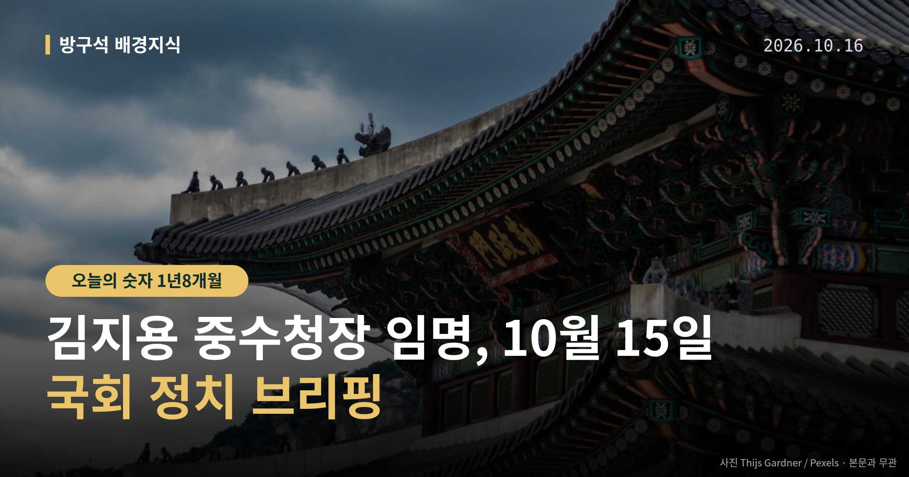
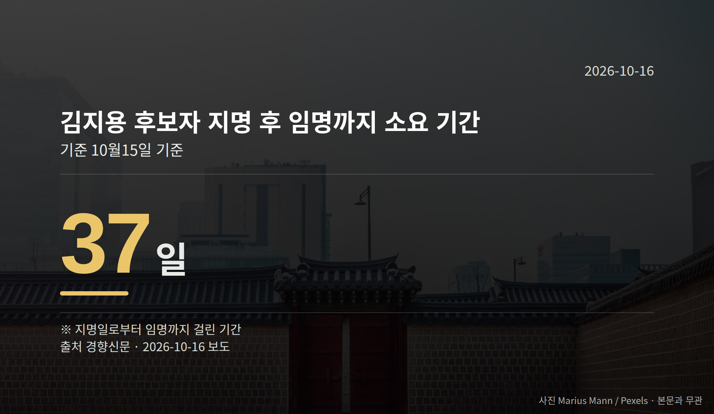

*이 글은 2026년 10월 16일 기준으로 정리한 내용입니다.*
**3줄 요약**

- 김지용 중수청장 임명안, 15일 저녁 대통령 재가
- 지명 37일 만, 보고서엔 적격·부적격 의견 함께 담김
- 앞으로 볼 것은 중수청의 '1호 수사' 대상 선정
여러분, 결론부터 말씀드리겠습니다. 김지용 중수청장 임명안이 15일 저녁 이재명 대통령의 재가로 확정됐습니다. 국회 행정안전위원회가 같은 날 인사청문 경과보고서를 채택한 지 하루도 지나지 않은 시점입니다.

중수청(중대범죄수사청)은 10월 2일 수장 없이 문을 열었던 신설 수사기관입니다. 이번 임명으로 수장 공백은 해소됐습니다.

[이미지: 국회 행정안전위원회 회의장 전경]

## 김지용 중수청장 임명, 어떤 절차를 거쳤나

행정안전위원회는 15일 김지용 후보자에 대한 인사청문 경과보고서(국회가 후보자 자격을 심사한 결과를 담은 문서)를 여야 합의로 채택했습니다. 강유정 청와대 수석대변인은 같은 날 저녁 대통령이 임명안을 재가했다고 밝혔습니다.

기간을 보면 이렇습니다. 같은 사안이라도 기준 시점에 따라 수치가 다릅니다.

| 기준 | 기간 | 보도 |
|---|---|---|
| 지명일 → 임명 | 37일 | 경향신문 |
| 중수청 출범(10/2) → 임명 | 2주일 | 뉴시스 |

두 숫자는 출발점이 달라 단순 비교할 수 없습니다. 지명 기준으로는 한 달 넘게, 기관 출범 기준으로는 2주 걸린 셈입니다.

## 보고서에 적격·부적격 의견이 함께 담긴 이유

경과보고서에는 양쪽 의견이 나란히 들어갔습니다. 부적격 의견은 "검찰 출신 후보자 임명 시 기존 검찰 수사 관행이 답습될 우려가 있다"는 내용이었습니다.

적격 의견은 "후보자가 관련 논란에 대한 소명과 형사사법체계 개편 취지 존중 의지를 표명했다"는 내용이었습니다. 국민의힘뿐 아니라 민주당 일부 의원도 부적격 의견을 낸 것으로 전해졌습니다.

행안위원장인 민주당 김영진 의원은 "친윤 검사 딱지를 붙이는 게 사실이 아니었다는 게 확인됐다"고 말했습니다. 한편 동아일보·경향신문 기사 본문이 말미에서 잘려 있어 전체 발언 맥락은 확인되지 않았습니다.

## 김지용 중수청장 임명 다음 관문은 '1호 수사'

중수청 개청 직후부터 이재명 대통령, 한동훈·김승원 의원 등 여야를 가리지 않는 정치적 사건 관련 고발이 쇄도한 것으로 전해졌습니다. 법조계에서는 중수청의 정치적 공정성을 가늠할'1호 수사 사건'이 무엇이 될지에 관심이 쏠린다는 보도가 나왔습니다.

다만 고발 건수나 구체적 사건명은 자료에 특정되지 않았습니다. '1호 수사'가 무엇을 뜻하는지도 확정되지 않은 전망 수준의 이야기입니다.

[이미지: 수사기관 건물 외벽과 간판]

## 그 밖의 오늘 소식

- 서울청 국감서 한동훈 의원 딸 '허위 스펙' 의혹 질의
- 고범석 서울경찰청장, 과거 수사 "미흡한 부분 점검" 답변
- 한강버스 리베이트 의혹, 수사 필요성과 외압 우려 공방

한강버스 의혹에 대해 민주당은 서울시 수사의뢰서에 구체적 금품 수수 정황이 담겼다며 경찰 수사 필요성을 제기했습니다. 국민의힘은 사실관계가 확인되지 않은 의혹을 근거로 한 공개 수사 촉구가 수사기관에 대한 외압이 될 수 있다고 반박했습니다.

이 사안은 아직 수사 착수 여부가 결정되지 않은 의혹 단계이며, 오세훈 서울시장 측과 한동훈 의원 측의 직접적인 반론·해명은 확인되지 않았습니다.

**그래서 나는?**

- 뉴스로 정치 보는 분이라면, 중수청 1호 수사 발표 시점을 체크해 보세요
- 국감 일정을 따라가는 분이라면, 서울청 재점검 결과 발표를 확인해 보세요
- 수사기관 개편이 궁금한 분이라면, 중수청 권한 범위부터 살펴보세요

**직접 센 숫자 — 국회·여론조사 (최근 7일)**

국회의원 발의 법률안 **51건**. 최근 발의: 전통사찰의 보존 및 지원에 관한 법률 일부개정법률안(조은희ㆍ이정문의원 등 14인)

이번 주 등록된 선거 여론조사 7건

- 전국 정기(정례)조사 정당지지도 (사회 현안 등) — (주)한국리서치 · (주)한국리서치/케이스탯리서치/(주)코리아리서치인터내셔널/(주)엠브레인퍼블릭 의뢰 · 2026-10-12~14 · 1,000명 · 무선전화면접 · 응답률 16.8% · 95% 신뢰수준에 ±3.1%p
- 전국 정기(정례)조사 대통령선거 국회의원선거 정당 지지도, 국정현안 등 — (주)코리아정보리서치 · 천지일보 의뢰 · 2026-10-12~13 · 1,002명 · 무선 ARS · 응답률 3.8% · 95% 신뢰수준에 ±3.1%p
- 전국 정기(정례)조사 정당지지도 — 케이에스오아이 주식회사(한국사회여론연구소) · 2026-10-12~13 · 1,001명 · 무선 ARS · 응답률 5.8% · 95% 신뢰수준에 ±3.1%p

*열린국회정보·중앙선거여론조사심의위원회 자료를 직접 셌습니다. 여론조사의 자세한 사항은 중앙선거여론조사심의위원회 홈페이지를 참조하세요.*
**새로 생긴 수사기관의 '첫 사건'을 보면서, 여러분은 어떤 기준으로 중립성을 판단하시겠어요?**

---

### 참고한 기사

1. **李, 김지용 청문회 하루만에 중수청장 임명 재가**
   - [동아일보·정치](https://www.donga.com/news/Politics/article/all/20261016/134851763/2)
   - [조선일보](https://news.google.com/rss/articles/CBMikAFBVV95cUxNTlpZclhRMjNadlgxYnk3aDVRZUJfOXctVlFndGtOcUZKRFg4eDBlNF9kdi16NFp3c2QxRkc3OXlPQV92TkRfNXgwNHpEaDRWZG4tNDNXS1V1LUw3LVp6T184Nk14cnFDdHNiclU1cU1VN1l3ZEU4ZTZhY0lZZkRVWXl1cEV6TEwtZDFTbzZxV3Q?oc=5)
2. **행정안전부(10월16일 금요일)**
   - [뉴시스·정치](https://www.newsis.com/view/NISX20261015_0003828104)
   - [뉴스핌](https://news.google.com/rss/articles/CBMiXEFVX3lxTE5ScWR4ZFhXZHdFcURnOVA1c1V5VDRtUjRWMFdNeWp0RkVKRm1lMXlGeVNoYmlJbVVSM1l2eUJ0LS1ZWk80bENZYUVlT3lfOHBqUXllcFR1TTh2dFpI?oc=5)
3. **서울청장 "한동훈 딸 사건 점검…한강버스 법과 원칙 따라 수사"(종합)**
   - [뉴시스·정치](https://www.newsis.com/view/NISX20261015_0003828210)
4. **서울경찰청 국감서도 '한강버스 의혹' 공방…與 "수사 필요" 野 "수사 외압"**
   - [뉴시스·정치](https://www.newsis.com/view/NISX20261015_0003828189)
5. **국감 중반전…여야, 서울고법·중앙지법 대상 '李대통령 재판' 격돌 전망**
   - [뉴시스·정치](https://www.newsis.com/view/NISX20261015_0003828018)

---

*본 글은 공개된 언론 보도를 정리한 것이며, 특정 정당·후보·인물을 지지하거나 반대하지 않습니다. 인용한 여론조사의 자세한 사항은 중앙선거여론조사심의위원회 홈페이지를 참조하세요.*
