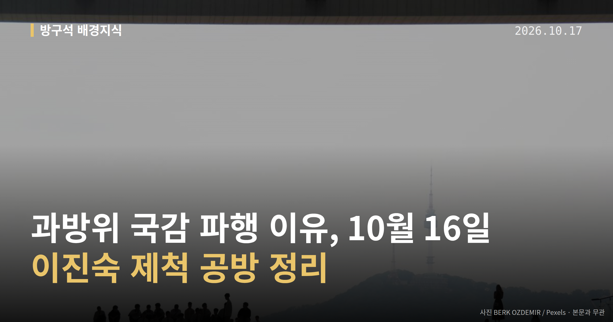
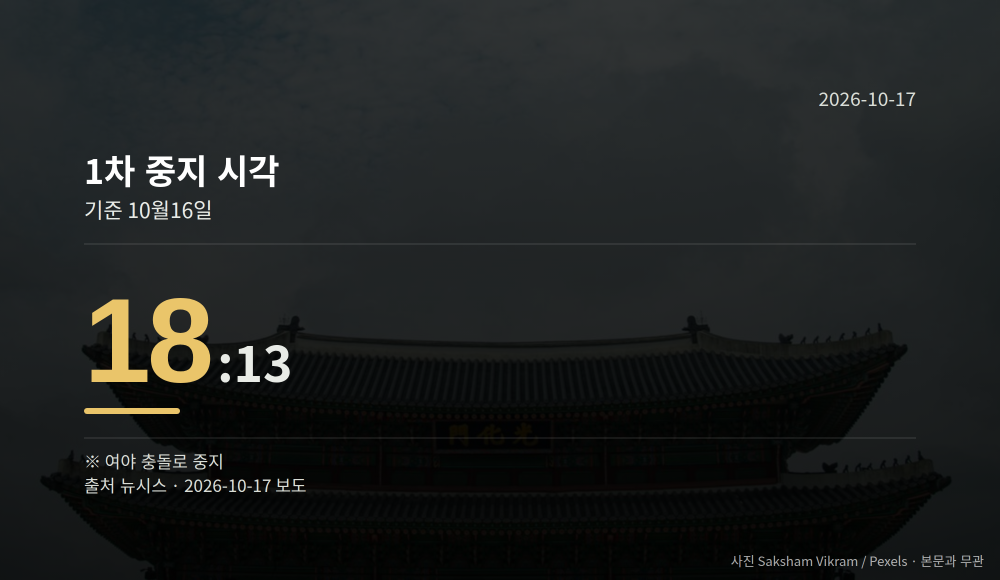

*이 글은 2026년 10월 17일 기준으로 정리한 내용입니다.*
**3줄 요약**

- 10월 16일 과방위 KBS 국감이 제척 문제로 멈췄습니다
- 오후 2시 35분 개의, 6시 13분 중지, 11시 30분까지 미속개
- 제척안 효력 해석이 정리되는지가 다음 관전 포인트입니다
10월 16일 국회 과방위 국감 파행이 있었습니다. KBS·EBS 등을 상대로 한 국정감사가 이진숙 국민의힘 의원을 감사에서 배제할지를 두고 멈춰 섰습니다.

오후에 시작된 감사는 중지를 반복하다 저녁에 멈춘 뒤, 자정 가까이 되도록 다시 열리지 못했습니다.

여기서 나온 '제척'은 이해관계가 걸린 사람을 해당 절차에서 빼는 것을 뜻합니다. 이번에는 의원을 국감 심사에서 배제하자는 의미로 쓰였습니다.

[이미지: 국회 상임위 회의장 전경 사진]

## 과방위 국감 파행, 시각으로 보면

이날 감사 대상은 KBS, EBS, 방송문화진흥회, 시청자미디어재단이었습니다. 진행 경과는 시각으로 보면 이렇습니다.

| 구분 | 시각 |
| --- | --- |
| 개의 | 오후 2시 35분 |
| 1차 중지 | 오후 6시 13분 |
| 이 시각까지 미속개 | 오후 11시 30분 |

뉴시스 보도 기준입니다. 개의부터 1차 중지까지 약 3시간 40분이 흘렀고, 그 뒤로는 앞서 본 마지막 시각까지 감사가 재개되지 않았습니다.

## 양쪽은 각각 무엇을 말했나

더불어민주당은 이진숙 의원이 방통위원장으로 있을 때 김태규 당시 부위원장과 둘만으로 KBS·방문진 이사진을 선임한 것이 위법이며, 이해충돌에 해당하므로 제척해야 한다는 입장을 밝혔습니다.

국민의힘은 제척안이 국회 본회의 통과를 거쳐야 확정되므로 지금은 효력이 없다고 반발했습니다. 그러면서 한준호 민주당 의원에 대한 제척안을 맞제출했습니다.

이진숙 의원은 방통위 2인 체제를 만든 쪽은 민주당 주도 국회라고 반박했습니다. 민주당이 방통위원 3명 추천을 요청받고도 추천하지 않았다는 주장입니다.

여기서 유의할 점이 있습니다. 제척안이 본회의 의결까지 거쳐야 확정되는지에 대해 여야 해석이 갈려 있어, 효력 여부는 현재 자료로는 확정되지 않았습니다.

[이미지: 방송국 스튜디오 카메라 모습 사진]

## 과방위 국감 파행, 다음에 볼 것

제척안의 효력을 둘러싼 해석이 정리되지 않은 탓에 국감 일정 자체가 밀리고 있습니다. 국민의힘이 맞제척안을 낸 만큼, 남은 과방위 국감에서도 같은 절차 공방이 되풀이될 여지가 남아 있습니다.

그래서 보실 지점은 두 가지입니다. 제척안이 본회의로 올라가는지, 그리고 중지된 감사가 언제 속개되는지입니다.

## 그 밖의 오늘 소식

- 법사위, 헌법 84조 '소추' 해석 두고 여야 공방
- 김대웅 서울고법원장, 제청권·임명권 우열 없다 발언
- 민주당, 조희대 대법원장 탄핵 논의 공식화·당내 신중론

조희대 대법원장 탄핵 논의와 관련해 국민의힘 등 상대편 반응은 제공된 자료에서 확인되지 않았습니다.

**그래서 나는?**

- 국감 지켜보는 유권자라면, 과방위 남은 일정부터 확인해 보세요
- 방송 수신료 내는 시청자라면, KBS 감사 재개 시점이 미뤄질 수 있습니다
- 정치 뉴스 보는 분이라면, '제척'이라는 절차 용어를 알아둘 만합니다

**직접 센 숫자 — 국회·여론조사 (최근 7일)**

국회의원 발의 법률안 **82건**. 최근 발의: 조세특례제한법 일부개정법률안(전은수의원 등 10인)

이번 주 등록된 선거 여론조사 9건

- 전국 정기(정례)조사 국회의원선거 대통령선거 — 리서치웰 · 뉴데일리 의뢰 · 2026-10-14~15 · 1,001명 · 무선 ARS · 응답률 2.5% · 95% 신뢰수준에 ±3.1%p
- 전국 정기(정례)조사 정당지지도 국회의원선거 — 한국갤럽조사연구소 · 한국갤럽 자체 조사 의뢰 · 2026-10-13~15 · 1,003명 · 무선전화면접 · 응답률 10.4% · 95% 신뢰수준에 ±3.1%p
- 전국 정기(정례)조사 정당지지도 (사회 현안 등) — (주)한국리서치 · (주)한국리서치/케이스탯리서치/(주)코리아리서치인터내셔널/(주)엠브레인퍼블릭 의뢰 · 2026-10-12~14 · 1,000명 · 무선전화면접 · 응답률 16.8% · 95% 신뢰수준에 ±3.1%p

오늘 이슈에 나온 법안은 지금 어디에

- 형사소송법 — 제22대 발의 166건 · 최근 「형사소송법 일부개정법률안」(김위상의원 등 18인, 2026-10-01) · 소관위 회부
- 공직선거법 — 제22대 발의 325건 · 최근 「공직선거법 일부개정법률안」(박지혜의원 등 10인, 2026-09-28) · 소관위 회부

*열린국회정보·중앙선거여론조사심의위원회 자료를 직접 셌습니다. 여론조사의 자세한 사항은 중앙선거여론조사심의위원회 홈페이지를 참조하세요.*
**여러분은 국정감사에서 의원 한 명의 참여 자격을 다투는 일이, 감사 내용 자체보다 먼저 정리되어야 할 문제라고 보시나요?**

---

### 참고한 기사

1. **여야 과방위 국감 ‘이진숙 제척’ 충돌**
   - [조선일보·정치](https://www.chosun.com/politics/politics_general/2026/10/17/FIWOY6FOYFDBXNRLLLDRXI64VQ)
   - [파이낸셜뉴스](https://news.google.com/rss/articles/CBMiWkFVX3lxTFAxXzY4d1pwT09ma05KVGhaYlREd0hLTWkzWmNiUVdWNTExb1FKUnJxTEdVX094M0daR2NQX3ZYYXY0SXlIVUhTejNWXy1ZTUY0dEdjandkNUp1UQ?oc=5)
2. **법사위 '李 재판중단' 공방…與 "소추엔 재판도 포함" 野 "편법 중지"(종합)**
   - [뉴시스·정치](https://www.newsis.com/view/NISX20261016_0003829730)
3. **여야, 국감 2주차 막날 곳곳 충돌 계속…李대통령 재판·이진숙 제척 등 공방(종합)**
   - [뉴시스·정치](https://www.newsis.com/view/NISX20261016_0003829796)
4. **與, 조희대 탄핵 논의 공식화…역풍 우려 신중론도, 실행 여부 주목**
   - [뉴시스·정치](https://www.newsis.com/view/NISX20261016_0003829504)
   - [한국일보](https://news.google.com/rss/articles/CBMibkFVX3lxTFBocUxKemhpamgtV1dNN09EYTlBY09UTnFVNF9hOC1HWVByM2dIbi1aNlpXbmdEakl4WW96djItZ09ZLWZYbWhMcmdUVWV5dWJjMmFrZU56T1ZQMDhlNmlYdVdZOWowWVhDSFdJaVRR0gFzQVVfeXFMTVVaRldJV0t1LVprdlhfOW1uaFlhZUt3MEJPMjRkZGJaM0xBeGpHcWhTUklxLWYySmJSeUJUdFZabEk5WmhUUXY3R2lhMTE5WVJWMFA0aUdZd1JpOWlZcExBaGpBbGR1WHRNd3U0M3hPWU80RQ?oc=5)
5. **서울고법원장 “제청권-임명권 간 우열 없어”**
   - [동아일보·정치](https://www.donga.com/news/Society/article/all/20261016/134857771/2)
   - [경향신문·정치](https://www.khan.co.kr/article/202610161523011)

---

*본 글은 공개된 언론 보도를 정리한 것이며, 특정 정당·후보·인물을 지지하거나 반대하지 않습니다. 인용한 여론조사의 자세한 사항은 중앙선거여론조사심의위원회 홈페이지를 참조하세요.*
