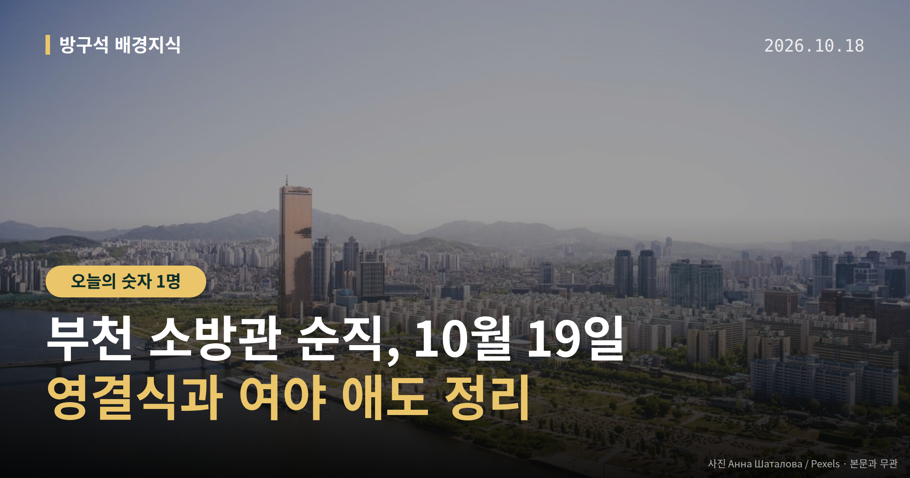
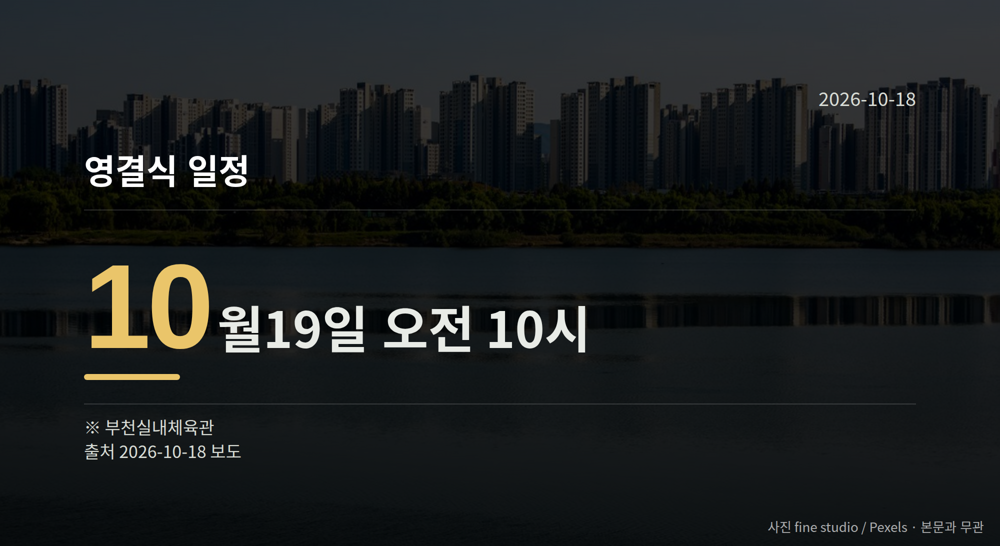

*이 글은 2026년 10월 18일 기준으로 정리한 내용입니다.*
**3줄 요약**

- 부천 도장공장 화재로 다친 소방관이 10월 17일 순직했습니다
- 중상 1명·경상 4명, 영결식은 10월 19일 오전 10시입니다
- 여야가 함께 말한 소방 예산, 예산안 심사에서 확인하면 됩니다
경기 **부천 소방관 순직** 소식입니다. 도장공장 화재 현장에서 부상을 입었던 김진석(44) 소방위가 10월 17일 새벽 숨졌습니다.

여야와 정부는 일제히 애도를 표했고, 영결식은 10월 19일 오전 10시 부천실내체육관에서 열릴 예정입니다.

[이미지: 소방 헬멧과 추모 꽃이 놓인 추모 공간]

## 부천 소방관 순직, 확인된 사실만 정리하면

경기 부천시 도장공장에서 화재가 발생해 소방관 1명이 숨지고 1명이 중상을 입었습니다. 숨진 김진석 소방위는 부천소방서 소속으로, 심정지 상태로 치료를 받다 끝내 순직했습니다.

화재가 난 정확한 날짜와 시각, 원인 등 세부 경위는 지금까지 공개된 자료에 명확히 담겨 있지 않습니다. 현재까지 파악된 피해와 일정은 아래와 같습니다.

| 구분 | 인원·일정 |
| --- | --- |
| 순직 | 김진석 소방위(44세) |
| 중상 | 1명 |
| 경상(열탈진·연기흡입) | 4명 |
| 치료받은 공장 관계자 | 2명 |
| 영결식 | 10월 19일 오전 10시, 부천실내체육관 |

## 소방청 예우 조치와 조문·국회 일정

소방청은 고인을 소방장에서 소방위로 1계급 특진 예우하고, 옥조근정훈장 추서(세상을 떠난 뒤 훈장을 주는 것)를 추진하며 국립현충원 안장을 지원할 계획이라고 밝혔습니다.

국민의힘 장동혁 대표와 정점식 원내대표, 더불어민주당 김민석 대표, 윤호중 행정안전부 장관이 각각 애도를 표했습니다. 정점식 원내대표는 10월 18일 빈소를 조문하겠다고 밝혔습니다.

여야와 정부는 애도와 함께 소방 인력·장비 확충, 처우 개선을 공통으로 언급했습니다. 부천 소방관 순직 이후 이 말들이 실제 숫자로 바뀌는지는 곧 이어질 예산안 심사에서 확인할 수 있습니다.

[이미지: 국회 본청 전경]

## 그 밖의 오늘 소식

- 추미애 경기도지사, '재정 빨대' 국감 발언 나흘 만에 사과
- 국민의힘 박성훈 수석대변인 "끝까지 오만했다" 논평
- 정점식 원내대표 '데드덕' 발언에 민주당 이용우 대변인 반박

세 번째 건은 조희대 대법원장 탄핵(공직자를 국회가 파면 요구하는 절차) 가능성을 둘러싼 공방입니다. 양측 발언 원문과 당사자 해명은 아직 확인되지 않았고, 제기된 내용은 모두 의혹 단계입니다.

**그래서 나는?**

- 경기도민이라면, 10월 19일 영결식 일정과 교통 안내를 확인해 보세요
- 세금 어디 쓰이나 궁금한 분이라면, 올해 소방 예산 심사를 지켜보세요
- 지방선거 유권자라면, 지자체 소방 공약의 실제 예산 반영을 따져보세요

**직접 센 숫자 — 국회·여론조사 (최근 7일)**

국회의원 발의 법률안 **82건**. 최근 발의: 조세특례제한법 일부개정법률안(전은수의원 등 10인)

이번 주 등록된 선거 여론조사 6건

- 전국 정기(정례)조사 국회의원선거 대통령선거 — 리서치웰 · 뉴데일리 의뢰 · 2026-10-14~15 · 1,001명 · 무선 ARS · 응답률 2.5% · 95% 신뢰수준에 ±3.1%p
- 전국 정기(정례)조사 정당지지도 국회의원선거 — 한국갤럽조사연구소 · 한국갤럽 자체 조사 의뢰 · 2026-10-13~15 · 1,003명 · 무선전화면접 · 응답률 10.4% · 95% 신뢰수준에 ±3.1%p
- 전국 정기(정례)조사 정당지지도 (사회 현안 등) — (주)한국리서치 · (주)한국리서치/케이스탯리서치/(주)코리아리서치인터내셔널/(주)엠브레인퍼블릭 의뢰 · 2026-10-12~14 · 1,000명 · 무선전화면접 · 응답률 16.8% · 95% 신뢰수준에 ±3.1%p

*열린국회정보·중앙선거여론조사심의위원회 자료를 직접 셌습니다. 여론조사의 자세한 사항은 중앙선거여론조사심의위원회 홈페이지를 참조하세요.*
**여러분이 사는 동네 소방서에는 인력과 장비가 충분하다고 느끼시나요?**

---

### 참고한 기사

1. **정치(10월18일 일요일)**
   - [뉴스1](https://news.google.com/rss/articles/CBMiWkFVX3lxTE55ZkVPNUs0a0VwTk9KTkNzdU0xX0F3SUFqQ241STh4eUdTMXY4LVJzODQyT3k3WFc1VS03dkpzQlE3cUN3VzFVU3IwdnJHZUF6cnFCZmZ5ODRPdw?oc=5)
   - [뉴시스·정치](https://www.newsis.com/view/NISX20261017_0003830062)
2. **추미애, ‘소방 재정 빨대’ 발언 나흘 만에 사과…여야 정치권 공방 과열**
   - [수원일보](https://news.google.com/rss/articles/CBMiZkFVX3lxTE9nVzBYbHhRczdVUG9kenZSWVh6eFpOM1Z6UjBmQjRiSk5PUEZnT2xEOHFSMElyUlhzVFF6a29DdDR0SVJSelNrdEZzSGZRaE1Dd2l5ZVVmTTlXN1JBanY5V0hyQW9SZw?oc=5)
   - [YTN](https://news.google.com/rss/articles/CBMidkFVX3lxTE1DdGxOdk5hSldBOXZDYVhmS3VDeWZlTTdfcjlaNkFIbkI4UUgwVEc1alNfVnNvZ3R0Ui1LS1l4a2N5M0ZsdGJ2d3dUT0JON3Jabkt2eDRlbWw1RExZTTd4MDV6c0Y0c1FqdFY5Z3JIeEZpZnE3elE?oc=5)
3. **국힘, 부천 화재 소방관 순직에 애도…내일 지도부 조문(종합)**
   - [뉴시스·정치](https://www.newsis.com/view/NISX20261017_0003830034)
   - [한겨레·정치](https://www.hani.co.kr/arti/politics/politics_general/1282841.html)
4. **與, 정점식 '데드덕' 발언에 "조희대 감싸려 대통령 끌어들여 협박…무책임"**
   - [뉴시스·정치](https://www.newsis.com/view/NISX20261017_0003829879)
5. **후반전 향하는 국감…김현지·김용범 증인 출석 공방 등 전운 고조**
   - [뉴시스·정치](https://www.newsis.com/view/NISX20261016_0003829666)

---

*본 글은 공개된 언론 보도를 정리한 것이며, 특정 정당·후보·인물을 지지하거나 반대하지 않습니다. 인용한 여론조사의 자세한 사항은 중앙선거여론조사심의위원회 홈페이지를 참조하세요.*
