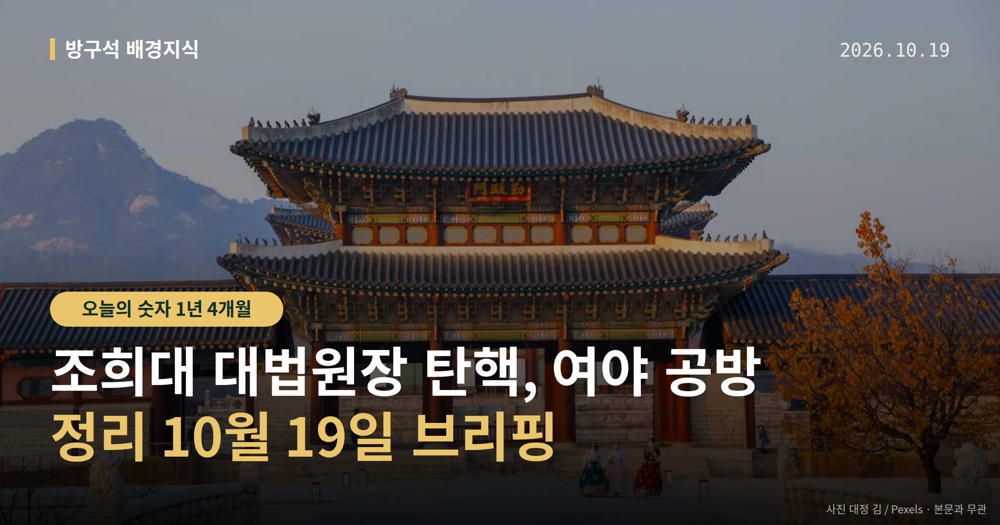
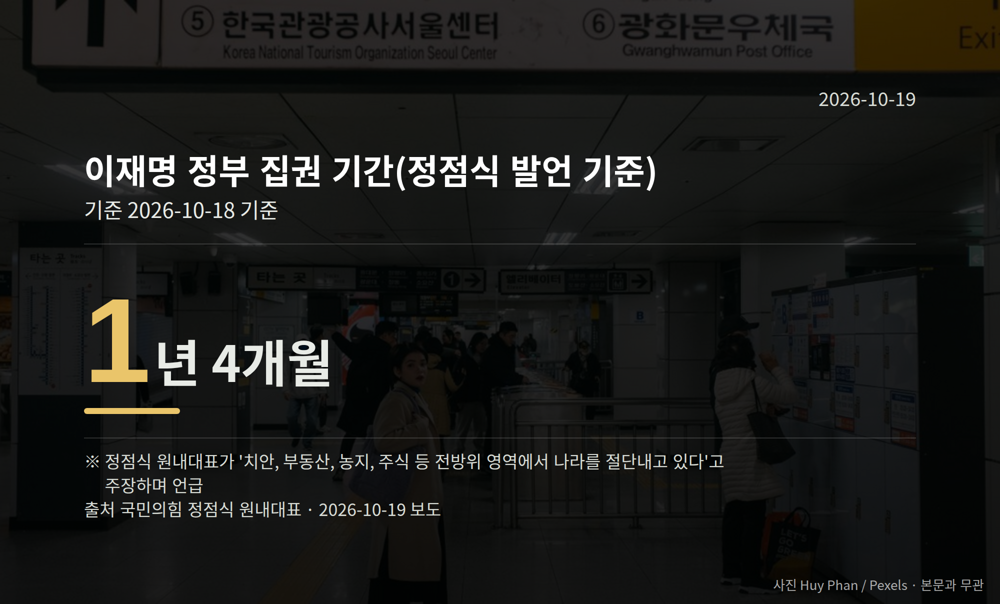

*이 글은 2026년 10월 19일 기준으로 정리한 내용입니다.*
**3줄 요약**

- 민주당이 조희대 대법원장 탄핵 추진 논의를 공식화했습니다
- 국민의힘은 18일 '모든 수단 동원해 저지' 방침을 밝혔습니다
- 실제 탄핵안 발의 여부와 발의 시점이 다음 관전 포인트입니다
조희대 대법원장 탄핵 추진을 두고 여야가 정면으로 부딪쳤습니다. 더불어민주당이 탄핵 추진 논의를 공식화했고, 국민의힘은 18일 저지 방침을 밝혔습니다.

아직 탄핵안이 실제로 발의된 단계는 아닙니다. 오늘은 양측이 각각 무슨 말을 했는지, 절차상 다음이 무엇인지만 담담하게 정리해 보겠습니다.

[이미지: 서울 서초구 대법원 청사 외관 사진]

## 조희대 대법원장 탄핵, 양측은 뭐라고 했나

먼저 용어부터 짚겠습니다. 탄핵소추는 국회가 고위공직자를 파면해 달라고 헌법재판소에 청구하는 절차입니다. 국회 의결과 헌재 심판이라는 두 단계를 거칩니다.

국민의힘 정점식 원내대표는 18일 국회 기자간담회에서 민주당 김민석 대표를 향해 "탄핵 추진 여부를 조속히 결론 내리라"고 말했습니다.

정점식 원내대표는 또 "본인들이 초래한 민생 파탄과 외교·안보 위기에서 국민의 관심을 돌리고 지지층을 다시 결집시키기 위해 탄핵이라는 카드를 꺼내 든 것"이라고 말했습니다. 민주당이 실제로 발의할 경우 "우리가 할 수 있는 모든 수단을 동원해 탄핵소추와 탄핵을 저지할 것"이라고도 했습니다.

다만 민주당 김민석 대표가 탄핵 추진을 공식화하며 밝힌 발언의 원문은 제공된 자료에서 확인되지 않았습니다. 이 사안에 대한 민주당 측의 구체적 설명은 확인되지 않았다는 점을 함께 전해 드립니다.

## 숫자로 본 양측 주장

양측이 각자 근거로 든 수치는 다음과 같습니다. 모두 발언 주체의 주장이며, 제3자 검증 내용은 자료에 없습니다.

| 수치 | 내용 | 말한 사람 |
|---|---|---|
| 1년 4개월 | 이재명 정부 집권 기간, "전방위로 나라를 절단내고 있다"며 언급 | 국민의힘 정점식 원내대표 |
| 15조 원대 | 식품 담합 카르텔 매출 규모, 국감 성과로 거론 | 민주당 김성회 원내대변인 |

정점식 원내대표는 전시작전통제권(전시에 우리 군을 지휘·통제하는 권한) 조기 전환과 관련해서도 "대통령의 임기 시간표에 억지로 맞추려는 시도를 중단하라"고 말했습니다.

## 국감 반환점, 서로 다른 평가

같은 날 이재명 정부 2년차 국정감사가 반환점을 돌았습니다.

민주당 김성회 원내대변인은 서면브리핑에서 "국정과제를 점검하고 정부의 미비점은 보완하는 민생 국감을 만들어 왔다"고 밝혔습니다. 앞서 본 식품 담합 사안을 질타해 기업의 사과와 정부의 감독 개선 약속을 받아냈다는 주장입니다.

김성회 원내대변인은 국민의힘을 향해 "팻말 시위로 회의를 지연시키고 북한 지뢰 도발 규탄 결의안마저 외면했다"고 말했습니다.

이에 정점식 원내대표는 "김민석 대표는 정쟁 국감의 차원을 넘어 탄핵 국감을 만들고 있다"고 반박했습니다.

[이미지: 국회 상임위 국정감사 회의장 모습 사진]

## 그 밖의 오늘 소식

- 조희대 대법원장, 지난 16일 대법원 출근 모습 보도
- 국민의힘, 6일 법사위 국감서 서영교 위원장 진행방식에 항의
- '탄핵 사유 충분'·'정권 몰락 신호탄' 발언 구체 내용은 미확인

조희대 대법원장 탄핵과 관련해 다음으로 볼 지점은 두 가지입니다. 민주당이 실제로 탄핵안을 발의할지, 그리고 남은 국감 일정에서 증인 채택을 둘러싼 공방이 이어질지입니다.

**그래서 나는?**

- 뉴스를 챙겨 보는 분이라면, 발의 여부부터 확인해 보세요
- 국감에 관심 있는 분이라면, 후반 증인 채택 일정을 보세요
- 용어가 낯선 분이라면, 탄핵소추와 심판의 차이를 기억해 두세요

**직접 센 숫자 — 국회·여론조사 (최근 7일)**

국회의원 발의 법률안 **82건**. 최근 발의: 조세특례제한법 일부개정법률안(전은수의원 등 10인)

이번 주 등록된 선거 여론조사 9건

- 전국 정기(정례)조사 정당지지도 — (주)여론조사꽃 · 2026-10-16~17 · 1,001명 · 무선 ARS · 응답률 2.3% · 95% 신뢰수준에 ±3.1%p
- 전국 정기(정례)조사 정당지지도 — (주)여론조사꽃 · 2026-10-16~17 · 1,003명 · 무선전화면접 · 응답률 9.7% · 95% 신뢰수준에 ±3.1%p
- 전국 정기(정례)조사 정당지지도 10월 3주차 주간집계 — (주)리얼미터 · 아시아경제 의뢰 · 2026-10-15~16 · 1,005명 · 무선 ARS · 응답률 2.7% · 95% 신뢰수준에 ±3.1%p

*열린국회정보·중앙선거여론조사심의위원회 자료를 직접 셌습니다. 여론조사의 자세한 사항은 중앙선거여론조사심의위원회 홈페이지를 참조하세요.*
**여러분은 이번 공방에서 어떤 절차가 가장 궁금하셨나요?**

---

### 참고한 기사

1. **행정안전부(10월19일 월요일)**
   - [뉴시스·정치](https://www.newsis.com/view/NISX20261017_0003829999)
   - [뉴스핌](https://news.google.com/rss/articles/CBMiXEFVX3lxTE9KRDhNb25fbldOeEQwMTFFbURJSVVHMWhoZVNHZngtYjhiV2RsSlFrMWJpdUM1QUVlUVN2NF91NVBaR0gzYW5uMVFMUWd6OHpOUkVmc0NNWHhaUzJM?oc=5)
2. **정점식 “김민석, 조희대 탄핵 여부 조속히 결론 내야…탄핵을 지지율 결집에 동원”**
   - [동아일보·정치](https://www.donga.com/news/Politics/article/all/20261018/134860719/1)
   - [뉴시스·정치](https://www.newsis.com/view/NISX20261018_0003830364)
3. **국감 반환점…與 “국힘, 장외 투쟁만” 野 “탄핵국감”**
   - [광주타임즈](https://news.google.com/rss/articles/CBMiakFVX3lxTFBtWGVVUHhMaXFrTnRDY0hsVjZ1QUNSMzRpNWpNNUNMSTd1emlBR0lndVhfT2wzNG82dmNRY2E0M3BkSVlKRm4tdVJRUno1QVNlMHB2M21RYUx3Wlh1WkN3Njg1d0Y2T1gzRXc?oc=5)
   - [뉴시스·정치](https://www.newsis.com/view/NISX20261018_0003830465)
4. **'조희대 탄핵' 충돌 격화…與 "탄핵 사유 충분" 野 "정권 몰락 신호탄"**
   - [뉴시스·정치](https://www.newsis.com/view/NISX20261018_0003830593)
5. **국힘 "與, 정쟁 넘어 '탄핵 국감'…李정권 실정 덮는 물타기 안 돼"(종합)**
   - [뉴시스·정치](https://www.newsis.com/view/NISX20261018_0003830494)

---

*본 글은 공개된 언론 보도를 정리한 것이며, 특정 정당·후보·인물을 지지하거나 반대하지 않습니다. 인용한 여론조사의 자세한 사항은 중앙선거여론조사심의위원회 홈페이지를 참조하세요.*
