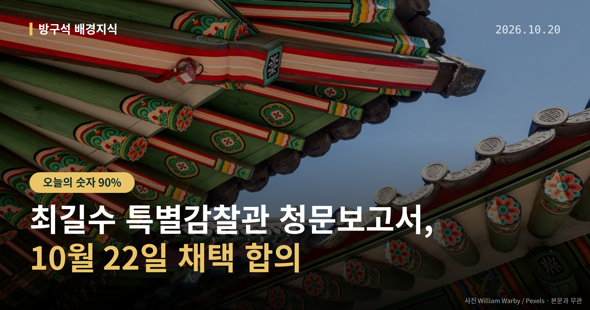
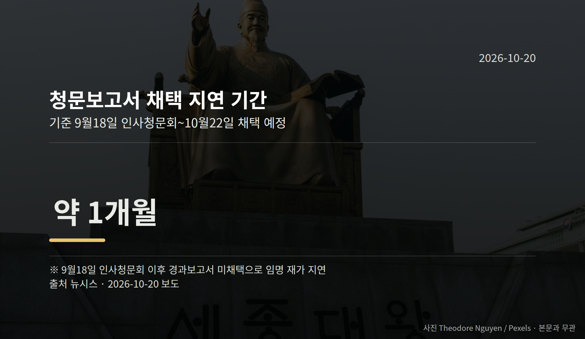

*이 글은 2026년 10월 20일 기준으로 정리한 내용입니다.*
**3줄 요약**

- 여야, 10월 22일 특별감찰관 청문보고서 채택 합의
- 지난달 18일 청문회 뒤 약 한 달간 임명 재가 지연
- 22일 법사위 전체회의와 임명 재가 여부가 관전 지점
10월 19일 여야가 최길수 특별감찰관 후보자의 인사청문경과보고서를 오는 22일 채택하기로 합의했습니다. 적격 의견과 부적격 의견을 함께 적는 방식입니다.

지난달 청문회 이후 멈춰 있던 임명 절차가 다시 움직일 수 있는 대목입니다. 오늘은 이 건 하나만 짚어 보겠습니다.

## 최길수 특별감찰관 청문보고서, 22일에 무슨 일이 생기나

국회 법제사법위원회는 22일 공소청 국정감사 중에 전체회의를 열기로 했습니다. 이 자리에서 보고서를 채택한다는 것이 합의 내용입니다.

용어를 짧게 풀어 두겠습니다. 특별감찰관은 대통령의 친인척과 측근의 비위를 감찰하는 자리입니다. 인사청문경과보고서는 상임위가 후보자 심사 결과를 정리해 남기는 문서입니다.

최 후보자는 지난달 18일 인사청문회를 마쳤습니다. 그러나 보고서가 채택되지 않아 임명 재가(대통령이 임명을 최종 승인하는 절차)가 약 한 달 미뤄졌습니다.

## 한 달 지연을 두고 양측 설명이 다릅니다

더불어민주당 김의겸 의원 측은 야당이 적격 의견에 동의하지 않아 지연됐다고 밝혔습니다.

국민의힘 박형수 의원 측은 이를 반박했습니다. 민주당이 '여야 합의를 통한 적격 의견 채택'에 동의하지 않은 것일 뿐이라는 주장입니다.

두 설명은 서로 맞지 않습니다. 어느 쪽 설명이 맞는지는 확인되지 않았고, 적격·부적격 의견을 함께 적어 채택한다는 결과만 합의된 상태입니다.

이 방식 자체가 여야가 한 가지 결론에 이르지는 못했다는 뜻이기도 합니다.

[이미지: 국회 법제사법위원회 회의장 전경]

## 최길수 특별감찰관 청문보고서 다음 절차는

보고서가 채택되면 공은 대통령실로 넘어갑니다. 경향신문은 이재명 대통령이 이르면 22일 최 후보자 임명 수순을 밟을 것으로 보인다고 전했습니다.

다만 이는 해당 매체의 전망입니다. 실제 재가 시점이 확정된 것은 아닙니다.

[이미지: 국회 본관 외부 모습]

## 그 밖의 오늘 소식

- 공소청 출범 후 첫 국감, 검찰청 폐지 두고 여야 공방
- 한동훈 무소속 의원 수사자료 유출 의혹, 법사위 질의 쟁점
- 민주당, 부승찬 의원 '소방 재정' 발언에 경고·조사 지시

**그래서 나는?**

- 정치 뉴스를 따라가는 분이라면, 22일 법사위 전체회의 일정을 확인해 보세요
- 공직 감찰 제도에 관심 있다면, 특별감찰관 임명 재가 시점이 달라질 수 있습니다
- 국감 일정을 챙기는 분이라면, 22일 공소청 국정감사가 같은 날 함께 열립니다

**직접 센 숫자 — 국회·여론조사 (최근 7일)**

최근 발의: 국가기술자격법 일부개정법률안(김위상의원 등 14인)

이번 주 등록된 선거 여론조사 9건

- 전국 정기(정례)조사 정당지지도 대통령선거 — (주)비전코리아 · 올리서치 의뢰 · 2026-10-16~17 · 1,055명 · 무선 ARS · 응답률 3.8% · 95% 신뢰수준에 ±3.0%p
- 전국 정기(정례)조사 정당지지도 — (주)여론조사꽃 · 2026-10-16~17 · 1,001명 · 무선 ARS · 응답률 2.3% · 95% 신뢰수준에 ±3.1%p
- 전국 정기(정례)조사 정당지지도 — (주)여론조사꽃 · 2026-10-16~17 · 1,003명 · 무선전화면접 · 응답률 9.7% · 95% 신뢰수준에 ±3.1%p

*열린국회정보·중앙선거여론조사심의위원회 자료를 직접 셌습니다. 여론조사의 자세한 사항은 중앙선거여론조사심의위원회 홈페이지를 참조하세요.*
**한 달 멈췄던 인사 절차가 다시 움직일 때, 여러분은 어떤 부분부터 확인하시나요?**

---

### 참고한 기사

1. **행정안전부(10월20일 화요일)**
   - [뉴스핌](https://news.google.com/rss/articles/CBMiXEFVX3lxTFBUYlIwVGRvY1NQVml1QmZkVzlhelRzWGZ4T0hCWE9wQ2o1bEF0Q2xLZ2dBLWlKZTBoOTNNa1hfNXRCNlZqV2lkWHdON0ZJUFdNR1BiS0N5RE5rOGtW?oc=5)
   - [뉴시스·정치](https://www.newsis.com/view/NISX20261019_0003832383)
2. **“소방이 재정 쭉쭉 빨아먹어”… 與 부승찬, 추미애 옹호 논란**
   - [동아일보·정치](https://www.donga.com/news/Politics/article/all/20261020/134871102/2)
   - [조선일보·정치](https://www.chosun.com/politics/assembly/2026/10/20/CWACFXT4ARD5RPQGBGBWHB2VBE)
3. **여야, 최길수 특별감찰관 후보자 청문보고서 채택 합의**
   - [경향신문·정치](https://www.khan.co.kr/article/202610192136015)
   - [뉴시스·정치](https://www.newsis.com/view/NISX20261019_0003832362)
4. **공소청 첫 국감·추미애 사과·단일종목 ETF…여야, 상임위 곳곳서 충돌(종합)**
   - [뉴시스·정치](https://www.newsis.com/view/NISX20261019_0003832416)
5. **공소청 첫 국감 충돌…與 "검찰권 남용" 野 "지독한 복수심"(종합)**
   - [뉴시스·정치](https://www.newsis.com/view/NISX20261019_0003832313)

---

*본 글은 공개된 언론 보도를 정리한 것이며, 특정 정당·후보·인물을 지지하거나 반대하지 않습니다. 인용한 여론조사의 자세한 사항은 중앙선거여론조사심의위원회 홈페이지를 참조하세요.*
