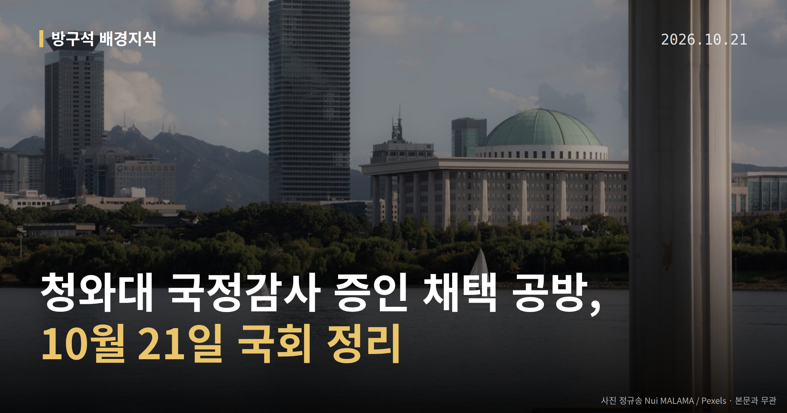
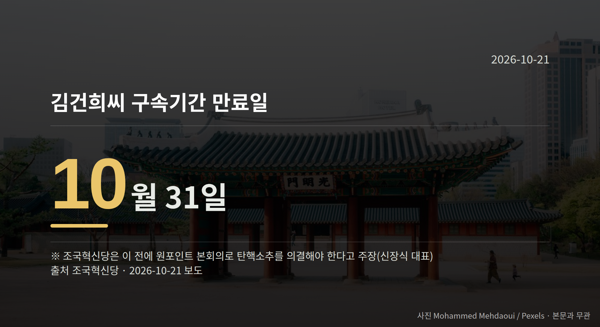

*이 글은 2026년 10월 21일 기준으로 정리한 내용입니다.*
**3줄 요약**

- 21일 오전 운영위 전체회의, 청와대 국감 증인 채택 논의
- 국민의힘 증인 4명 요구, 29~30일 국감 일정도 쟁점
- 민주·혁신당 원내대표 회동, 조희대 탄핵 공조 여부 주목
여러분, 21일 오전 9시 30분 국회 운영위원회 전체회의가 열립니다. 청와대 국정감사 증인 채택을 둘러싼 여야 공방이 예고돼 있습니다.

이 회의에서 합의가 되는지에 따라 29~30일로 잡힌 국정감사의 진행 방식이 달라집니다.

[이미지: 국회 본관 전경 사진]

## 청와대 국정감사 증인 채택, 누가 거론됐나

국민의힘은 20일 운영위 국정감사에 네 사람의 증인 채택을 요구했습니다. 강훈식 전 대통령 비서실장, 김용범 전 청와대 정책실장, 김현지 제1부속실장, 정진상 전 더불어민주당 정무조정실장입니다.

김승수 국민의힘 원내운영수석부대표는 강훈식 전 실장에 대해 인천 흉기 사건과 DMZ 지뢰 폭발 사고 등 재난 상황에서 대통령 보고·지시 경위를 아는 인물이라고 말했습니다.

또 김현지 실장에 대해서는 인사 난맥과 관련한 의혹을, 정진상 전 실장에 대해서는 선출·임명되지 않은 인물의 국정 개입 의혹을 제기했습니다. 모두 한쪽이 제기한 의혹이며, 확인된 사실은 아닙니다.

민주당은 이 요구에 부정적인 입장인 것으로 전해집니다. 다만 민주당 측의 구체적인 반박 발언은 자료에서 확인되지 않았습니다.

## 청와대 국정감사 증인 채택과 일정, 왜 또 부딪히나

일정도 함께 쟁점입니다. 당초 운영위는 29일 국회 사무처, 30일 청와대를 대상으로 국정감사를 진행할 계획이었습니다.

국민의힘은 청와대 국감을 앞당겨야 한다는 입장이고, 민주당은 29일 하루에 두 기관 국감을 함께 치르자는 입장인 것으로 전해집니다. 통합안에 대한 국민의힘의 구체적 반응은 자료에 없습니다.

지난해에도 김현지 실장의 출석 범위를 두고 민주당은 오전만, 국민의힘은 종일 출석을 요구하다 협상이 결렬돼 국감이 파행된 전례가 있습니다.

[이미지: 국회 상임위 회의장에서 의원들이 질의하는 모습]

## 조희대 대법원장 탄핵소추안 논의는 어디까지

같은 날 한병도 민주당 원내대표와 김준형 조국혁신당 원내대표가 회동합니다. 조국혁신당은 19일 조희대 대법원장 탄핵소추안(국회가 고위공직자 파면을 헌법재판소에 청구하는 절차)을 공개했습니다.

신장식 조국혁신당 대표는 20일 기자회견에서 "민주당이 책임 있게 결단하면 실행할 수 있는 일"이라고 말했습니다. 그러면서 김건희씨가 10월 31일 구속기간 만료로 석방된다며, 그 전에 원포인트 본회의를 열어 의결해야 한다고 밝혔습니다.

민주당 김민석 대표는 16일 당 유튜브 방송에서 "모든 사안과 방법과 경로를 올려놓고 논의하기 시작했다고 보면 될 것"이라고 말했습니다. 민주당은 국정감사가 끝난 뒤 추진 여부를 결정한다는 방침입니다.

국민의힘 등 다른 정당의 입장은 자료에서 확인되지 않았습니다.

## 그 밖의 오늘 소식

- 국방위 국감, 여야 모두 김여정 담화를 규탄했습니다.
- 광주 군공항 이전 임시 배치지 놓고 여야 시각차가 드러났습니다.
- 행안위 경북 국감에서 예천 임시 배치 계획이 논란이 됐습니다.

**그래서 나는?**

- 국정감사를 지켜보는 유권자라면, 21일 오전 운영위 결론부터 확인해 보세요
- 경북 예천·충남 서산 주민이라면, 전투비행단 임시 배치 논의를 살펴보세요
- 광주 시민이라면, 군공항 이전 관련 국감 질의 내용을 확인해 두세요

**직접 센 숫자 — 국회·여론조사 (최근 7일)**

국회의원 발의 법률안 **88건**. 최근 발의: 조세특례제한법 일부개정법률안(김남준의원 등 11인)

본회의 처리 법률안 **1건** — 철회 1건

이번 주 등록된 선거 여론조사 11건

- 전국 정당지지도 정기(정례)조사 — 한길리서치 · 쿠키뉴스 의뢰 · 2026-10-17~19 · 1,019명 · 무선 ARS · 응답률 2.7% · 95% 신뢰수준에 ±3.1%p
- 전국 정기(정례)조사 정당지지도 대통령선거 — 조원씨앤아이 · 스트레이트뉴스 의뢰 · 2026-10-17~19 · 2,000명 · 무선 ARS · 응답률 3.4% · 95% 신뢰수준에 ±2.2%p
- 전국 정기(정례)조사 정당지지도 — 여론조사공정(주) · 펜앤마이크 의뢰 · 2026-10-18~19 · 1,002명 · 무선 ARS · 응답률 3.2% · 95% 신뢰수준에 ±3.1%p

*열린국회정보·중앙선거여론조사심의위원회 자료를 직접 셌습니다. 여론조사의 자세한 사항은 중앙선거여론조사심의위원회 홈페이지를 참조하세요.*
**여러분은 국정감사에서 누가 증인으로 나오는지가 그 국감의 성패를 가른다고 보시나요?**

---

### 참고한 기사

1. **(21일·수)**
   - [연합뉴스](https://news.google.com/rss/articles/CBMiYEFVX3lxTE82b3FYcTRqamh0NG5MZjkyS3JlaGRFNU13dE5TUDRweFpPamtudzlyQTNhMFdxM0tIdFBGbXVqamg3YjV4TnVkaERFUkdXeGs2SXlPY1BqTFVRZkc0UHV0SdIBYEFVX3lxTE82b3FYcTRqamh0NG5MZjkyS3JlaGRFNU13dE5TUDRweFpPamtudzlyQTNhMFdxM0tIdFBGbXVqamg3YjV4TnVkaERFUkdXeGs2SXlPY1BqTFVRZkc0UHV0SQ?oc=5)
   - [뉴시스·정치](https://www.newsis.com/view/NISX20261020_0003833996)
2. **국힘 "강훈식·김용범·김현지, 국감 나와라"**
   - [아이뉴스24](https://news.google.com/rss/articles/CBMiS0FVX3lxTE1udTM3N09wN1BLcW9pTk9ZVXZOZUxVaWZuSHZYODhsR2Y2clc0bjVMUFBIdE9BSEwxSC1VWTRlajdmazRKT3pyZThPYw?oc=5)
   - [노컷뉴스](https://news.google.com/rss/articles/CBMiVEFVX3lxTE9vOGJZVXh4U0ZVOTdBMFBPd0Q3d2phU0g3VlJrbUx0TGczSmtTdld1SzZRbUZCemVHcUlTVnpsSFFCeXFaMDRLelRSNFI4N0JxZ2ZmNg?oc=5)
3. **국감 후반전, 여야 곳곳서 공방…北 도발 대응·대법관 재제청 등 놓고 충돌(종합)**
   - [뉴시스·정치](https://www.newsis.com/view/NISX20261020_0003834047)
4. **국회 운영위, 국감 계획서 채택 앞두고 여야 충돌 예고**
   - [한스경제](https://news.google.com/rss/articles/CBMibEFVX3lxTE1GMmNZQWYtdUlIMUduOU5wVU5DMjZUcWcwM2U4eTdJMXdzMFVmUHFkV3cycnhMUFZUR1pYNWxwQnZXdWtqd2psSmhxMjRZUThZdzBxT0Z2b2ttb3pGZEY2S25TbGlkY08xSWF6LdIBb0FVX3lxTE5CTF9JNUZWNUt4NjV2ODJpQ2pnbGJSVV9iaUNLZEFzUVU3MHNYNFB0Znd4ZGtBTE13OGktNmFMemxPWnNjUWtObzRpdGNIWHdicThCMDdkWGFEMmVlMjdMSzhRTDlpblVUQXp1dGxIMA?oc=5)
   - [동방일보](https://news.google.com/rss/articles/CBMic0FVX3lxTE45eFNVQU91dndUeDFvSkgydHhnOEJEMG9LX0FNTXVLSUs3RDhOU3U4b09TUE5xQ0R2d00xVTFnbHQ5VU5QTktNQWpIa1hfbjBUR0F6WkF1TUpCTkZFaFlwcmE4ZXE0YVdtU1I4QXY3cTZTdlE?oc=5)
5. **민주·조국혁신당, '조희대 탄핵 논의' 회동…양당 공조 여부 주목**
   - [뉴시스·정치](https://www.newsis.com/view/NISX20261020_0003833811)
   - [더팩트](https://news.google.com/rss/articles/CBMiWEFVX3lxTE5MNFpyRWhTbzVfNTVEUnNQODZRQnEzbWVjX0ROcmZqNXdaYlFkZFFEaXNZQkdoZmd6OFdObHFiS0NNZEdkaU10TDVjdUFQSG1MT05uakYyVUzSAVNBVV95cUxPVTNDWHdpSS1vam9tajZmcThJM1pCeUlmQ2Q0d0hKa0pGYjJCb3AwMF9YcXlETkNab1Z3bGhsMU02dGozRnIxbTgyQzFwcU1saVNiaw?oc=5)

---

*본 글은 공개된 언론 보도를 정리한 것이며, 특정 정당·후보·인물을 지지하거나 반대하지 않습니다. 인용한 여론조사의 자세한 사항은 중앙선거여론조사심의위원회 홈페이지를 참조하세요.*
