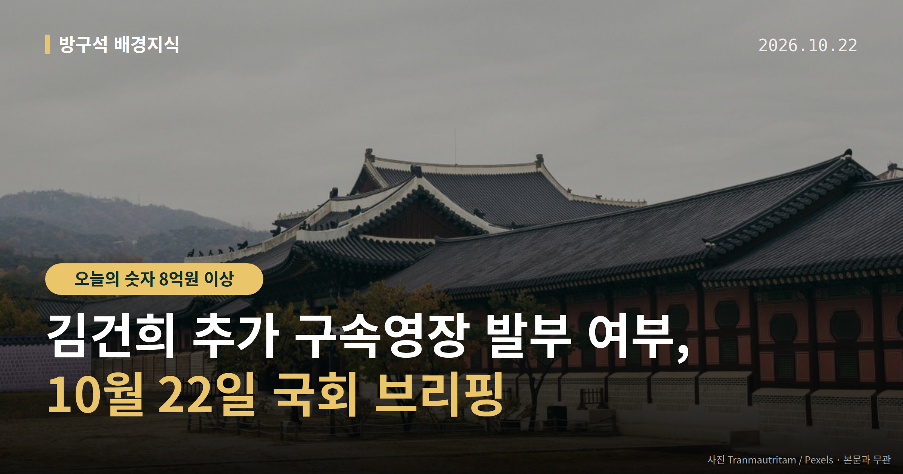
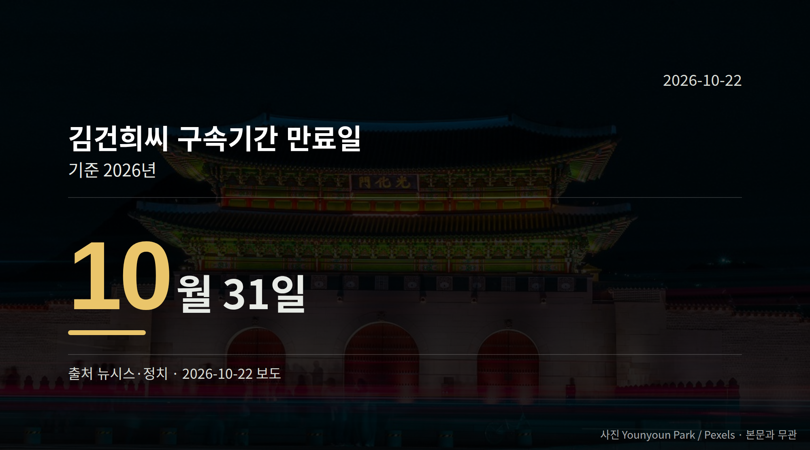

*이 글은 2026년 10월 22일 기준으로 정리한 내용입니다.*
**3줄 요약**

- 특검팀이 김건희씨 추가 구속영장 발부를 법원에 요청했습니다
- 구속기간 만료일은 10월 31일, 전원합의체 회부는 7월 24일입니다
- 대법원의 영장 결정과 선고기일 지정 여부를 보면 됩니다
10월 21일 정치 소식의 중심에는 김건희 추가 구속영장 문제가 있었습니다. 민중기 특별검사팀이 윤석열 전 대통령 배우자 김건희씨에 대한 추가 구속영장 발부를 법원에 요청했고, 더불어민주당은 대법원이 결정을 미루지 말아야 한다고 촉구했습니다.

구속기간 만료일이 10월 31일로 예정돼 있어, 이 날짜 전에 법원이 어떤 판단을 내리는지가 절차상 갈림길입니다.

[이미지: 대법원 청사 외관 사진]

## 김건희 추가 구속영장, 지금 어디까지 왔나

추가 구속영장은 이미 구속된 사람을 다른 혐의로 다시 구속하기 위해 법원이 발부하는 영장입니다. 발부되면 구속 상태가 이어지고, 그렇지 않으면 기존 구속기간 만료와 함께 상황이 달라집니다.

더불어민주당 박성준 수석대변인은 21일 서면브리핑에서 대법원을 향해 "더 이상 결정을 미뤄서는 안 된다"고 말했습니다. 그는 김건희씨 혐의로 도이치모터스 주가조작 가담 의혹과, 윤석열 전 대통령과 공모해 여론조사를 무상으로 제공받은 혐의를 들었습니다.

이 사건들은 모두 재판이 진행 중인 의혹 단계이며, 유죄가 확정된 사안은 아닙니다.

## 왜 10월 31일이 기준이 되나

날짜를 한 번에 정리하면 이렇습니다.

| 항목 | 내용 |
| --- | --- |
| 구속기간 만료일 | 2026년 10월 31일 |
| 전원합의체 회부일 | 2026년 7월 24일 |
| 부당이득 추정액(민주당 주장) | 8억 원 이상 |

박성준 수석대변인은 지난 7월 24일 대법원이 선고를 하루 앞두고 사건을 전원합의체(대법관들이 함께 모여 심리하는 재판부)에 회부했으나, 3개월이 지난 현재까지 선고기일이 지정되지 않았다고 말했습니다.

표에 적은 부당이득 추정 금액은 민주당 측이 제시한 수치로, 법원이 인정한 액수가 아닙니다.

## 김건희 추가 구속영장을 둘러싼 말들

여당에서는 대법원을 향한 압박성 발언도 나왔습니다. 정청래 전 대표와 박범계 의원은 페이스북에 조희대 대법원장 탄핵 문제를 거론했습니다.

반대편 입장도 함께 실어야 하지만, 이 사안에 대한 국민의힘 등의 입장은 제공된 자료에서 확인되지 않았습니다. 확인되는 대로 별도로 전하겠습니다.

결국 여러분이 볼 지점은 두 가지입니다. 대법원이 추가 구속영장 발부 여부를 언제 결정하는지, 그리고 미뤄져 온 선고기일을 지정하는지입니다.

[이미지: 국회 본청 앞에서 취재진이 모여 있는 사진]

## 그 밖의 오늘 소식

- 22일 상임위 종합감사, 공소취소·가상자산 과세가 쟁점으로 거론됐습니다.
- 감사 진행 상임위 수는 연합뉴스 10개, 뉴시스 11개로 보도가 엇갈렸습니다.
- 탈북어민 북송 2심, 정의용·서훈 전 실장·원장은 징역 1년 6개월에 집행유예 3년을 받았습니다.

**그래서 나는?**

- 뉴스를 따라가는 유권자라면, 10월 31일 전 대법원 결정 시점을 확인해 보세요
- 가상자산 투자자라면, 내년 1월 과세 시행 여부 논의가 달라질 수 있습니다
- 서울 시민이라면, 한강버스 의혹 관련 서울시 설명 공개 여부를 지켜볼 수 있습니다

**직접 센 숫자 — 국회·여론조사 (최근 7일)**

국회의원 발의 법률안 **107건**. 최근 발의: 조세특례제한법 일부개정법률안(안상훈의원 등 11인)

본회의 처리 법률안 **1건** — 철회 1건

이번 주 등록된 선거 여론조사 12건

- 전국 정기(정례)조사 대통령선거 정당지지도 국정현안 등 — (주)코리아정보리서치 · 천지일보 의뢰 · 2026-10-19~20 · 1,004명 · 무선 ARS · 응답률 3.7% · 95% 신뢰수준에 ±3.1%p
- 전국 정기(정례)조사 정당지지도 — 미디어토마토 · 뉴스토마토 의뢰 · 2026-10-19~20 · 1,033명 · 무선 ARS · 응답률 2.2% · 95% 신뢰수준에 ±3.0%p
- 전국 정당지지도 정기(정례)조사 — 한길리서치 · 쿠키뉴스 의뢰 · 2026-10-17~19 · 1,019명 · 무선 ARS · 응답률 2.7% · 95% 신뢰수준에 ±3.1%p

*열린국회정보·중앙선거여론조사심의위원회 자료를 직접 셌습니다. 여론조사의 자세한 사항은 중앙선거여론조사심의위원회 홈페이지를 참조하세요.*
**여러분은 이런 사법 절차 뉴스를 볼 때 판결 내용과 절차 일정 중 어느 쪽이 더 궁금하신가요?**

---

### 참고한 기사

1. **행정안전부(10월22일 목요일)**
   - [뉴스핌](https://news.google.com/rss/articles/CBMiXEFVX3lxTE9XMzRjUFdtdVBfZ0Y0ZkxRM1RKMUZ2VmlNY3ZSV1RmRk1jU0R0ZzllajQwUG9WUmg2Y04yaDU1MzZoSWc3bExKb283ZmdMWWhCbE4yclp1bW5XMDFm?oc=5)
   - [뉴시스·정치](https://www.newsis.com/view/NISX20261021_0003835747)
2. **與 "김건희 추가 구속영장 발부해야…대법원, 결정 미뤄서는 안 돼"**
   - [뉴시스·정치](https://www.newsis.com/view/NISX20261021_0003835641)
   - [연합뉴스·정치](https://www.yna.co.kr/view/AKR20261021138000001)
3. **국회, 종합감사 본격화…오늘 '공소취소·레버리지' 재공방 전망**
   - [연합뉴스·정치](https://www.yna.co.kr/view/AKR20261021145100001)
   - [뉴시스·정치](https://www.newsis.com/view/NISX20261021_0003835693)
4. **與 '한강버스' 野 '중수청장' 맞공방…亞게임 병역혜택 논란도 국감 쟁점(종합)**
   - [뉴시스·정치](https://www.newsis.com/view/NISX20261021_0003835809)
5. **‘탈북어민 강제 북송’혐의 文정부 인사들 2심서 집유**
   - [동아일보·정치](https://www.donga.com/news/Society/article/all/20261021/134886028/2)
   - [뉴시스·정치](https://www.newsis.com/view/NISX20261021_0003835437)

---

*본 글은 공개된 언론 보도를 정리한 것이며, 특정 정당·후보·인물을 지지하거나 반대하지 않습니다. 인용한 여론조사의 자세한 사항은 중앙선거여론조사심의위원회 홈페이지를 참조하세요.*
