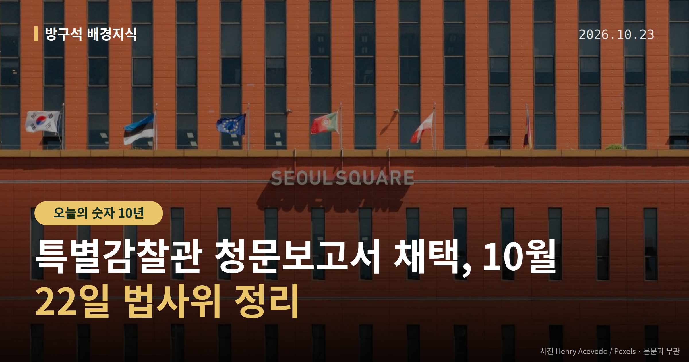
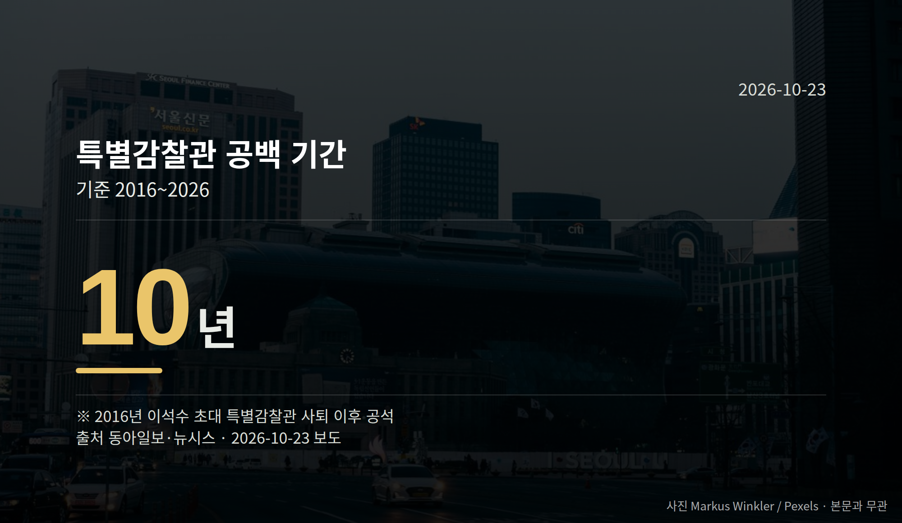

*이 글은 2026년 10월 23일 기준으로 정리한 내용입니다.*
**3줄 요약**

- 법사위, 최길수 특별감찰관 청문보고서 여야 합의 채택
- 2016년 이후 공백 10년, 청문회 뒤 채택까지 한 달 넘게 지연
- 다음은 대통령 임명 여부, 시점은 아직 확정되지 않았습니다
특별감찰관 청문보고서 채택이 여야 합의로 이뤄졌습니다. 국회 법제사법위원회는 22일 최길수 특별감찰관 후보자의 인사청문 경과보고서를 채택했습니다.

2016년부터 비어 있던 자리를 채우기 위한 절차적 관문 하나를 넘은 셈입니다. 다만 실제 임명 여부와 시점은 자료상 확정되지 않았습니다.

[이미지: 국회 법제사법위원회 회의장 전경]

## 특별감찰관 청문보고서 채택, 무슨 일이 있었나

특별감찰관은 대통령의 배우자와 친족, 일부 고위 공직자의 비위를 감찰하는 자리입니다. 2014년에 신설됐습니다.

인사청문 경과보고서(상임위가 후보자에 대한 의견을 정리해 넘기는 문서)에는 '적격'과 '부적격' 의견이 함께 담겼습니다.

더불어민주당 소속 서영교 법사위원장이 이의 여부를 물은 뒤 가결을 선포했다고 자료는 전합니다.

## 10년 공백, 숫자로 보면

| 항목 | 수치 | 기간 |
|---|---|---|
| 특별감찰관 공백 기간 | 10년 | 2016~2026 |
| 청문회 후 보고서 채택 지연 | 1개월 이상 | 9월 18일~10월 22일 |

2016년 이석수 초대 특별감찰관이 사퇴한 뒤 이 자리는 계속 공석이었습니다(자료 출처: 동아일보·뉴시스).

여야는 지난달 18일 인사청문회를 끝냈지만, 보고서 채택은 이 지연 기간만큼 미뤄졌다가 이날 처리됐습니다.

## 여야 입장은 어떻게 갈렸나

여당은 최 후보자의 감찰 업무 경험과 전문성을 평가했습니다.

야당은 민주당 추천 인사인 최 후보자가 대통령과 주변 인사를 독립적으로 감찰하는 데 한계가 있을 수 있다고 지적했습니다.

두 의견이 나란히 적힌 채로 특별감찰관 청문보고서 채택이 이뤄졌습니다. 이재명 대통령이 임명하면 공백은 메워지지만, 야당이 제기한 독립성 우려는 이후 감찰 활동 과정에서 다시 쟁점이 될 수 있는 지점으로 남습니다.

[이미지: 국정감사장에서 마이크를 두고 질의가 이어지는 모습]

## 그 밖의 오늘 소식

- 이정현 공소청장 직무대행, 공소취소 검토·지시 의혹 부인
- 검찰청 폐지 뒤 첫 공소청 국정감사, 여야 공방
- 탈북 어민 강제북송 사건 두고 법사위 설전

**그래서 나는?**

- 뉴스로 절차를 따라가는 분이라면, 다음 단계는 임명 발표 시점입니다
- 공직 감찰 제도에 관심 있는 분이라면, 감찰 대상 범위를 함께 보세요
- 이번 국감을 지켜보는 유권자라면, 진상조사단 결과 발표를 확인해 보세요

**직접 센 숫자 — 국회·여론조사 (최근 7일)**

국회의원 발의 법률안 **119건**. 최근 발의: 조세특례제한법 일부개정법률안(김남준의원 등 14인)

본회의 처리 법률안 **1건** — 철회 1건

이번 주 등록된 선거 여론조사 11건

- 강원특별자치도 전체 정당지지도 — (주)리얼미터 · 강원일보 의뢰 · 2026-10-20~21 · 2,003명 · 무선 ARS · 응답률 6.1% · 95% 신뢰수준에 ±2.2%p
- 전국 정기(정례)조사 대통령선거 정당지지도 국정현안 등 — (주)코리아정보리서치 · 천지일보 의뢰 · 2026-10-19~20 · 1,004명 · 무선 ARS · 응답률 3.7% · 95% 신뢰수준에 ±3.1%p
- 전국 정기(정례)조사 정당지지도 — 미디어토마토 · 뉴스토마토 의뢰 · 2026-10-19~20 · 1,033명 · 무선 ARS · 응답률 2.2% · 95% 신뢰수준에 ±3.0%p

*열린국회정보·중앙선거여론조사심의위원회 자료를 직접 셌습니다. 여론조사의 자세한 사항은 중앙선거여론조사심의위원회 홈페이지를 참조하세요.*
**10년간 비어 있던 자리가 다시 채워진다면, 여러분은 이 기구가 가장 먼저 무엇을 들여다봐야 한다고 보시나요?**

---

### 참고한 기사

1. **최길수 특별감찰관 청문보고서 채택, 10년 공백 끝내**
   - [동아일보·정치](https://www.donga.com/news/Politics/article/all/20261023/134893711/2)
   - [조선일보](https://news.google.com/rss/articles/CBMihgFBVV95cUxPT2JjeUktTm1PWXphRTlXc0VXWmxMVUpJQnpCbnVncHFMOGlBcVVyalBEVGpDVllhNEJ1Q2NRQ1ZBalQ4WEhLaV9rekVlbHJjX3V6YVh0Z0lSYWFIMVBHYkxFVm1mZ25hT2xwWGRPU3EtSmlEdkZ3Mkc0TUpWcV95Q2dKODZVZw?oc=5)
2. **행정안전부(10월23일 금요일)**
   - [뉴시스·정치](https://www.newsis.com/view/NISX20261022_0003837580)
   - [뉴스핌](https://news.google.com/rss/articles/CBMiXEFVX3lxTE9WazhlSzBIY2U3aUhvdnFhdGRhN2hDNVhOU19teDdycVRBOEV4Q1c4WkpXUl9BRmQwZlNWUnVBLXlrN0hPVWdlUnN2aWtnc3U0Sm5UdEdHQWQwMnRo?oc=5)
3. **공소청장 대행 “공소취소의 ‘공’자도 꺼낸 적 없어”**
   - [동아일보·정치](https://www.donga.com/news/Politics/article/all/20261023/134893469/2)
   - [뉴시스·정치](https://www.newsis.com/view/NISX20261022_0003837501)
4. **여야, 국감 막바지에도 국지전…李 공소취소·단일종목 ETF 등 놓고 충돌**
   - [뉴시스·정치](https://www.newsis.com/view/NISX20261022_0003837670)
5. **공소청 국감 '정치수사' 공방…與 "검찰 조작기소" 野 "李 공소취소 압박"(종합)**
   - [뉴시스·정치](https://www.newsis.com/view/NISX20261022_0003837535)

---

*본 글은 공개된 언론 보도를 정리한 것이며, 특정 정당·후보·인물을 지지하거나 반대하지 않습니다. 인용한 여론조사의 자세한 사항은 중앙선거여론조사심의위원회 홈페이지를 참조하세요.*
