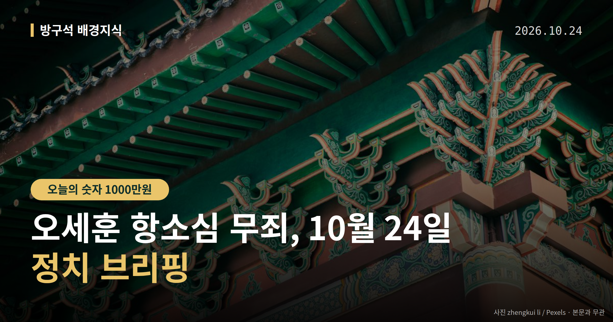
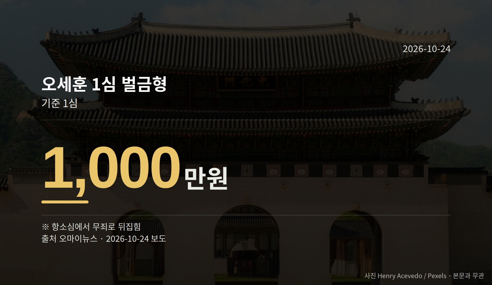
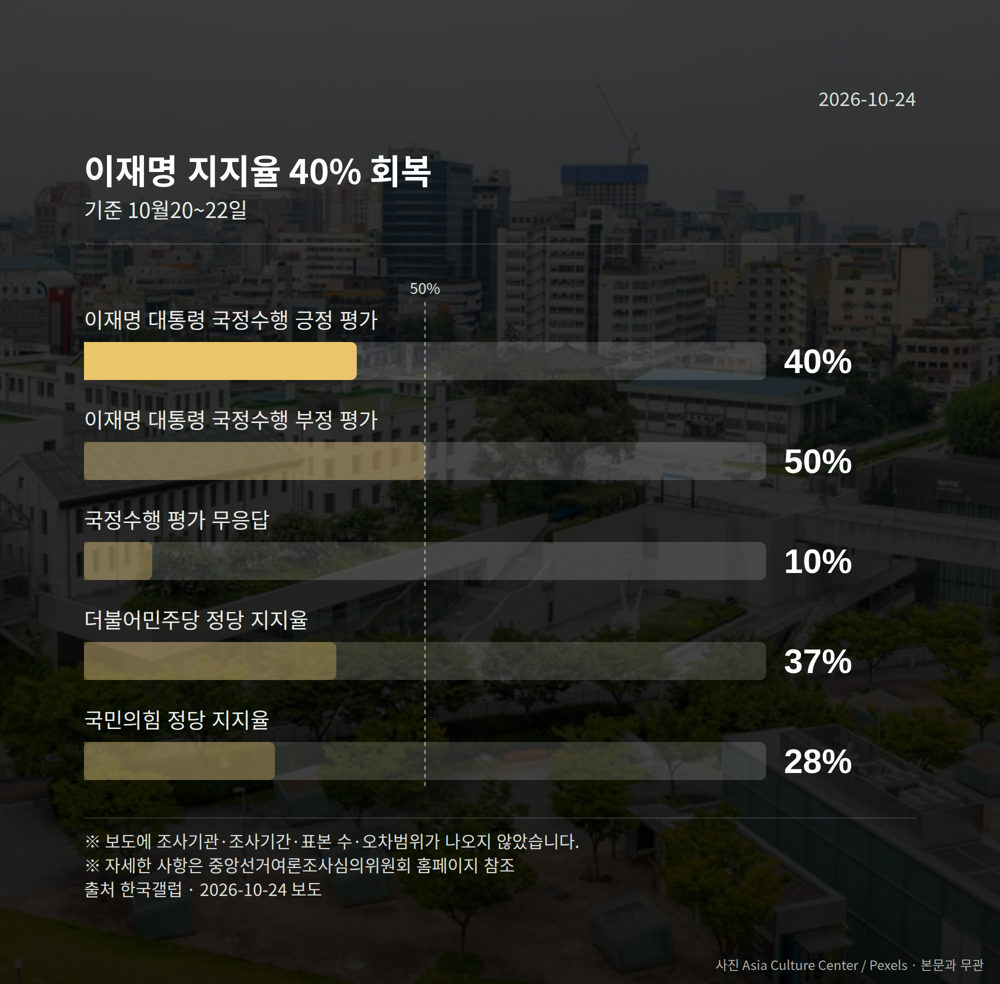

*이 글은 2026년 10월 24일 기준으로 정리한 내용입니다.*
**3줄 요약**

- 오세훈 항소심 무죄, 1심 유죄 판단이 2심에서 뒤집혔습니다
- 1심은 벌금 1000만원·추징금 2100만원의 시장직 상실형이었습니다
- 남은 절차는 특검의 상고 여부, 대법원으로 갈지가 관전 포인트입니다
오세훈 항소심 무죄 판결이 어제 나왔습니다. 서울고법은 10월 23일 오세훈 서울시장의 정치자금법 위반 혐의 2심에서 1심의 유죄 판단을 뒤집고 무죄를 선고했습니다.

오 시장은 서울시장직을 유지하게 됐고, 남은 절차는 특검의 상고(2심 판결에 불복해 대법원에 다시 판단을 구하는 절차) 여부입니다.

[이미지: 서울시청 건물 외관 사진]

## 오세훈 항소심 무죄, 재판부는 무엇을 근거로 들었나

판결을 내린 곳은 서울고법 형사7부입니다. 재판장 이름은 매체에 따라 '구희근'과 '구회근'으로 다르게 표기되고 있습니다.

함께 기소된 강철원 전 서울시 정무부시장과 후원자 김한정씨도 같은 날 무죄를 선고받았습니다.

1심과 2심의 결론은 이렇게 달라졌습니다.

| 구분 | 결론 |
| --- | --- |
| 1심 | 벌금 1000만원·추징금 2100만원(시장직 상실형) |
| 2심 | 무죄 |

항소심 재판부는 "유죄의 의심이 없는 것은 아니다"라고 하면서도, 명태균씨 진술의 신빙성 등을 이유로 합리적 의심 없이 증명되지는 않았다고 판단했습니다.

다만 특검과 명태균씨 등 당사자의 직접 반론은 제공된 자료에서 확인되지 않았습니다.

## 여야 반응은 어떻게 갈렸나

국민의힘 장동혁 대표는 "사필귀정"이라며 특검의 상고 포기를 요구했고, "재판받아야 할 범죄자는 이재명 대통령"이라고 말했습니다. 정점식 원내대표와 박충권 수석대변인 등도 민중기 특검의 사과와 반성을 촉구했습니다.

더불어민주당 박성준 수석대변인은 "상식을 벗어난 판결"이라며 재판부를 "무죄 자판기"라고 지칭했습니다. 한병도 원내대표는 특검의 즉각 상고를 촉구했고, 서영교 법제사법위원장과 한민수 최고위원은 조희대 대법원장 탄핵(헌법·법률 위반을 이유로 공직자 파면을 요구하는 절차)을 거론했습니다.

조국혁신당은 기자회견을 열어 조희대 대법원장 탄핵과 법원행정처 해체를 요구했고, 정의당은 "정치 부패의 우회로를 열어준 것"이라고 반발했습니다.

오세훈 항소심 무죄 판결 자체는 확정된 결론이 아닙니다. 상고가 이뤄지면 최종 판단은 대법원으로 넘어갑니다.

## 그 밖의 오늘 소식

- 한국갤럽: 이 대통령 긍정 40%·부정 50%(±3.1%p, 95% 신뢰수준)
- 정당 지지율은 민주당 37%, 국민의힘 28%, 무당층 27%
- 조희대 대법원장 탄핵 반대 39%·찬성 34%로 오차범위 내

**그래서 나는?**

- 서울시민이라면, 시장 보궐선거 가능성은 당분간 사라졌습니다
- 뉴스로 재판을 따라가는 분이라면, 상고 기한과 대법원 접수 여부를 확인해 보세요
- 여론조사를 자주 보는 분이라면, 오차범위 안 차이는 우열로 읽지 않는 편이 안전합니다

**직접 센 숫자 — 국회·여론조사 (최근 7일)**

국회의원 발의 법률안 **122건**. 최근 발의: 국민건강보험법 일부개정법률안(박용갑의원 등 14인)

본회의 처리 법률안 **2건** — 철회 2건

이번 주 등록된 선거 여론조사 10건

- 전국 정기(정례)조사 정당지지도 — 한국갤럽조사연구소 · 한국갤럽 자체 조사 의뢰 · 2026-10-20~22 · 1,001명 · 무선전화면접 · 응답률 10.6% · 95% 신뢰수준에 ±3.1%p
- 강원특별자치도 전체 정당지지도 — (주)리얼미터 · 강원일보 의뢰 · 2026-10-20~21 · 2,003명 · 무선 ARS · 응답률 6.1% · 95% 신뢰수준에 ±2.2%p
- 전국 정기(정례)조사 대통령선거 정당지지도 국정현안 등 — (주)코리아정보리서치 · 천지일보 의뢰 · 2026-10-19~20 · 1,004명 · 무선 ARS · 응답률 3.7% · 95% 신뢰수준에 ±3.1%p

오늘 이슈에 나온 법안은 지금 어디에

- 정치자금법 — 제22대 발의 45건(계류 45) · 최근 「정치자금법 일부개정법률안」(박범계의원 등 10인, 2026-05-15) · 소관위 상정

*열린국회정보·중앙선거여론조사심의위원회 자료를 직접 셌습니다. 여론조사의 자세한 사항은 중앙선거여론조사심의위원회 홈페이지를 참조하세요.*
**여러분은 2심에서 결론이 뒤집힌 사건을 볼 때, 어느 단계의 판단까지 지켜본 뒤 생각을 정리하시나요?**

---

### 참고한 기사

1. **국민의힘, 오세훈 항소심 무죄에 "사필귀정…무리한 정치적 기소한 특검, 책임져야"(종합)**
   - [뉴시스·정치](https://www.newsis.com/view/NISX20261023_0003838853)
   - [KBS 뉴스](https://news.google.com/rss/articles/CBMiW0FVX3lxTFBZcXhwRDBwc01iTU9RSkkwOTc4d2JuRTNCRTg3X3Q1YUpXVDZHR3EtVnNiSzVfS2ZReG9XUmJpY1VEVDF6djZzRVl4TGlsNExRTnhEN1VfcVdIdVU?oc=5)
2. **“조희대 탄핵해야” VS “저질 압박”···오세훈 2심 무죄에 여야 SNS 난타전**
   - [경향신문·정치](https://www.khan.co.kr/article/202610240900031)
   - [더팩트](https://news.google.com/rss/articles/CBMiU0FVX3lxTE4teWZwUUFrVmtycTRoeWU1WHNCN1EybmZOZnlYck5tVVJGdEhZTkw2X2RZYnBZSmw2aGtPenlNb21Tc2RJOEtvVFZoLWNCeWpSTVpj?oc=5)
3. **오세훈 무죄에 與 “무죄 자판기 재판부” 野 “억지 기소 사필귀정”**
   - [동아일보·정치](https://www.donga.com/news/Politics/article/all/20261023/134899688/2)
   - [오마이뉴스·정치](https://www.ohmynews.com/NWS_Web/View/at_pg.aspx?CNTN_CD=A0003278100)
4. **與, '오세훈 2심 무죄'에 "상식 벗어나…특검, 즉각 상고해야"**
   - [연합뉴스·정치](https://www.yna.co.kr/view/AKR20261023123200001)
   - [뉴시스·정치](https://www.newsis.com/view/NISX20261023_0003838801)
5. **李지지율, 7주만에 40% 회복… 부정 평가 50%**
   - [동아일보·정치](https://www.donga.com/news/Politics/article/all/20261023/134899692/2)
   - [한국경제·정치](https://www.hankyung.com/article/2026102317641)

---

*본 글은 공개된 언론 보도를 정리한 것이며, 특정 정당·후보·인물을 지지하거나 반대하지 않습니다. 인용한 여론조사의 자세한 사항은 중앙선거여론조사심의위원회 홈페이지를 참조하세요.*
