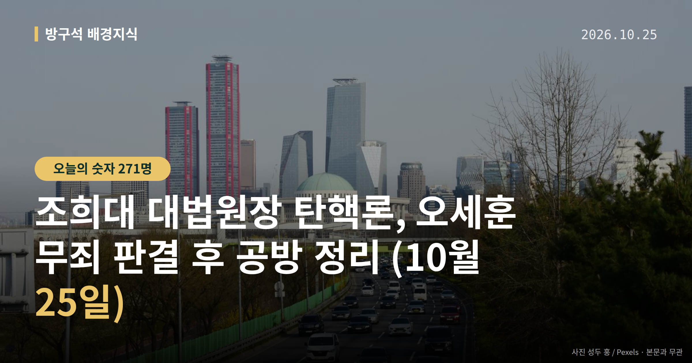
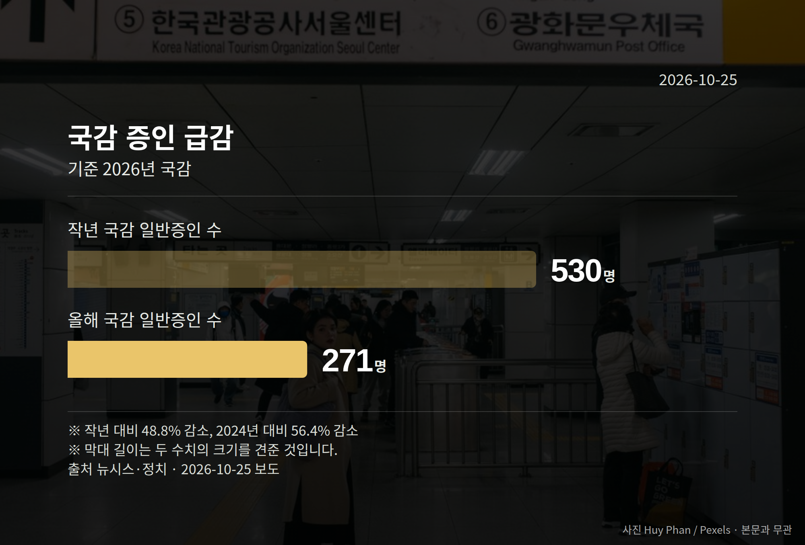

*이 글은 2026년 10월 25일 기준으로 정리한 내용입니다.*
**3줄 요약**

- 오세훈 시장 항소심 무죄 뒤 조희대 대법원장 탄핵론이 쟁점화됐습니다.
- 올해 국감 일반증인은 271명, 작년 530명보다 48.8% 줄었습니다.
- 민주당 원내 일정 조율 결과와 10월 29일 운영위 국감을 보면 됩니다.
조희대 대법원장 탄핵론이 하루 사이 정치권의 최대 쟁점이 됐습니다. 오세훈 서울시장이 정치자금법 위반 사건 항소심에서 무죄를 선고받은 것이 계기였습니다.

민주당 지도부는 국정조사를 포함한 논의를 이어가겠다고 밝혔고, 국민의힘은 사법부에 대한 압박이라며 반발했습니다. 아직 탄핵안이 발의된 단계는 아닙니다.

[이미지: 국회 본회의장 전경 사진]

## 조희대 대법원장 탄핵론, 무슨 일이 있었나

오세훈 시장은 정치자금법 위반 항소심에서 무죄를 선고받았습니다. 이 판결을 두고 더불어민주당 일각과 조국혁신당 등 범여권이 반발하며 조희대 대법원장 탄핵을 주장했습니다.

더불어민주당 김민석 대표는 10월 24일 "국정조사를 포함해서 원래 생각한대로 차근차근 진행해 나가겠다"고 말했습니다. 일정에 대해서는 "원내에서 여러가지를 종합해서 조율하고 있는 것으로 안다"고 했습니다.

김 대표는 무죄 판결에 대해 "법리적으로나 상식적으로나 이해하기 어렵고 납득하기 어려운 판결"이라고 말했습니다.

국민의힘 장동혁 대표는 "'만물 조희대설' 수준"이라며 "도를 넘은 사법부 겁박을 중단하라"고 말했습니다. 박성훈 수석대변인은 범여권의 '사법부 길들이기'가 "법치국가의 기본인 삼권분립을 정면으로 부정하는 행태"라고 말하며, 이재명 대통령에게 본인 재판 재개를 촉구했습니다.

윤상현 의원은 "민주당이 원하는 판결은 유죄이고 무죄가 나오면 탄핵인가"라며 '답정너 탄핵'이라고 말했습니다.

판결 당사자인 오세훈 시장도 입장을 냈습니다. 오 시장은 10월 24일 국회에서 "선출 권력이 삼권 위에 있는 것처럼 착각하는 발언들이 수시로 쏟아져나오고 있다"며 "집권당의 자제를 촉구한다"고 말했습니다.

## 조희대 대법원장 탄핵론, 절차상 다음은

탄핵소추(공직자의 파면을 국회가 요구하는 절차)는 국회에서 발의와 의결을 거쳐야 효력이 생깁니다. 현재는 발의도, 의결도 이뤄지지 않은 '주장·논의' 단계입니다.

오세훈 시장 사건은 검찰(특검) 측의 대법원 상고 여부가 아직 확정되지 않았습니다. 국민의힘은 상고 포기를 요구했고, 민주당은 탄핵 추진 일정을 원내에서 조율 중이라고 밝힌 상태입니다.

## 국감 증인은 왜 줄었나

올해 국정감사에서 채택된 일반증인은 271명입니다. 연도별로 보면 이렇습니다.

| 연도 | 일반증인 수 | 변화 |
| --- | --- | --- |
| 2026년 | 271명 | 작년 대비 48.8% 감소 |
| 2025년 | 530명 | - |
| 2024년 | 622명 | 올해와 비교해 56.4% 차이 |

국민의힘은 강훈식 전 대통령비서실장, 김용범 전 정책실장, 김현지 제1부속실장, 정진상 전 민주당 정무조정실장을 '실장 4인방'으로 규정해 증인 채택을 요구했으나 여당이 거부했습니다.

국민의힘 정점식 원내대표는 10월 23일 "여당이 4인방의 증인 채택을 끝끝내 거부한 것은 이재명 정권의 청와대를 둘러싼 각종 의혹을 사실상 자백한 것이나 다름없다"고 말했습니다.

민주당 한병도 운영위원장은 10월 21일 "대통령비서실 부속실장 국감 출석은 2000년대부터 단 한 차례도 없다"며 "강 전 실장·김 전 실장은 이미 사퇴했다"고 말했습니다.

한편 국회 법제사법위원회에서는 범여권 주도로 조희대 대법원장이 국정감사 일반증인으로 채택돼 논란이 일었습니다. 10월 29일 국회 운영위원회의 대통령실 국정감사에서 '실장 4인방' 증인 채택 여부가 다시 다뤄질 수 있습니다.

[이미지: 법무부 청사 외관 사진]

## 그 밖의 오늘 소식

- 법무장관 후보, 박균택·양부남 의원 2인으로 압축됐습니다.
- 법무부 장관 공석은 두 달째, 발표 시점은 '조만간'만 언급됐습니다.
- 오세훈 시장, 전세·월세 부담을 들어 부동산 정책 전환을 제시했습니다.

**그래서 나는?**

- 이번 선거 유권자라면, 사법부 관련 공방이 총선 쟁점으로 번지는 흐름을 확인해 보세요.
- 서울 거주자라면, 시장 재판 결과에 따라 시정 일정이 달라질 수 있습니다.
- 뉴스를 처음 따라가는 분이라면, 탄핵은 '발의→의결' 절차부터 보면 쉽습니다.

**직접 센 숫자 — 국회·여론조사 (최근 7일)**

국회의원 발의 법률안 **122건**. 최근 발의: 국민건강보험법 일부개정법률안(박용갑의원 등 14인)

본회의 처리 법률안 **2건** — 철회 2건

이번 주 등록된 선거 여론조사 8건

- 전국 정기(정례)조사 정당지지도 — 한국갤럽조사연구소 · 한국갤럽 자체 조사 의뢰 · 2026-10-20~22 · 1,001명 · 무선전화면접 · 응답률 10.6% · 95% 신뢰수준에 ±3.1%p
- 강원특별자치도 전체 정당지지도 — (주)리얼미터 · 강원일보 의뢰 · 2026-10-20~21 · 2,003명 · 무선 ARS · 응답률 6.1% · 95% 신뢰수준에 ±2.2%p
- 전국 정기(정례)조사 대통령선거 정당지지도 국정현안 등 — (주)코리아정보리서치 · 천지일보 의뢰 · 2026-10-19~20 · 1,004명 · 무선 ARS · 응답률 3.7% · 95% 신뢰수준에 ±3.1%p

오늘 이슈에 나온 법안은 지금 어디에

- 정치자금법 — 제22대 발의 45건(계류 45) · 최근 「정치자금법 일부개정법률안」(박범계의원 등 10인, 2026-05-15) · 소관위 상정

*열린국회정보·중앙선거여론조사심의위원회 자료를 직접 셌습니다. 여론조사의 자세한 사항은 중앙선거여론조사심의위원회 홈페이지를 참조하세요.*
**여러분은 이번처럼 판결과 정치 논쟁이 겹칠 때, 어느 지점부터 뉴스를 따라가기가 어려워지시나요?**

---

### 참고한 기사

1. **오세훈 무죄에 더 커진 '조희대 탄핵론'..."국조부터 차근차근"**
   - [YTN](https://news.google.com/rss/articles/CBMib0FVX3lxTFBqblF5a0NiSEpLX1BpUHFKcmgwa2hqQjZzYTk4N0RfRGRuYnZtS3hVbktHTzdXR3hieHhZN3lzTUp6cHNWNWpEU2lNcmd3UnVWdEsyaG9ZM0VWMTNsVFBERE1uQzFMSHVOTHotOHJOdw?oc=5)
   - [강원일보](https://news.google.com/rss/articles/CBMiW0FVX3lxTE5fZTE4Mmo1bUczTkQ5ZGFUR09zTWlPekFjdzJ0cHdFY0dKdjJCNldReGhseFdHOENuMG1WdEZKdHRJZDdHYm40Q2hDcHRfMmdQN1lTVDN1Q3JQNkU?oc=5)
2. **차기 법무장관에 檢출신 박균택·양부남 압축…李대통령 막판 고심**
   - [한국경제·정치](https://www.hankyung.com/article/2026102528897)
   - [조선일보·정치](https://www.chosun.com/politics/politics_general/2026/10/25/E6VAU7IPHVDEFDAYCK7LTM3M4M)
3. **김민석, '曺탄핵' 질문에 "국조 포함해 원래 생각대로 차근차근"(종합)**
   - [연합뉴스·정치](https://www.yna.co.kr/view/AKR20261024028351001)
   - [뉴시스·정치](https://www.newsis.com/view/NISX20261024_0003839568)
4. **③증인 없는 국감…일반 증인, 작년 대비 절반으로 줄고 핵심 증인도 빠져**
   - [뉴시스·정치](https://www.newsis.com/view/NISX20261023_0003838940)
5. **‘항소심 무죄’ 오세훈 “與, 선출 권력이 3권 위라고 착각”…조희대 탄핵 논의 직격**
   - [동아일보·정치](https://www.donga.com/news/Politics/article/all/20261024/134901196/1)
   - [뉴시스·정치](https://www.newsis.com/view/NISX20261024_0003839579)

---

*본 글은 공개된 언론 보도를 정리한 것이며, 특정 정당·후보·인물을 지지하거나 반대하지 않습니다. 인용한 여론조사의 자세한 사항은 중앙선거여론조사심의위원회 홈페이지를 참조하세요.*
