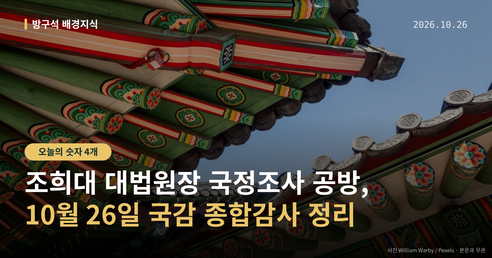
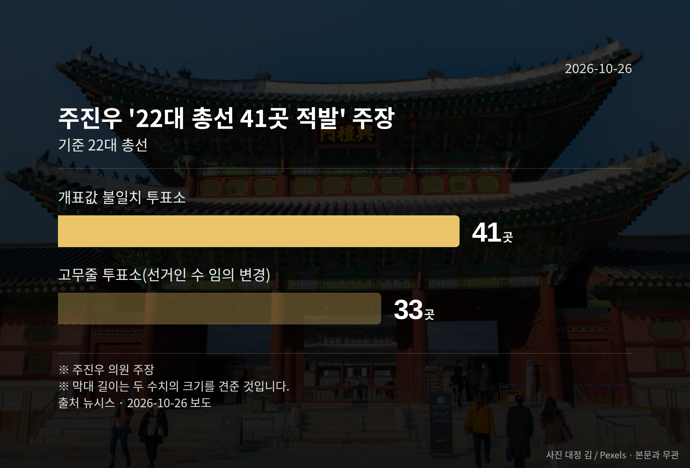
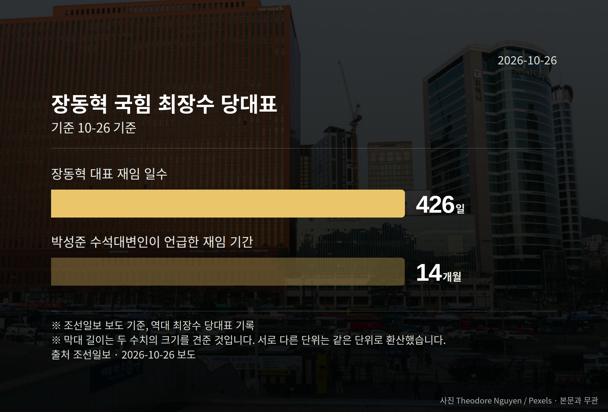

*이 글은 2026년 10월 26일 기준으로 정리한 내용입니다.*
**3줄 요약**

- 26일 국회 4개 상임위 종합감사, 법사위 쟁점은 대법원장 문제입니다
- 국정조사·탄핵소추 착수 여부는 아직 결정되지 않은 단계입니다
- 주진우 의원은 22대 총선 투표소 41곳 개표값 불일치를 주장했습니다
26일 국회에서 4개 상임위원회 종합감사가 열립니다. 여야가 가장 세게 부딪힐 곳으로 꼽히는 곳은 법제사법위원회이고, 쟁점은 조희대 대법원장 국정조사입니다.

다만 국정조사도, 탄핵소추도 아직 착수가 결정된 단계는 아닙니다. 오늘은 이 사안을 사실과 주장으로 나눠 보겠습니다.

[이미지: 국회 본청 외관과 상임위 회의장 전경 사진]

## 조희대 대법원장 국정조사, 지금 어디까지 왔나

26일에는 국방위, 기후에너지환경노동위, 법제사법위, 행정안전위 등 4개 상임위에서 종합감사가 진행된다고 뉴시스가 보도했습니다.

법사위에서는 대법관 후보 재제청 요구 거부 등 조희대 대법원장을 둘러싼 논란을 두고 여야가 다시 충돌할 것으로 전망됐습니다. 앞서 10월 6일 대법원 국정감사에서도 여당 간사 김의겸 더불어민주당 의원과 야당 간사 박형수 국민의힘 의원이 언쟁을 벌였습니다.

여기서 두 용어를 짧게 풀어 둡니다. 국정조사는 국회가 특정 사안을 정해 자료를 받고 조사하는 절차이고, 탄핵소추는 국회가 공직자 파면을 헌법재판소에 청구하는 절차입니다.

## 조희대 대법원장 국정조사를 두고 갈린 말들

국민의힘 정점식 원내대표는 25일 기자회견에서 민주당의 국정조사 추진을 "탄핵에 대한 국민적 반발이 두려우니 국정조사라는 탄핵 간 보기 꼼수를 쓰겠다는 것"이라고 말했습니다.

그는 "탄핵 국정조사가 탄핵소추 자체보다 더 악질적"이라며 "차라리 깔끔히 탄핵소추하고 빨리 헌법재판소에서 기각을 받는 게 나라를 위한 길"이라고 말했습니다. 또 민주당의 국정조사 목적을 이재명 대통령 파기환송 판결과 오세훈 서울시장 2심 무죄 선고에 대한 "분풀이성 보복"이라고 주장했습니다.

이는 정점식 원내대표의 주장이며, 이에 대한 더불어민주당 측 반론은 오늘 자료에서 확인되지 않았습니다. 정 원내대표는 정동영 통일부 장관과 이종석 국가정보원장 경질도 재차 요구했는데, 이 역시 주장 단계입니다.

## 주진우 의원이 제기한 22대 총선 개표 의혹

국민의힘 주진우 의원은 25일 기자회견에서 22대 총선 개표상황표와 입력값이 다른 투표소를 적발했다고 주장했습니다.

| 항목 | 주진우 의원 주장 |
| --- | --- |
| 개표값 불일치 투표소 | 41곳 |
| 후보·정당 임의 입력 투표소 | 8곳(서울 6·경기 1·인천 1) |
| 선거인 수 불일치 규모 | 1만4214명 |
| 선거인 수 임의 변경 투표소 | 33곳 |

주진우 의원은 "윗선의 지시·개입이 있었거나 조직적인 부정"이라고 주장하고, 선관위 특검이 출범 50일이 지났는데 구속 수사가 한 건도 없다며 엄단을 촉구했습니다. 선거관리위원회와 특검 측 해명은 자료에 담기지 않았고, 이 내용은 수사나 판결로 확정된 사실이 아닙니다.

## 그 밖의 오늘 소식

- 장동혁 국민의힘 대표, 취임 426일로 역대 최장수(조선일보 기준)
- 민주당 박성준 수석대변인 "버티기 장인", 국민의힘 조용술 대변인 "김민석 대표 처지부터 살피라"
- 오세훈 서울시장 정치자금법 위반 항소심에서 무죄 판결이 나온 것으로 언급됐습니다

**그래서 나는?**

- 국회 일정을 챙기는 분이라면, 26일 법사위 종합감사를 확인해 보세요
- 선거 절차가 궁금한 유권자라면, 선관위 특검의 대응 발표를 지켜볼 때입니다
- 정당 일정에 관심 있다면, 당 지도부 선출 일정이 달라질 수 있습니다

**직접 센 숫자 — 국회·여론조사 (최근 7일)**

국회의원 발의 법률안 **122건**. 최근 발의: 국민건강보험법 일부개정법률안(박용갑의원 등 14인)

본회의 처리 법률안 **2건** — 철회 2건

이번 주 등록된 선거 여론조사 12건

- 전국 정기(정례)조사 정당지지도 — (주)여론조사꽃 · 2026-10-23~24 · 1,011명 · 무선 ARS · 응답률 1.9% · 95% 신뢰수준에 ±3.1%p
- 전국 정기(정례)조사 정당지지도 — (주)여론조사꽃 · 2026-10-23~24 · 1,003명 · 무선전화면접 · 응답률 9.5% · 95% 신뢰수준에 ±3.1%p
- 강원특별자치도 전체 국회의원선거 정당지지도 — (주)리얼미터 · 강원일보 의뢰 · 2026-10-23~24 · 502명 · 무선 ARS · 응답률 6.2% · 95% 신뢰수준에 ±4.4%p

오늘 이슈에 나온 법안은 지금 어디에

- 정치자금법 — 제22대 발의 45건 · 최근 「정치자금법 일부개정법률안」(박범계의원 등 10인, 2026-05-15) · 소관위 상정

*열린국회정보·중앙선거여론조사심의위원회 자료를 직접 셌습니다. 여론조사의 자세한 사항은 중앙선거여론조사심의위원회 홈페이지를 참조하세요.*
**여러분은 국회가 어떤 사안을 다룰 때 '조사'와 '표결' 중 무엇이 먼저라고 느끼시나요?**

---

### 참고한 기사

1. **장동혁 ‘국힘 최장수 대표’… 與 “버티기 장인”**
   - [동아일보·정치](https://www.donga.com/news/Politics/article/all/20261026/134906034/2)
   - [조선일보·정치](https://www.chosun.com/politics/assembly/2026/10/26/CRNPB6GALRBFTE5STUTP5ODHMM)
2. **행정안전부(10월26일 월요일)**
   - [뉴시스·정치](https://www.newsis.com/view/NISX20261025_0003839786)
   - [뉴스핌](https://news.google.com/rss/articles/CBMiXEFVX3lxTFB5RnhRZ0VuQnZSbFBObEdmbXU3bTBxOFE2NzhjM2VRV3hvdmt0Z2g0dzJqcmVTa2NVTUlIZWcxdVU0X1Z0YlZYU1hlSUhDM2dJRFhIM0wtQTZNYnQx?oc=5)
3. **막바지 접어든 국감…오늘 법사위서 '조희대 탄핵·국정조사' 두고 공방**
   - [뉴시스·정치](https://www.newsis.com/view/NISX20261025_0003839943)
4. **정점식 "與 조희대 국조는 탄핵 간보기 꼼수…탄핵보다 더 악질"**
   - [연합뉴스·정치](https://www.yna.co.kr/view/AKR20261025032300001)
   - [뉴시스·정치](https://www.newsis.com/view/NISX20261025_0003840045)
5. **주진우 "22대 총선서 투표 허위입력 41곳 확인…선관위 특검 수사해야"**
   - [트루스데일리](https://news.google.com/rss/articles/CBMibkFVX3lxTE9FWG5EUWJkblU4X0dPRERXMXhzUExvVXZYWkFpaWhfXzVsekpOUHlmTENkZUdkN1pvTTNLNDFIX2xEeW5xX3hZZVU5M3VzVTdKdmRPajJYWUJaM2ZSV2EyQnFfRld0U0luUFB6LUxR?oc=5)
   - [이데일리](https://news.google.com/rss/articles/CBMigAFBVV95cUxQcDBGcm5wQ2h0QnRkeHl6bHRfVmxETFpYZWJObkZDcmRTVUJlZ25HVjQ5cnFBcV90blFwekk5anRuS0ZCR01BUmpUU0VKOGlwbHhXRjQzeWxRNFpQMkNCLTlsYkRvZHFqX3hNVFpfcUlMVy1jUG1SV080WG1SdjhZcA?oc=5)

---

*본 글은 공개된 언론 보도를 정리한 것이며, 특정 정당·후보·인물을 지지하거나 반대하지 않습니다. 인용한 여론조사의 자세한 사항은 중앙선거여론조사심의위원회 홈페이지를 참조하세요.*
