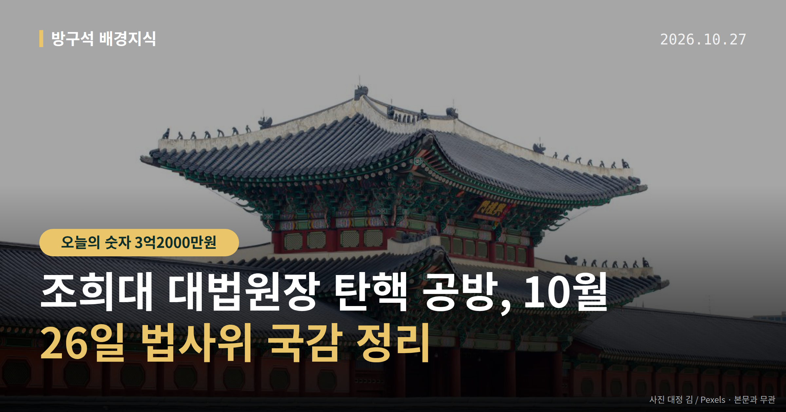
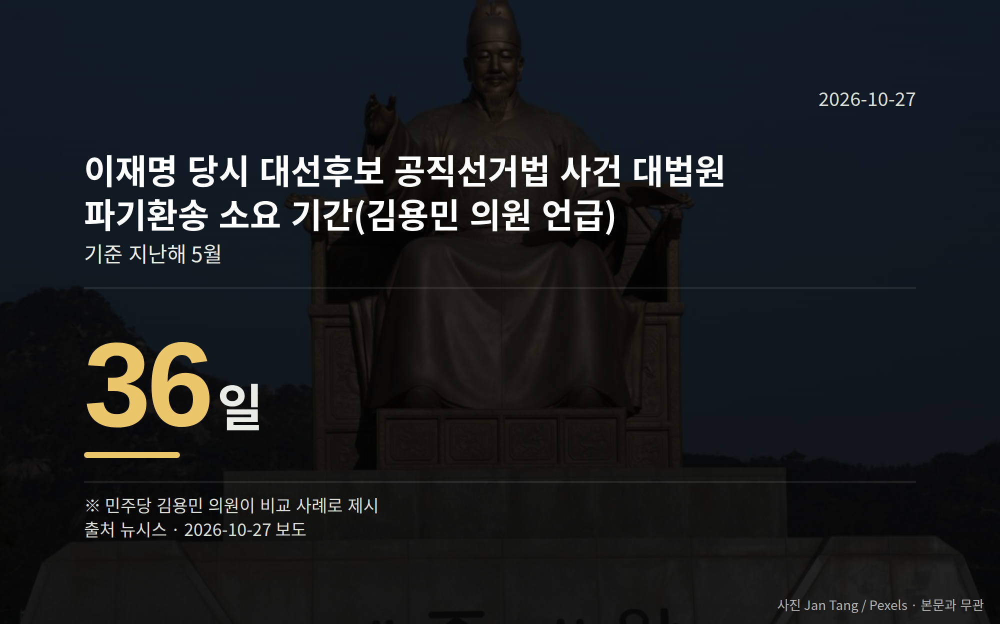

*이 글은 2026년 10월 27일 기준으로 정리한 내용입니다.*
**3줄 요약**

- 법사위 국감서 조희대 대법원장 탄핵 주장과 반박이 맞섰습니다
- 오세훈 사건 내년 2월 확정 시 4월 7일 보궐선거 가능 발언이 나왔습니다
- 27일 민주당 의원총회의 특검법·국정조사 논의 결과를 보면 됩니다
여러분, 10월 26일 국회 법제사법위원회 종합국정감사에서 조희대 대법원장 탄핵 주장이 다시 나왔습니다. 오세훈 서울시장의 항소심 무죄 판결이 계기였고, 국민의힘은 이를 사법부 공격이라고 반박했습니다. 아직 탄핵소추가 발의된 단계는 아닙니다.

[이미지: 국회 법제사법위원회 국정감사장 전경]

## 조희대 대법원장 탄핵 주장은 어디서 나왔나

이날 법사위 종합국정감사에서는 오세훈 서울시장의 '명태균 여론조사비 대납' 의혹 항소심 무죄 판결을 두고 여야 공방이 벌어졌습니다.

더불어민주당 김의겸·김용민·김한규·이성윤 의원 등은 조희대 대법원장 탄핵이 필요하다고 주장했습니다. 동아일보는 친정청계와 조국혁신당에 이어 친명계로 분류되는 송영길 의원도 탄핵 촉구에 가세했다고 보도했습니다.

국민의힘 곽규택·윤상현 의원 등은 여당의 사법부 공격이 도를 넘었다며, 이재명 대통령의 공직선거법 사건 재판부터 재개해야 한다고 반박했습니다. 조희대 대법원장과 대법원 측이 이 주장들에 대해 내놓은 입장은 자료에서 확인되지 않았고, 오세훈 시장 측의 직접 해명도 확인되지 않았습니다.

여기서 탄핵소추는 국회가 고위공직자를 파면해 달라고 헌법재판소에 청구하는 절차를 말합니다. 의원 개인의 탄핵 주장과 실제 소추안 발의·의결은 서로 다른 단계입니다.

## 숫자로 본 두 가지 쟁점

국감에서 의원들이 제시한 수치는 다음과 같습니다. 두 숫자 모두 의원 발언으로 나온 주장이라는 점을 함께 봐 주시면 좋겠습니다.

| 항목 | 수치 | 발언 주체 |
|---|---|---|
| 오 시장 사건 확정 시한과 보궐선거 | 내년 2월까지 확정 시 4월 7일 보궐선거 가능 | 민주당 김한규 의원 |
| 이재명 당시 대선후보 공직선거법 사건 대법원 파기환송 소요 기간 | 36일 (지난해 5월) | 민주당 김용민 의원 |

앞의 시한은 선거 일정과 맞물린 전제 조건으로 언급된 것이고, 뒤의 기간은 처리 속도를 비교하는 사례로 제시됐습니다.

## 조희대 대법원장 탄핵, 다음에 볼 절차는

동아일보는 민주당 지도부가 '선(先) 국정조사'를 내세우고 있다고 보도했습니다. 탄핵 주장이 곧바로 소추로 가는 대신, 국정조사를 먼저 두는 흐름입니다.

뉴시스는 민주당이 '조작기소 특검법'과 조희대 대법원장 국정조사를 10월 27일 의원총회에서 논의할 예정이라고 보도했습니다. 다만 특검법과 국정조사의 구체적 내용은 공개된 자료에서 확인되지 않았습니다.

[이미지: 국회 본청 앞 의원총회 취재 현장]

## 그 밖의 오늘 소식

- 대법원, 27일 오후 2시 30분 김건희 여사 구속영장 심문
- 심문 대상은 알선수재 혐의 사건, 결론은 늦어도 28일 전망
- 행안위, 중수청장 국무회의 배석과 한강버스 의혹 공방

**그래서 나는?**

- 서울 유권자라면, 내년 4월 보궐선거 성립 여부 일정을 확인해 두세요
- 뉴스를 따라가는 분이라면, 탄핵 주장과 실제 탄핵소추 발의는 다른 단계입니다
- 국감을 보시는 분이라면, 27일 외통·복지·기후위 국감 일정도 함께 보세요

**직접 센 숫자 — 국회·여론조사 (최근 7일)**

국회의원 발의 법률안 **154건**. 최근 발의: 조세특례제한법 일부개정법률안(안도걸의원 등 12인)

본회의 처리 법률안 **2건** — 철회 2건

이번 주 등록된 선거 여론조사 10건

- 전국 정기(정례)조사 정당지지도 — (주)여론조사꽃 · 2026-10-23~24 · 1,011명 · 무선 ARS · 응답률 1.9% · 95% 신뢰수준에 ±3.1%p
- 전국 정기(정례)조사 정당지지도 — (주)여론조사꽃 · 2026-10-23~24 · 1,003명 · 무선전화면접 · 응답률 9.5% · 95% 신뢰수준에 ±3.1%p
- 강원특별자치도 강릉시 국회의원선거정당지지도 — (주)리얼미터 · 강원일보 의뢰 · 2026-10-23~24 · 502명 · 무선 ARS · 응답률 6.2% · 95% 신뢰수준에 ±4.4%p

오늘 이슈에 나온 법안은 지금 어디에

- 공직선거법 — 제22대 발의 325건 · 최근 「공직선거법 일부개정법률안」(박지혜의원 등 10인, 2026-09-28) · 소관위 회부

*열린국회정보·중앙선거여론조사심의위원회 자료를 직접 셌습니다. 여론조사의 자세한 사항은 중앙선거여론조사심의위원회 홈페이지를 참조하세요.*
**여러분은 이런 공방 소식을 들을 때, 주장과 확정된 사실을 어떻게 구분해서 보고 계신가요?**

---

### 참고한 기사

1. **오세훈 무죄에 "조희대 탄핵"…김현지 PPT 나오자 법사위 파행**
   - [한국경제·정치](https://www.hankyung.com/article/2026102663317)
   - [뉴시스·정치](https://www.newsis.com/view/NISX20261026_0003841788)
2. **(27일·화)**
   - [연합뉴스·정치](https://www.yna.co.kr/view/AKR20261026169900001)
   - [뉴스핌](https://news.google.com/rss/articles/CBMiXEFVX3lxTE15dEFWaEdQY1BEbWVUd0xnRkRISkVhYmU2VVA4VWpIdWx3Qkhhemp4dzY4TE10T0dfQVVwMFhFMzdHSGtCZ2JJcUpFVFBmVEZrbkhZemNMOTNwNl9S?oc=5)
3. **與, 조작기소 특검법·조희대 국정조사 추진…오늘 의총서 논의**
   - [뉴시스·정치](https://www.newsis.com/view/NISX20261026_0003841556)
4. **與강경파 “조희대 탄핵이 답” 국힘 “제정신이냐”… ‘吳무죄’ 충돌**
   - [동아일보·정치](https://www.donga.com/news/Politics/article/all/20261027/134913240/2)
5. **중수청장 국무회의 배석 공방…국힘 "부적절"·與 "긍정 기능도"(종합)**
   - [연합뉴스·정치](https://www.yna.co.kr/view/AKR20261026119451001)
   - [뉴시스·정치](https://www.newsis.com/view/NISX20261026_0003841714)

---

*본 글은 공개된 언론 보도를 정리한 것이며, 특정 정당·후보·인물을 지지하거나 반대하지 않습니다. 인용한 여론조사의 자세한 사항은 중앙선거여론조사심의위원회 홈페이지를 참조하세요.*
