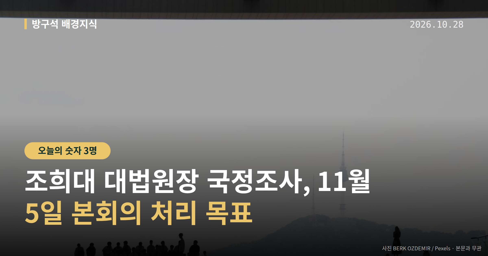
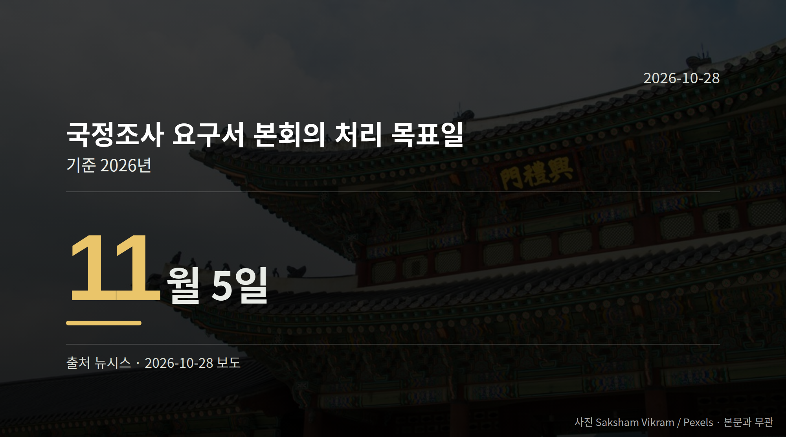

*이 글은 2026년 10월 28일 기준으로 정리한 내용입니다.*
**3줄 요약**

- 민주당 의총, 조희대 대법원장 국정조사 실시 결정
- 요구서 본회의 처리 목표일은 11월 5일
- 국정조사특위 구성 협의는 아직 시작 전 단계
더불어민주당이 10월 27일 의원총회에서 조희대 대법원장 국정조사를 실시하기로 결정했습니다. 처리 목표일은 11월 5일 본회의입니다.

국민의힘은 "모든 수단을 총동원해 저지하겠다"고 밝혔습니다. 당장 다음 분기점은 11월 5일 본회의입니다.

## 조희대 대법원장 국정조사, 무엇이 거론됐나

국정조사는 국회가 특정 사안을 정해 자료를 받고 증인을 불러 따져 보는 절차입니다. 민주당은 10월 27일 의원총회에서 이 절차를 밟기로 의견을 모았습니다.

거론된 대상은 '대법관 후보자 재제청 거부'와 '업무추진비 부당 집행' 의혹 등입니다. 모두 의혹 제기 단계이며, 조희대 대법원장 본인의 해명은 확인되지 않았습니다.

동아일보 보도에 따르면 계엄 당시 회의도 조사 대상으로 거론됐고, 대법원장 휴대전화 교체 내역 조회를 둘러싼 논란도 제기됐습니다. 다만 세부 경위는 확인되지 않았습니다.

[이미지: 국회 본회의장 전경 사진]

## 여야는 각각 무엇을 말했나

| 발언 주체 | 발언 요지 |
| --- | --- |
| 민주당 한병도 원내대표 | "제기된 의혹을 철저히 규명하고 국민적 의구심을 해소하는 것은 국회가 마땅히 할 책무" |
| 민주당 전은수 원내대변인 | 요구서를 11월 5일 본회의에서 처리하는 것이 목표 |
| 국민의힘 장동혁 대표 | "국정조사는 탄핵으로 가기 위한 전 단계" |
| 국민의힘 정점식 원내대표 | "이 국정조사야말로 이재명 대통령과 민주당의 탄핵 사유" |

정점식 원내대표는 이 국정조사가 "위헌"이며 "사법부를 노예화하려는 시도"라고 주장했습니다. 또 조 대법원장이 오세훈 서울시장에게 무죄를 선고한 적이 없다고 반문하며 관련 재판 재개를 촉구했습니다.

한편 조국혁신당 등 범여권 일각의 탄핵 주장에 대해 한병도 원내대표는 "우리는 우리 판단을 할 것"이라고 선을 그었습니다. 국민의힘 측 "탄핵 사유" 주장에 대한 민주당의 직접 반박은 자료에 담겨 있지 않습니다.

## 11월 5일 본회의, 조희대 대법원장 국정조사는 어떻게 되나

국민의힘은 "국정조사 계획안(요구서)은 필리버스터가 불가능하다"며 의원총회를 열어 원내 대응 방안을 논의할 계획이라고 밝혔습니다. 필리버스터는 표결을 늦추기 위해 발언을 길게 이어 가는 무제한 토론을 뜻합니다.

국정조사특위 구성 같은 세부 절차는 아직 여야 협의가 시작되지 않았습니다. 요구서가 본회의에서 어떻게 처리되는지, 예고된 저지가 어떤 형태로 나타나는지가 다음 확인 지점입니다.

[이미지: 여야 원내대표단 기자회견 모습 사진]

## 그 밖의 오늘 소식

- 행안부, 시·도 행정부시장·부지사 3명 인사 발표
- 부산 김성기·대구 심영재·충북 김중열 임명
- 행안부 국장급 4명 전보 발령(인사기획관 등)

**그래서 나는?**

- 국회 일정 챙기는 유권자라면, 11월 5일 본회의 안건을 확인해 보세요
- 재판 일정에 걸린 분이라면, 사법부 관련 논의 흐름을 지켜볼 만합니다
- 부산·대구 거주자라면, 행정부시장 교체로 행정 담당자가 달라집니다

**직접 센 숫자 — 국회·여론조사 (최근 7일)**

국회의원 발의 법률안 **177건**. 최근 발의: 장애인학대방지 및 피해장애인 권리구제 등에 관한 법률안(서미화의원 등 16인)

본회의 처리 법률안 **1건** — 철회 1건

이번 주 등록된 선거 여론조사 9건

- 전국 전체 정당지지도정기(정례)조사대통령선거 — 한길리서치 · KNA25/폴리뉴스 의뢰 · 2026-10-25~26 · 1,002명 · 무선 ARS · 응답률 2.4% · 95% 신뢰수준에 ±3.1%p
- 전국 정기(정례)조사 정당지지도 — (주)여론조사꽃 · 2026-10-23~24 · 1,011명 · 무선 ARS · 응답률 1.9% · 95% 신뢰수준에 ±3.1%p
- 전국 정기(정례)조사 정당지지도 — (주)여론조사꽃 · 2026-10-23~24 · 1,003명 · 무선전화면접 · 응답률 9.5% · 95% 신뢰수준에 ±3.1%p

*열린국회정보·중앙선거여론조사심의위원회 자료를 직접 셌습니다. 여론조사의 자세한 사항은 중앙선거여론조사심의위원회 홈페이지를 참조하세요.*
**여러분은 국회가 사법부를 상대로 조사에 나설 때, 어디까지가 적정한 범위라고 보시나요?**

---

### 참고한 기사

1. **행정안전부(10월28일 수요일)**
   - [뉴시스·정치](https://www.newsis.com/view/NISX20261027_0003843624)
   - [뉴스핌](https://news.google.com/rss/articles/CBMiXEFVX3lxTE5ETEpfbkpub192dTVQRW5RTzFVTnExbEhNWldYMFVyczFGaXdzNTl0U2NNVDNpQ3JvX0F3cXNhNzRPOEIyLXBOODdpeHE3YnNDWDZUZV9jNW5mY0E5?oc=5)
2. **국힘, 與 '조희대 국정조사' 추진에 "李대통령 탄핵 사유…총력 저지"(종합)**
   - [뉴시스·정치](https://www.newsis.com/view/NISX20261027_0003843651)
   - [연합뉴스·정치](https://www.yna.co.kr/view/AKR20261027155551001)
3. **조희대 대법원장 국정조사, 민주당 11월 5일 본회의 보고 목표… 헌정사 이례적 사례라고? 🔍**
   - [뉴닉](https://news.google.com/rss/articles/CBMiU0FVX3lxTE45SkN2c0VZRDdQYWVEWXhuSGw2bVR6RktkSDhEcUI1Zkg0NldUQ1hYMHVzZGR1MDhtM3FPWmpQSkdCOEhtaFkxU041N1NOREV3Wjdz?oc=5)
   - [이슈밸리](https://news.google.com/rss/articles/CBMibkFVX3lxTE1XZGhiTWk5eGxFM21PRjRaZVZoOC0tZmdjSzExRW1BazVNQUhncW9GQmZ6MUdpbXRkMnlqZDVrXzlFQVJfVF9fMGM3MVpaZ2pXSFJiQWNOM1VJLTJ3ZUprT0VROWJ2TDNEZ1N2eXJR?oc=5)
4. **與 “조희대 국조 실시… 내달 5일 본회의 상정”**
   - [동아일보·정치](https://www.donga.com/news/Politics/article/all/20261028/134921352/2)
   - [월요신문](https://news.google.com/rss/articles/CBMiakFVX3lxTE93SnlDUjRWM28xNjdXaUFaWE8zMmhpazl1QVQ0eWxVSDBFY05vVVNQX1VWcE9nN01EVFJITHZ2MW9ZS1l5YzNaYnd0TkNOVGFHcy1BQjc1Vm9kX0RWbmdlRTZhU3M3bHBCQ1E?oc=5)
5. **與, 초유의 '대법원장 국정조사' 실시 결정…野 "사법부 탄압에 범국민적 저항"**
   - [뉴시스·정치](https://www.newsis.com/view/NISX20261027_0003843492)
   - [한국경제·정치](https://www.hankyung.com/article/202610278389H)

---

*본 글은 공개된 언론 보도를 정리한 것이며, 특정 정당·후보·인물을 지지하거나 반대하지 않습니다. 인용한 여론조사의 자세한 사항은 중앙선거여론조사심의위원회 홈페이지를 참조하세요.*
