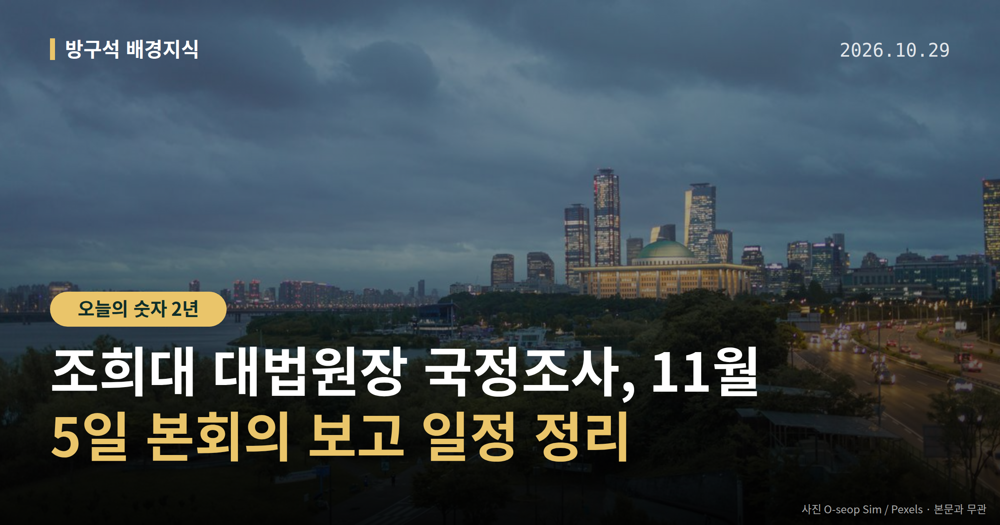
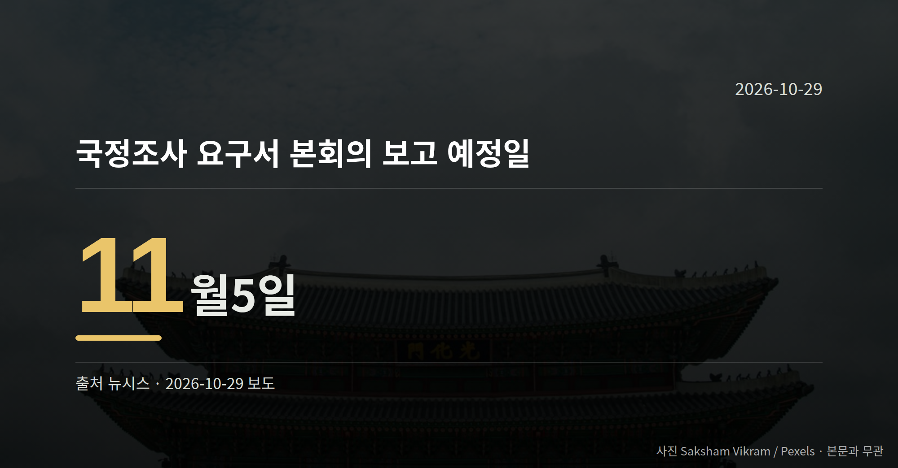

*이 글은 2026년 10월 29일 기준으로 정리한 내용입니다.*
**3줄 요약**

- 민주당, 조희대 대법원장 국정조사 요구서를 본회의에 보고 추진
- 11월 5일 보고 뒤 1~2주 내 조사계획서 처리가 목표
- 국민의힘은 필리버스터·장외투쟁 가능성 거론, 다음 주 법사위도 변수
더불어민주당이 조희대 대법원장 국정조사 요구서를 11월 5일 국회 본회의에 보고하겠다는 일정을 내놨습니다. 국민의힘은 정치적 보복이라며 필리버스터와 장외투쟁 가능성을 언급했습니다.

같은 시기 법제사법위원회에는 조작기소 특검법 상정도 예고돼 있어, 11월 초 국회 일정이 한꺼번에 맞물리게 됐습니다.

## 조희대 대법원장 국정조사, 지금까지 나온 일정은

민주당은 11월 5일 본회의에 요구서를 보고한 뒤, 1~2주 이내에 조사계획서까지 처리한다는 구상을 세웠다고 전해졌습니다. 실제 조사 착수 목표는 이르면 11월 말이나 12월 초입니다.

| 항목 | 내용 |
| --- | --- |
| 요구서 본회의 보고 | 11월 5일 예정 |
| 조사계획서 처리 | 보고 뒤 1~2주 이내 목표 |
| 조사 착수 목표 | 이르면 11월 말~12월 초 |

민주당은 오세훈 서울시장이 정치자금법 위반 사건 항소심에서 무죄를 선고받자 반발하며 조 대법원장 탄핵을 거론했지만, 우선 국정조사로 사실관계를 확인한 뒤 탄핵 여부를 정하겠다는 방침입니다.

조사 대상으로는 대법관 후보자 재제청 거부 경위, 대법관 격려금 지급과 업무추진비 집행 의혹 등이 검토되고 있습니다. 이재명 대통령 선거법 사건 파기환송 경위도 포함될 가능성이 거론됩니다.

## 여야는 각각 어떻게 말하고 있나

국민의힘 정점식 원내대표는 "민주당은 TV 생중계를 통해 국민들이 보는 앞에서 조 대법원장에게 온갖 모욕과 망신을 주려 할 것"이라며 "이 야만적인 폭력에 단호히 맞서 싸우겠다"고 말했습니다.

같은 당 최수진 원내수석대변인은 "실상은 이 대통령의 선거법 재판을 파기환송했던 사법부를 향한 정치적 보복"이라고 주장하며, 장외투쟁에 대해서는 "이야기가 나온 바는 없지만 필요하면 할 수 있다"고 말했습니다.

[이미지: 국회 본회의장 전경 사진]

민주당 측은 탄핵보다 국정조사로 사실관계를 먼저 확인하겠다는 입장을 밝힌 상태입니다. 다만 국민의힘이 "일종의 스토킹 폭력"이라고 비판한 조 대법원장 휴대전화 최근 2년치 교체 내역 조회에 대해서는, 조회 경위와 목적에 관한 민주당 측 설명이 아직 확인되지 않았습니다.

## 절차상 다음은 무엇인가

국정조사 요구서는 별도 표결 없이 본회의에 보고되는 절차입니다. 그래서 보고 자체를 막을 표결 수단은 마땅치 않다고 보도됐습니다.

국민의힘이 거론한 필리버스터는 법안 처리를 늦추기 위해 의원들이 시간제한 없이 발언을 이어가는 무제한 토론을 말합니다. 조희대 대법원장 국정조사 절차에서 실제로 쓰일지는 아직 정해지지 않았습니다.

정리하면 11월 5일 보고가 이뤄지는지, 이어 조사계획서가 1~2주 안에 처리되는지가 조희대 대법원장 국정조사의 다음 관찰 지점입니다.

[이미지: 광화문 북광장에서 열리는 추모 기억식 현장 사진]

## 그 밖의 오늘 소식

- 서영교 법사위원장, 조작기소 특검법 다음 주 상정 예고
- 민주당, 특검의 공소취소 권한 조항은 삭제하기로
- 10월 29일 이태원참사 4주기 기억식·국가정보원 국정감사

**그래서 나는?**

- 뉴스를 따라가는 유권자라면, 11월 5일 본회의 보고 여부부터 확인해 보세요
- 국회 일정이 궁금하다면, 다음 주 법사위 상정 여부가 다음 관찰 지점입니다
- 추모 일정을 찾는 분이라면, 10월 29일 광화문 북광장 기억식 시간을 확인해 보세요

**직접 센 숫자 — 국회·여론조사 (최근 7일)**

국회의원 발의 법률안 **214건**. 최근 발의: 조세특례제한법 일부개정법률안(윤후덕의원 등 10인)

본회의 처리 법률안 **2건** — 철회 2건

이번 주 등록된 선거 여론조사 9건

- 전국 정기(정례)조사 대통령선거 정당지지도 국정현안 등 — (주)코리아정보리서치 · 천지일보 의뢰 · 2026-10-26~27 · 1,001명 · 무선 ARS · 응답률 3.7% · 95% 신뢰수준에 ±3.1%p
- 전국 정기(정례)조사 정당지지도 — 케이에스오아이 주식회사(한국사회여론연구소) · 2026-10-26~27 · 1,000명 · 무선 ARS · 응답률 5.7% · 95% 신뢰수준에 ±3.1%p
- 전국 전체 정당지지도정기(정례)조사대통령선거 — 한길리서치 · KNA25/폴리뉴스 의뢰 · 2026-10-25~26 · 1,002명 · 무선 ARS · 응답률 2.4% · 95% 신뢰수준에 ±3.1%p

오늘 이슈에 나온 법안은 지금 어디에

- 정치자금법 — 제22대 발의 46건 · 최근 「정치자금법 일부개정법률안」(임문영의원 등 13인, 2026-10-27) · 소관위 회부
- 선거법 — 제22대 발의 327건 · 최근 「공직선거법 일부개정법률안」(강대식의원 등 10인, 2026-10-28) · 발의(계류)

*열린국회정보·중앙선거여론조사심의위원회 자료를 직접 셌습니다. 여론조사의 자세한 사항은 중앙선거여론조사심의위원회 홈페이지를 참조하세요.*
**여러분은 이번처럼 국회와 사법부가 부딪힐 때, 어떤 정보를 먼저 찾아보시나요?**

---

### 참고한 기사

1. **행정안전부(10월29일 목요일)**
   - [뉴시스·정치](https://www.newsis.com/view/NISX20261028_0003845463)
   - [뉴스핌](https://news.google.com/rss/articles/CBMiXEFVX3lxTE5IZUZSZktzcG1TTE8yU04tNEI1Ui11c3lvZlo0YVN0OGV2ci1MU1psMXNLQUI5bXBYRzYwWDhBTi0waUVXYldRejFHaGhMV2hFTWZ2UlR1MG9KOWtj?oc=5)
2. **與 ‘조희대 국조’ 이어 조작기소 특검 재시동… 野 “공소취소 빌드업”**
   - [동아일보·정치](https://www.donga.com/news/Politics/article/all/20261029/134928769/2)
   - [조선일보·정치](https://www.chosun.com/politics/politics_general/2026/10/29/XWQL7SZ5QJAJFLNO3M4GZHFJRY)
3. **서영교 “조작기소 특검법, 다음 주 법사위 상정”**
   - [문화일보](https://news.google.com/rss/articles/CBMiUEFVX3lxTE1XS3JFZUJlMEtId2ZhelphRUpMT29yaWxRTGFhWjRPcjNzaTZTTnBuNDNnNmdHNjI4WlY1RGVXWmNOY2M5OGhyYlFKdlpfaHM2?oc=5)
   - [천지일보](https://news.google.com/rss/articles/CBMiakFVX3lxTE1PVG9rV1hUQWRwMTlobm5rM3piM25QR1lOOEV5RnhnMml2djI2N1ZtSTltVnBzS2dqX1cyVU9tOWRJdHNFbXN6blpFOGNYUFR6WGppRUFyM0pjMXJ0WVRpRmpxemtSN2RvQnc?oc=5)
4. **'조희대 국조' 與野 전운 고조…국힘, 장외투쟁 나서나**
   - [뉴시스·정치](https://www.newsis.com/view/NISX20261028_0003845374)
5. **국힘 "與 조희대 휴대전화 교체내역 조회, 스토킹 폭력…국조에 강경 대처"**
   - [뉴시스·정치](https://www.newsis.com/view/NISX20261028_0003845080)

---

*본 글은 공개된 언론 보도를 정리한 것이며, 특정 정당·후보·인물을 지지하거나 반대하지 않습니다. 인용한 여론조사의 자세한 사항은 중앙선거여론조사심의위원회 홈페이지를 참조하세요.*
