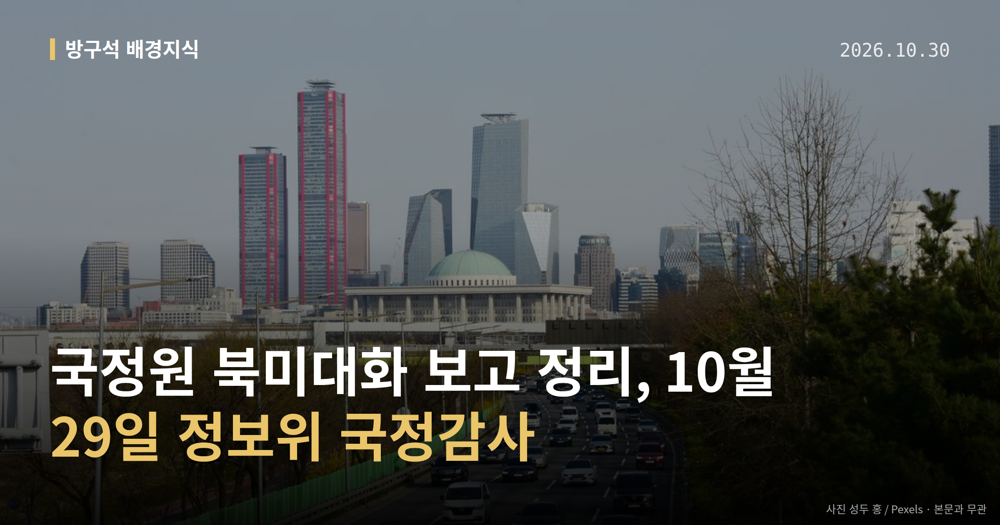
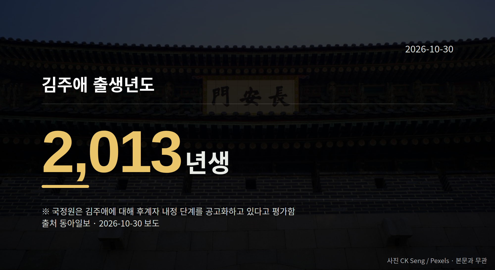

*이 글은 2026년 10월 30일 기준으로 정리한 내용입니다.*
**3줄 요약**

- 국정원, 북미가 대화 조건 입장차로 접점 못 찾았다고 보고
- 김정은 10월 24일 단둥 방문·김주애(2013년생) 후계 평가 언급
- APEC 전후 국면전환 여부가 다음 확인 지점입니다
10월 29일 국회 정보위원회 국정감사에서 국정원 북미대화 보고가 나왔습니다. 국정원은 북한과 미국이 대화 조건을 두고 입장차를 좁히지 못했다고 밝혔습니다. 다만 APEC 정상회의 전후 국면전환 가능성에는 대비하고 있다고 보고했습니다.

[이미지: 국회 상임위원회 회의실에서 국정감사가 진행되는 모습]

## 국정원 북미대화 보고, 무슨 내용이었나

정보위원회는 국정원 등 정보기관을 담당하는 국회 상임위원회입니다. 이 자리에서 국정원은 북미가 "아직 접점을 찾지 못했다"고 설명했습니다.

김정은 북한 국무위원장의 중국 단둥 방문도 보고됐습니다. 10월 24일 신압록강대교를 경유한 일정입니다.

국정원은 항미원조 기념 외에, 북미 대화에 관한 북한의 의중을 중국 지도부에 전달했을 가능성이 있다고 분석했습니다.

근거로는 수행단 구성이 꼽혔습니다. 군부 인사 대신 최선희 외무상 등 외교 간부가 주축이었고, 중국 측도 왕이 외교부장 등 외교 인사가 주로 참석했다는 점입니다.

[이미지: 중국과 북한을 잇는 압록강 다리 풍경]

## 국정원 북미대화 보고는 확정된 전망이 아닙니다

국정원은 중국이 북한의 입장을 미국에 전달할 수는 있어도, 적극적인 중재에는 나서지 않을 것으로 내다봤습니다. 전해진 내용에 대해서는 "낙관적으로는 보지 않는다"고 밝혔습니다.

즉 이번 국정원 북미대화 보고는 분석·추정 단계의 설명입니다. 확정된 결론으로 읽기는 어렵다는 점을 국정원 스스로 짚은 셈입니다.

## 김주애 관련 평가와 영접 인사 교체

국정원은 김 위원장의 딸 김주애(2013년생)에 대해 후계자 내정 단계를 더욱 공고화하고 있다고 평가했습니다.

또 이번 방중에서 영접 인사가 리창 국무원 총리에서 왕후닝 정협 주석으로 교체된 사실도 보고했습니다. 이 평가 역시 국정원의 분석이며, 북한이 공식 확인한 사안은 아닙니다.

## 그 밖의 오늘 소식

- 국민의힘 김미애 의원, 측근 인사 개입 여부 확인 요구
- 레버리지 ETF 녹취록 재생 요구에 민주당 김한규 의원 반박
- 조희대 대법원장 국정조사 두고 여야 충돌 보도

운영위 쟁점과 관련해 의혹 당사자 측의 구체적 해명은 이날 수집된 자료에서 확인되지 않았습니다. 조희대 대법원장 국정조사 관련 기사도 본문 내용이 제한적이어서, 발언의 구체적 맥락은 추가 보도를 봐야 알 수 있습니다.

**그래서 나는?**

- 뉴스로 정세를 보는 분이라면, 이번 보고는 '분석'임을 기억해 두세요
- 국정감사 일정을 챙기는 분이라면, 운영위 추가 감사 일정을 확인해 보세요
- 투자 뉴스를 보는 분이라면, 레버리지 ETF 논의 경과를 지켜보시면 됩니다

**직접 센 숫자 — 국회·여론조사 (최근 7일)**

국회의원 발의 법률안 **279건**. 최근 발의: 디지털자산시장과 디지털자산업 등에 관한 법률안(정태호의원 등 10인)

본회의 처리 법률안 **2건** — 철회 2건

이번 주 등록된 선거 여론조사 8건

- 전국 전체 정기(정례)조사정당지지도 — 케이스탯리서치 · (주)엠브레인퍼블릭, 케이스탯리서치, (주)코리아리서치인터내서널, (주)한국리서치 의뢰 · 2026-10-26~28 · 1,000명 · 무선전화면접 · 응답률 14.7% · 95% 신뢰수준에 ±3.1%p
- 전국 정기(정례)조사 대통령선거 정당지지도 국정현안 등 — (주)코리아정보리서치 · 천지일보 의뢰 · 2026-10-26~27 · 1,001명 · 무선 ARS · 응답률 3.7% · 95% 신뢰수준에 ±3.1%p
- 전국 정기(정례)조사 정당지지도 — 케이에스오아이 주식회사(한국사회여론연구소) · 2026-10-26~27 · 1,000명 · 무선 ARS · 응답률 5.7% · 95% 신뢰수준에 ±3.1%p

*열린국회정보·중앙선거여론조사심의위원회 자료를 직접 셌습니다. 여론조사의 자세한 사항은 중앙선거여론조사심의위원회 홈페이지를 참조하세요.*
**여러분은 이런 정보기관 보고를 들을 때, 어디까지가 사실이고 어디부터가 추정이라고 느끼시나요?**

---

### 참고한 기사

1. **'조희대 국조' 충돌…與 "조희대 행보, 불법의 연속" 野 "장외투쟁 등 모든 수단 강구"**
   - [뉴시스·정치](https://www.newsis.com/view/NISX20261029_0003847281)
2. **국정원 "APEC 전후 북미 국면전환 가능성…김주애 후계 내정 공고화"(종합)**
   - [뉴시스·정치](https://www.newsis.com/view/NISX20261029_0003847118)
   - [연합뉴스·정치](https://www.yna.co.kr/view/AKR20261029143100001)
3. **“김정은, 방중때 北美대화 의중 전달 추정”**
   - [동아일보·정치](https://www.donga.com/news/Politics/article/all/20261030/134936483/2)
   - [경향신문·정치](https://www.khan.co.kr/article/202610292135005)
4. **여야, 운영위서 '김현지 인사 개입 의혹' '李 차남 관저' '황제 골프 의혹' 등 공방(종합)**
   - [뉴시스·정치](https://www.newsis.com/view/NISX20261029_0003847435)
5. **행정안전부(10월30일 금요일)**
   - [뉴시스·정치](https://www.newsis.com/view/NISX20261029_0003847363)
   - [뉴스핌](https://news.google.com/rss/articles/CBMiXEFVX3lxTE1LQ29LSTVCQVJUTEV1OTRTUjVKYjhzVmd6b1phUXVWSy1RbU5FOWd6YlhVS3pPTkNnQ3V5b0MtWWgzdVJJWEVoeEdIZnIwYVJScWg4MkJjS0lET0Vv?oc=5)

---

*본 글은 공개된 언론 보도를 정리한 것이며, 특정 정당·후보·인물을 지지하거나 반대하지 않습니다. 인용한 여론조사의 자세한 사항은 중앙선거여론조사심의위원회 홈페이지를 참조하세요.*
