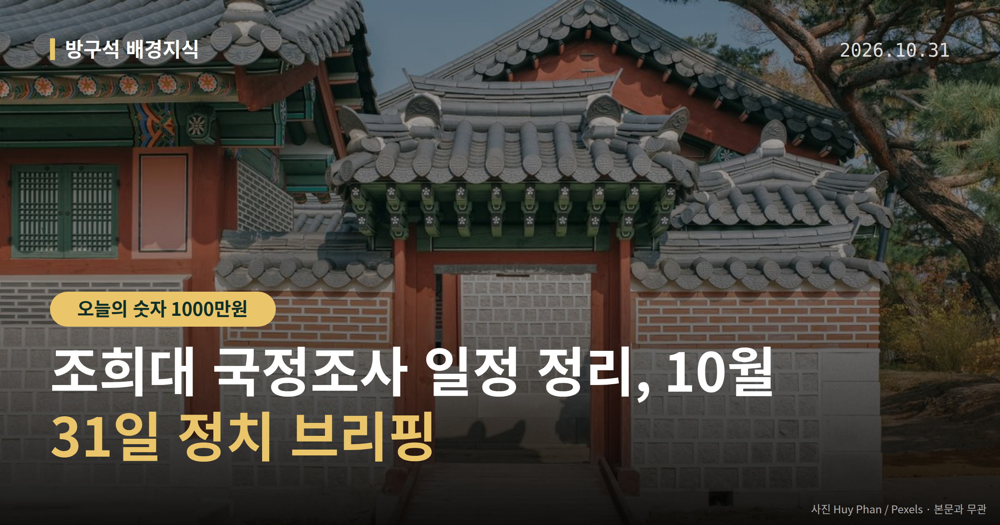
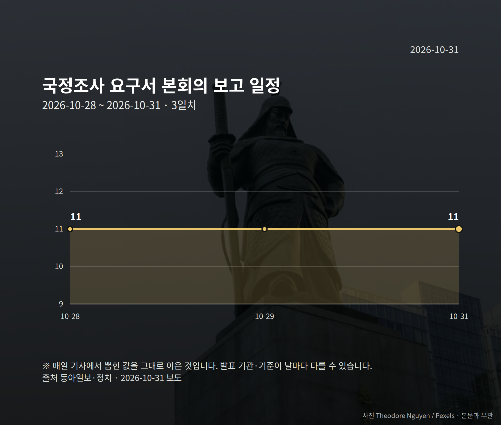

*이 글은 2026년 10월 31일 기준으로 정리한 내용입니다.*
**3줄 요약**

- 민주당, 조희대 대법원장 국정조사 요구서 본회의 보고 방침
- 요구서 보고는 11월 5일, 계획서 처리는 11월 12일 또는 19일
- 국민의힘은 특검 불기소·각하를 들어 반발, 11월 본회의가 분기점
민주당이 조희대 국정조사 요구서를 11월 5일 국회 본회의에 보고하겠다고 밝혔습니다. 국민의힘은 이미 특검 두 곳에서 처분이 끝난 사안이라며 반발했습니다.

오늘 결론이 나는 사안은 아닙니다. 11월 본회의 일정이 분기점입니다.

[이미지: 국회 본회의장 전경]

## 조희대 국정조사, 절차는 어디까지 왔나

국정조사(국회가 특정 사안을 정해 직접 조사하는 절차)는 요구서 보고 뒤 계획서를 의결해야 실제로 시작됩니다.

민주당은 요구서를 11월 5일 본회의에 보고하고, 이르면 11월 12일 또는 19일 본회의에서 계획서를 처리한다는 방침입니다.

| 단계 | 예정 시점 |
| --- | --- |
| 국정조사 요구서 본회의 보고 | 11월 5일 |
| 국정조사계획서 처리 | 11월 12일 또는 19일 |

두 일정 모두 민주당이 밝힌 방침이며, 실제 처리 여부는 확정되지 않았습니다.

## 여야 주장은 이렇게 갈립니다

민주당 박성준 수석대변인은 10월 30일 조 대법원장의 2024년 12월 3일 내란 당시 행위에 초점을 맞추겠다고 밝혔습니다. 민주당은 '5대 의혹' 규명을 공언했는데, 구체적 항목은 자료에서 확인되지 않습니다.

국민의힘 정점식 원내대표는 같은 날 해당 의혹에 대해 조은석 내란특검이 불기소, 권창영 2차 특검이 각하 처분을 내렸다고 밝혔습니다. 그러면서 국정조사가 치졸한 보복이자 국회 권한 남용이라고 주장했습니다.

다만 불기소·각하의 세부 사유는 자료에서 추가로 확인되지 않습니다. 국민의힘은 장외 투쟁 등 강경 대응을 예고했고, 조희대 대법원장 본인의 입장은 확인되지 않았습니다.

## 조희대 국정조사, 왜 11월을 봐야 하나

성사되면 헌정사상 첫 대법원장 국정조사가 됩니다. 그 여부가 앞서 본 두 차례 본회의 일정에 걸려 있습니다.

시기도 예산 정국과 겹칩니다. 처리 여부에 따라 여야 대치가 더 격화될 수 있는 변수로 남아 있다는 것이 정치권의 대체적 시각입니다.

[이미지: 법원 청사 외관]

## 그 밖의 오늘 소식

- 김건희 특검팀, 오세훈 시장 2심 무죄에 대법원 상고
- 특검팀, 1000만원 입금을 여론조사비 대납이라고 주장
- 장동혁 대표, 박정희 전 대통령 생가 참배 뒤 당원 중심 정당 강조

**그래서 나는?**

- 국회 일정을 챙기는 분이라면, 11월 5일 본회의 보고부터 확인해 보세요
- 서울시민이라면, 오세훈 시장 사건이 대법원 단계로 넘어간 점을 알아두세요
- 이번 선거 유권자라면, 여야 대치 강도가 예산 일정과 겹칠 수 있습니다

**직접 센 숫자 — 국회·여론조사 (최근 7일)**

국회의원 발의 법률안 **287건**. 최근 발의: 인공지능 데이터센터 산업 진흥에 관한 특별법 일부개정법률안(한정애의원 등 11인)

본회의 처리 법률안 **1건** — 철회 1건

이번 주 등록된 선거 여론조사 9건

- 전국 정기(정례)조사 정당지지도 — 한국갤럽조사연구소 · 한국갤럽 자체 조사 의뢰 · 2026-10-27~29 · 1,000명 · 무선전화면접 · 응답률 10.4% · 95% 신뢰수준에 ±3.1%p
- 전국 정기(정례)조사 국회의원선거 대통령선거 — 리서치웰 · 뉴데일리 의뢰 · 2026-10-28~29 · 1,000명 · 무선 ARS · 응답률 2.3% · 95% 신뢰수준에 ±3.1%p
- 전국 전체 정기(정례)조사정당지지도 — 케이스탯리서치 · (주)엠브레인퍼블릭, 케이스탯리서치, (주)코리아리서치인터내서널, (주)한국리서치 의뢰 · 2026-10-26~28 · 1,000명 · 무선전화면접 · 응답률 14.7% · 95% 신뢰수준에 ±3.1%p

오늘 이슈에 나온 법안은 지금 어디에

- 정치자금법 — 제22대 발의 46건 · 최근 「정치자금법 일부개정법률안」(임문영의원 등 13인, 2026-10-27) · 소관위 회부

*열린국회정보·중앙선거여론조사심의위원회 자료를 직접 셌습니다. 여론조사의 자세한 사항은 중앙선거여론조사심의위원회 홈페이지를 참조하세요.*
**여러분은 국회가 수사기관 처분이 끝난 사안을 다시 조사하는 절차를 어떤 기준으로 보시나요?**

---

### 참고한 기사

1. **'조희대 국조' 대치…與 "5대 의혹 조사" vs 野 "범국민적 저항"**
   - [뉴시스·정치](https://www.newsis.com/view/NISX20261030_0003848882)
2. **특검도 무혐의라 했는데…與 “조희대 내란 당시 행위에 국조 초점”**
   - [동아일보·정치](https://www.donga.com/news/Politics/article/all/20261030/134939453/1)
   - [뉴시스·정치](https://www.newsis.com/view/NISX20261030_0003848353)
3. **장동혁, 박정희 생가 참배…“당원 중심 정당 만들 것” [정치오늘]**
   - [시사오늘](https://news.google.com/rss/articles/CBMia0FVX3lxTE9PNjlwTXJsOUx1dms3R3ZuaUZPOGdaOXRLdk1FeFR5dm5CeUVRVE4zMzhYWEhwMDBneldUZnVHMVk4ajlqb2NUX19VNWdQb3JEYU5lS3FhaTM5RDlkY0RkSks1WWhoanRRSjc4?oc=5)
   - [뉴시스·정치](https://www.newsis.com/view/NISX20261030_0003848212)
4. **국회(10월 31일 토요일)**
   - [뉴스1](https://news.google.com/rss/articles/CBMiWkFVX3lxTE5ZVW1HUDJ1THZuMGJGdHNDb1JNbXdvX3JGdGE0WVYwV3lINk1vWnQ0MTRUblZpcVFUN3VpaWVxVWxrajBiR2xONUdZSVJyeGUyMzZDczBmZ041dw?oc=5)
   - [뉴시스·정치](https://www.newsis.com/view/NISX20261030_0003849091)
5. **특검, 오세훈 2심 무죄에 상고…"일반 상식 크게 어긋나"(종합)**
   - [뉴시스·정치](https://www.newsis.com/view/NISX20261030_0003848215)
   - [연합뉴스·정치](https://www.yna.co.kr/view/AKR20261030084351004)

---

*본 글은 공개된 언론 보도를 정리한 것이며, 특정 정당·후보·인물을 지지하거나 반대하지 않습니다. 인용한 여론조사의 자세한 사항은 중앙선거여론조사심의위원회 홈페이지를 참조하세요.*
