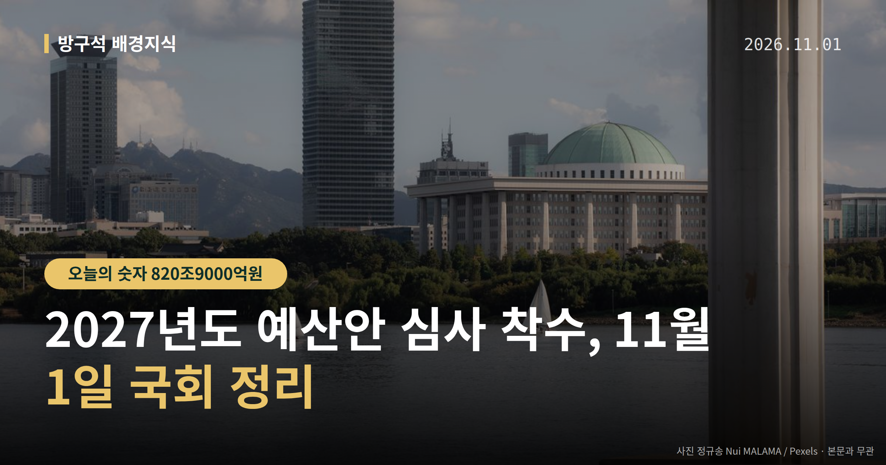
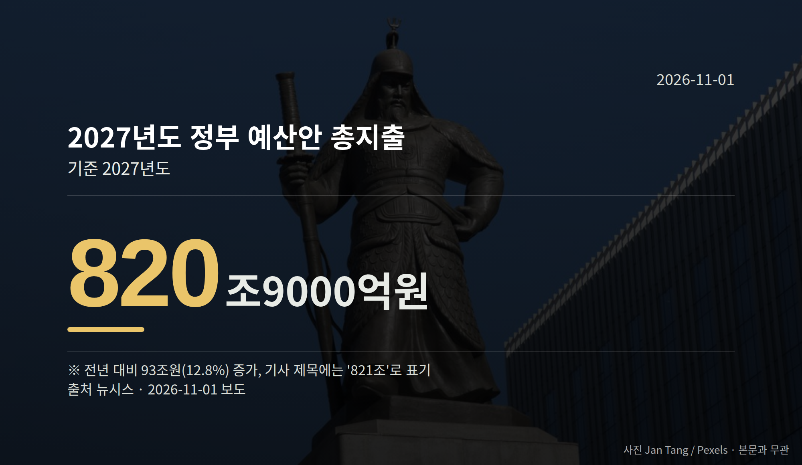

*이 글은 2026년 11월 1일 기준으로 정리한 내용입니다.*
**3줄 요약**

- 국회가 2027년도 예산안 심사에 본격 착수했습니다.
- 총지출 820조9000억원, 국민의힘은 134조원 삭감 검토 중입니다.
- 11월 2일 시정연설, 11월 5일 국정조사요구서 보고를 보세요.
여러분, 국회가 821조원 규모 2027년도 예산안 심사에 본격적으로 들어갔습니다. 11월 2일 시정연설을 시작으로 심사가 열리고, 국민의힘은 134조원 규모 삭감 방안을 검토하고 있습니다.

숫자가 큰 만큼 양쪽이 보는 지점도 갈립니다. 오늘은 이 사안 하나만 차분히 짚어 보겠습니다.

[이미지: 국회 본회의장 전경]

## 2027년도 예산안 심사, 어디까지 왔나

국회 예산결산특별위원회(예산안을 따져 보기 위해 국회가 두는 특별 위원회)는 10월 30일 공청회를 열고 심사에 착수했습니다.

정부는 다음 달 2일 오전 10시 국회 본회의에서 시정연설(정부가 예산안의 취지를 국회에 직접 설명하는 연설)을 진행할 예정입니다.

정부가 낸 내년도 총지출은 820조9000억원입니다. 올해보다 93조원, 12.8% 늘어난 규모입니다. 기사 제목에는 '821조'로 표기되기도 합니다.

## 숫자로 보는 쟁점

| 항목 | 규모 |
| --- | --- |
| 2027년도 총지출 | 820조9000억원 |
| 전년 대비 증가 | 93조원(12.8%) |
| 미래대응기금 신설 | 162조원 |
| 국민의힘 검토 삭감 | 134조원 |
| 채무 상환 활용 검토 | 104조4000억원 |

최대 쟁점은 162조원 규모 미래대응기금 신설입니다. 초과 세수가 추가로 전입되면 200조원을 넘어설 수 있다는 관측도 나옵니다.

국민의힘은 이 기금 신설에 반대하며 앞서 본 규모의 삭감 방안을 검토 중입니다. 기금 여유자금 104조4000억원을 국가채무 상환에 활용하는 방안도 함께 보고 있습니다.

청와대와 중대범죄수사청의 특수활동비(사용처를 구체적으로 밝히지 않는 예산)도 삭감 검토 대상에 포함됐습니다. 관련 자료 제출 여부가 추가 쟁점으로 거론됩니다.

다만 이 삭감 방안에 대한 정부와 더불어민주당 측의 구체적 반박 입장은 오늘 확인된 자료에 담겨 있지 않습니다. 양쪽 주장이 나오면 나란히 전하겠습니다.

[이미지: 국회 예산결산특별위원회 회의 모습]

## 2027년도 예산안 심사, 이제 무엇을 보면 되나

절차상 다음 단계는 11월 2일 시정연설, 그 뒤 예결위 심사입니다. 미래대응기금 신설 여부와 삭감안 처리가 핵심 쟁점으로 남아 있습니다.

결과를 미리 단정하기는 어렵습니다. 2027년도 예산안 심사는 여야 협의 과정에서 수치가 조정되는 경우가 많아, 심사 일정 자체를 따라가는 편이 정확합니다.

## 그 밖의 오늘 소식

- 민주당, 조희대 국정조사(국회 조사 절차) 요구서 11월 5일 보고 방침
- 조희대 관련 의혹은 특검 2곳이 불기소·각하로 종결됐습니다
- 나경원 국민의힘 의원, 사전투표 폐지 재차 촉구

**그래서 나는?**

- 세금 흐름이 궁금한 분이라면, 11월 2일 시정연설 내용을 확인해 보세요
- 정부 지원사업을 준비하는 분이라면, 기금 신설 여부로 일정이 달라질 수 있습니다
- 이번 선거 유권자라면, 사전투표 폐지 법안 심사 경과를 지켜볼 만합니다

**직접 센 숫자 — 국회·여론조사 (최근 7일)**

국회의원 발의 법률안 **287건**. 최근 발의: 인공지능 데이터센터 산업 진흥에 관한 특별법 일부개정법률안(한정애의원 등 11인)

본회의 처리 법률안 **1건** — 철회 1건

이번 주 등록된 선거 여론조사 6건

- 전국 정기(정례)조사 정당지지도 — 한국갤럽조사연구소 · 한국갤럽 자체 조사 의뢰 · 2026-10-27~29 · 1,000명 · 무선전화면접 · 응답률 10.4% · 95% 신뢰수준에 ±3.1%p
- 전국 정기(정례)조사 국회의원선거 대통령선거 — 리서치웰 · 뉴데일리 의뢰 · 2026-10-28~29 · 1,000명 · 무선 ARS · 응답률 2.3% · 95% 신뢰수준에 ±3.1%p
- 전국 전체 정기(정례)조사정당지지도 — 케이스탯리서치 · (주)엠브레인퍼블릭, 케이스탯리서치, (주)코리아리서치인터내서널, (주)한국리서치 의뢰 · 2026-10-26~28 · 1,000명 · 무선전화면접 · 응답률 14.7% · 95% 신뢰수준에 ±3.1%p

*열린국회정보·중앙선거여론조사심의위원회 자료를 직접 셌습니다. 여론조사의 자세한 사항은 중앙선거여론조사심의위원회 홈페이지를 참조하세요.*
**여러분은 내년 예산에서 어느 항목을 가장 먼저 들여다보고 싶으신가요?**

---

### 참고한 기사

1. **특검은 불기소·각하했는데… 조희대 국정조사, 새로 밝힐 게 있나**
   - [JIBS제주방송](https://news.google.com/rss/articles/CBMijgFBVV95cUxPWTdqNmltem11aUc4ZTV2Q2dOeE4xR3FiVzVJdG9hWldVQUhxZ3poTF9QNDhBVDRnM2psNlZZaU5JcHIzaGhTRmxDLTJTYlp1QzFoN2NsRlhWelJydUQ4c2hFN3JNYThOMkFfRHVqM3ByU21Db1ZKVjdaMktZOVJ1akJyMElVRUtRMno3bEF3?oc=5)
   - [뉴시스·정치](https://www.newsis.com/view/NISX20261030_0003848328)
2. **이번주 국회에는 무슨 일이? [뉴시스국회토pic]**
   - [뉴시스·정치](https://www.newsis.com/view/NISX20261030_0003847514)
3. **나경원 “사전투표, 그 자체로 구조적 결함… 반드시 폐지해야”**
   - [천지일보](https://news.google.com/rss/articles/CBMiakFVX3lxTE9QWlpfSlRkcDMweDcwSjZidlNyMWZ0Q0pEb29uNXdDdUlmeWV3dExJTjdyWnRjdVJMSk1uNGdVY05HQ21TTldVMFhrVWhwMW5nUVZKMGFnS0xpNU1ZLVlvb3c3RUxQZzQxVkE?oc=5)
   - [파이낸스투데이](https://news.google.com/rss/articles/CBMibEFVX3lxTE01bF9ZbnlfR2UzbHFRZUJtX3dZYTRRb1ZkeUFCLXhMR0VSTjNjLTBkTXNJZ2ZMS1p4Mm5CYV94Z19xVXFFMkVSbXZfYXBzSFhOZlRLSENoWE53dXVfYlVmVDlTSWo1TXZyNk56Vg?oc=5)
4. **821조 역대 최대 예산안 돌입…여야 134조 삭감 충돌**
   - [팩트인뉴스](https://news.google.com/rss/articles/CBMicEFVX3lxTE9RX2ZpNjRYQW1oQ1ZPRFYta1J4Z18zYThjS1Z3cHUtem5tRVlyZHF4Q19YWWI0eDVQQnpnU1dVaVBIc2N3a1ZSNV9Jc2hIRHJSOXdTTVM3RndyX0VZaXNKOXRtSnVmQzJmak5wQTNtYXjSAXRBVV95cUxNdWl4WXZNcmxpcUJ3WFIxTDhMazlUN05IbEFxN3BQYkpUNVFuWmpEanpsdENveE4zb2JZWXc4eDBSMlNfQkxkWEVxZ01nWW5rVFNubHJRbnh0TUtadnFJY0ROc2VaQWNBMnRWREN4LXF2WGFCZw?oc=5)
   - [뉴시스·정치](https://www.newsis.com/view/NISX20261030_0003848842)
5. **정치(11월1일 일요일)**
   - [뉴시스·정치](https://www.newsis.com/view/NISX20261031_0003849434)
   - [뉴스1](https://news.google.com/rss/articles/CBMiWkFVX3lxTE5QUHc4WFpjVUYzZmI1ZEN4U084bWFTUlR6b01mZlFJYUw0VktzU3ppM3libS1GLWIwMUhlSm5qdUJKQVNHLUVaTjdlZXVrUWZSUUZmVVpjREFMdw?oc=5)

---

*본 글은 공개된 언론 보도를 정리한 것이며, 특정 정당·후보·인물을 지지하거나 반대하지 않습니다. 인용한 여론조사의 자세한 사항은 중앙선거여론조사심의위원회 홈페이지를 참조하세요.*
