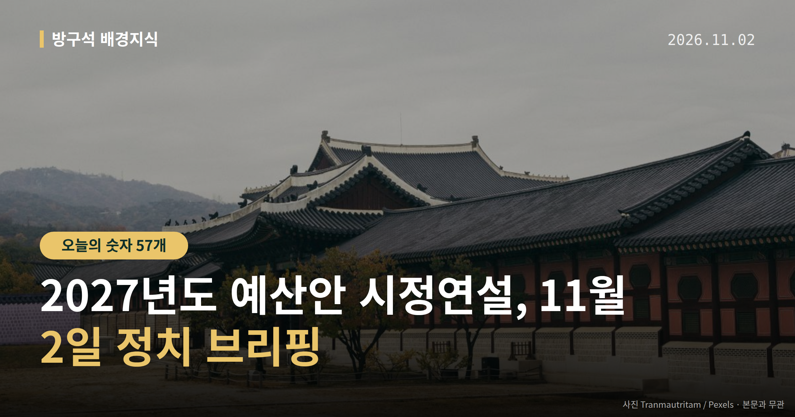
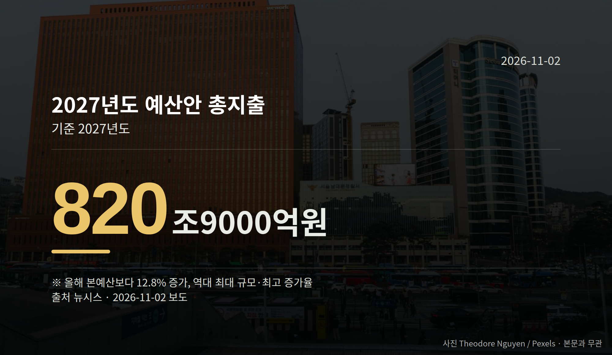

*이 글은 2026년 11월 2일 기준으로 정리한 내용입니다.*
**3줄 요약**

- 이재명 대통령, 11월 2일 내년도 예산안 시정연설 예정
- 총지출 820조9000억원, 올해 본예산보다 12.8% 증가
- 연설 뒤 국회 예산결산특별위원회 심사 일정을 보면 됩니다
오늘 정치권에서 가장 큰 일정은 2027년도 예산안 시정연설입니다. 이재명 대통령이 11월 2일 총지출 820조9000억원 규모의 내년도 예산안을 국회에서 설명할 예정입니다.

시정연설은 정부가 짠 예산안을 대통령이나 총리가 국회 본회의에서 직접 설명하는 절차입니다. 국회 예산 심사가 시작되는 공식 출발점이기도 합니다.

[이미지: 국회 본회의장 전경 사진]

## 2027년도 예산안 시정연설에 담기는 숫자

정부가 국회에 제출한 내년도 예산안 총지출은 820조9000억원으로 보도됐습니다. 올해 본예산 727조9000억원과 비교하면 12.8% 늘어난 규모입니다.

보도에 따르면 이 증가율은 역대 최고, 금액은 역대 최대입니다.

| 항목 | 금액·비율 |
|---|---|
| 2027년도 예산안 총지출 | 820조9000억원 |
| 2026년 본예산 | 727조9000억원 |
| 증가율 | 12.8% |
| 미래기금(언급 전망) | 162조원 |

(출처: 뉴시스)

표 마지막 줄의 162조원 미래기금은 "시정연설에 필요성이 담길 것"이라는 전망 보도입니다. 연설 전에 확정된 내용은 아니라는 점을 같이 봐 주세요.

또 일부 기사 제목은 '821조'로, 본문은 820조9000억원으로 적혀 소폭 차이가 있습니다. 이 글은 본문 수치를 기준으로 썼습니다.

## 시정연설 다음 절차는 무엇인가

연설이 끝나면 예산안은 국회 예산결산특별위원회(예결위) 심사로 넘어갑니다. 상임위별 검토와 예결위 조정을 거쳐 본회의 표결까지 가는 구조입니다.

역대 최대 규모라는 점 자체가 심사 과정의 쟁점이 될 수 있다는 전망이 나옵니다. 다만 이번 예산안에 대한 각 정당의 공식 입장은 제공된 자료에서 확인되지 않았습니다.

여러분이 볼 지점은 두 가지입니다. 정부가 어느 분야를 늘렸다고 설명하는지, 그리고 예결위에서 어떤 항목이 깎이거나 늘어나는지입니다. 2027년도 예산안 시정연설은 그 판단의 출발 자료가 됩니다.

[이미지: 책상 위 예산 관련 서류를 검토하는 손 사진]

## 그 밖의 오늘 소식

- 국민의힘 주진우 의원, 22대 총선 57개 투표구 개표 허위입력 주장
- 더불어민주당, 이번 주 조희대 대법원장 국정조사 요구서 본회의 보고 추진
- 장동혁 국민의힘 대표, 한동훈 의원 복당에 "거론 자체도 적절하지 않다"

**그래서 나는?**

- 직장인이라면, 내년 세금과 지원 항목 편성이 달라질 수 있습니다
- 자영업자라면, 예결위 심사에서 소상공인 항목을 확인해 보세요
- 유권자라면, 11월 2일 시정연설 생중계 일정을 체크해 보세요

**직접 센 숫자 — 국회·여론조사 (최근 7일)**

국회의원 발의 법률안 **287건**. 최근 발의: 인공지능 데이터센터 산업 진흥에 관한 특별법 일부개정법률안(한정애의원 등 11인)

본회의 처리 법률안 **1건** — 철회 1건

이번 주 등록된 선거 여론조사 9건

- 전국 정기(정례)조사 정당지지도 — (주)여론조사꽃 · 2026-10-30~31 · 1,005명 · 무선 ARS · 응답률 1.8% · 95% 신뢰수준에 ±3.1%p
- 전국 정기(정례)조사 정당지지도 — (주)여론조사꽃 · 2026-10-30~31 · 1,004명 · 무선전화면접 · 응답률 9.1% · 95% 신뢰수준에 ±3.1%p
- 전국 정기(정례)조사 정당지지도 10월 5주차 주간집계 — (주)리얼미터 · 아시아경제 의뢰 · 2026-10-29~30 · 1,005명 · 무선 ARS · 응답률 3% · 95% 신뢰수준에 ±3.1%p

*열린국회정보·중앙선거여론조사심의위원회 자료를 직접 셌습니다. 여론조사의 자세한 사항은 중앙선거여론조사심의위원회 홈페이지를 참조하세요.*
**내년 예산에서 여러분은 어느 항목이 가장 궁금하신가요?**

---

### 참고한 기사

1. **주진우 "22대 총선, 57곳 개표 허위입력…선관위가 참정권 행사한 셈"**
   - [서플 뉴스](https://news.google.com/rss/articles/CBMiXEFVX3lxTE11Nk5Sc3liNjFJcHlxM3hfQzBlUS1CTjNOM0o2YjZISHNkQWc5TWdJUzFWWjVwU2hpN0hKNkFPN3VfVS1VRU5SY3lKaXNmMmg4YzAxZDNpb3pHSjZV?oc=5)
   - [머니투데이](https://news.google.com/rss/articles/CBMickFVX3lxTE1ZbGtsSFNFbkxXZUVXRDBRaWloZlJvNVRXOVJIVUxrWmttTlozbFNoZUhSM1daLWtJWk9URmdPa1FRYjdjdU05cXhjdlExdTljQWE5bTE1aGVFRmlhUWdxQnhuVE9fS04zYWJkdDFxemY3d9IBckFVX3lxTE1ZbGtsSFNFbkxXZUVXRDBRaWloZlJvNVRXOVJIVUxrWmttTlozbFNoZUhSM1daLWtJWk9URmdPa1FRYjdjdU05cXhjdlExdTljQWE5bTE1aGVFRmlhUWdxQnhuVE9fS04zYWJkdDFxemY3dw?oc=5)
2. **장동혁 "보수 통합·연대, 필요한 시점에 당원 뜻 모아 추진"…韓 복당엔 선 그어**
   - [뉴시스·정치](https://www.newsis.com/view/NISX20261101_0003849871)
3. **조국, 국회 '동물농장' 빗댄 판사에 "검찰정치 끝나니 법원정치" - 머니투데이**
   - [머니투데이](https://news.google.com/rss/articles/CBMibEFVX3lxTE5YYWRURnczckJHNDBhU25CYUhXZEwyUTR6eXZNT3RfUWtNdlFWTUJVdnRNVWVUZ3VhUnZZZ3ZtdFV1SU5UbVFKaHZuRHhuQjNwTGFTTzJvWXNVSlYyWnFpV05nZERUSXY1Ukd1WtIBckFVX3lxTE5pSGllZFpRSHczNUFIejdRNll2WF9kRm96NnI0SEtvZzlURjJxMGVMb2tCUC1KbENNaElOQnltTnUxczB6bDBUWGFGNkJyLXJpOG1Cc1ZmaDB5RjEzZUREQlhpVzlSS2hXWlFVamZ3VHExQQ?oc=5)
   - [문화일보](https://news.google.com/rss/articles/CBMiUEFVX3lxTE5NQ0p4NU5lN1VVeG5uTHdHdkdMVmVvb2lURFpySlRvZXByOW5wY0prUDVGMlFZNjdWc1ZhUDFaSVRiX0h2b0VjeldqXy1LcHVv?oc=5)
4. **행정안전부(11월2일 월요일)**
   - [뉴시스·정치](https://www.newsis.com/view/NISX20261031_0003849361)
   - [뉴스핌](https://news.google.com/rss/articles/CBMiXEFVX3lxTE1EZzlKdlpySldFUmVmeHZqSzZ6aWtJZEs5bmtiZmZhVVFXdHdlTjdmVUFET1V2NUtrUkZQa3Q1T1NzTXUzWTI2elBBN2lrcGRYMHk0NFFNT1pXRzM3?oc=5)
5. **민주당, 주내 '조희대 국정조사' 본회의 보고…국힘 대응 주목**
   - [뉴시스·정치](https://www.newsis.com/view/NISX20261101_0003849886)
   - [법치뉴스](https://news.google.com/rss/articles/CBMiZEFVX3lxTE9lVlRwMGVYS1V2R2FvYnJHRFhTaWFVMTFfTXBnNnpOb3hBNlJJUXBMbEdPcTNudWxPaThRZzg1OVpJSE1sRjAzOFhQRFhSU2p1cmhZdVQ1b3J3ay1fN1MxR2E0RWXSAWhBVV95cUxQMUZYUExuVmVUY3VwMVhCYkcwOHNGVE02X2RmVnRmTWVhdkpOUWFTRnRsM3EtUnNraXVRaTVPbHFYb3BUZWx3WTlaYTdlMm1xeTRRMDNtSzlfUkhwcGgya1VGTVhnSk9TeQ?oc=5)

---

*본 글은 공개된 언론 보도를 정리한 것이며, 특정 정당·후보·인물을 지지하거나 반대하지 않습니다. 인용한 여론조사의 자세한 사항은 중앙선거여론조사심의위원회 홈페이지를 참조하세요.*
