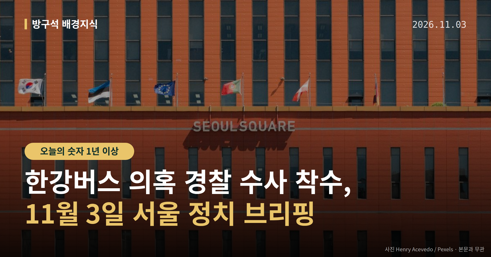
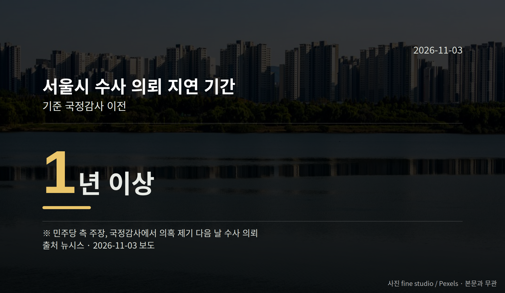

*이 글은 2026년 11월 3일 기준으로 정리한 내용입니다.*
**3줄 요약**

- 한강버스 의혹 경찰 수사, 고발인 조사로 첫 절차 시작
- 민주당 측은 서울시 수사 의뢰가 1년 이상 늦었다고 주장
- 11월 4일 법사위 특검법 상정 여부를 함께 보면 됩니다
11월 3일, 한강버스 의혹 경찰 수사가 고발인 조사로 첫 절차를 밟았습니다. 서울 남대문경찰서는 이날 오전 10시 30분부터 박주민 의원을 고발인 신분으로 조사했습니다.

같은 날 서울시의회 더불어민주당은 이 사안을 행정사무감사로 검증하겠다고 밝혔습니다. 수사와 의회 감사가 동시에 돌아가는 상황입니다.

[이미지: 한강 수상 교통과 서울 도심 전경 사진]

## 한강버스 의혹 경찰 수사, 어떤 고발에서 시작됐나

박주민 의원 등 진상조사단은 10월 29일 오세훈 서울시장을 공직선거법상 허위사실 공표 혐의로 서울경찰청에 고발했다고 밝혔습니다. 서울경찰청은 이 사건을 남대문경찰서에 배당했습니다.

고발인 조사는 고발한 사람을 먼저 불러 고발 취지와 근거를 확인하는 절차입니다. 수사의 출발점이지, 혐의가 확인된 단계는 아닙니다.

조사단은 서울시 감사위원회가 지난해 9월 한강버스 선박 건조업체 선정 관련 금품수수 의혹을 오세훈 시장에게 대면 보고했다고 주장했습니다.

오세훈 시장은 지난해 11월 20일 서울시의회 본회의에서 "국회 행정안전위원회에서 요청한 감사도 남아있어 추가 감사를 더 해줄 수 없다는 답변을 받았다"고 말했습니다. 조사단은 올해 3월 17일 '감사원 감사 결과로 부실 사업자 선정 의혹이 해소됐다'는 취지의 발언도 허위사실이라고 주장했습니다.

다만 이 주장들에 대한 오세훈 시장과 서울시 측의 직접적인 반박·해명은 오늘 자료에서 확인되지 않았습니다. 리베이트·은폐는 모두 의혹 제기 단계이고, 혐의는 수사 중이라는 뜻이어서 유죄가 확정된 것이 아닙니다.

## 행정사무감사는 어디까지 가나

서울시의회 민주당 한강버스 비리 은폐 진상조사단과 의원단은 이날 기자회견을 열고, 행정사무감사(지방의회가 집행부의 업무 처리를 따져 묻는 절차)로 의혹을 밝히겠다고 밝혔습니다.

이들은 서울시가 국정감사에서 의혹이 드러난 뒤 1년 넘게 미뤄온 수사 의뢰를 다음 날 했다고 주장했습니다. 이 지연 기간은 민주당 측 주장으로, 서울시 설명은 자료에 담기지 않았습니다.

이상훈 대표의원은 행정조사권 발동도 검토하고 있다고 말했습니다. 박유진 서울시의원 등도 발언했으나, 발언 전문은 일부만 확인됐습니다.

정리하면 한강버스 의혹 경찰 수사는 고발 내용의 사실관계를, 행정사무감사는 사업 추진 과정과 보고 라인을 각각 들여다보는 구조입니다.

[이미지: 지방의회 본회의장에서 진행되는 감사 장면 사진]

## 그 밖의 오늘 소식

- 11월 4일 법사위, 조작기소(공소취소) 특검법 상정 예정
- 국민의힘 박형수 의원 "수사 대상 12개 중 8개가 이재명 대통령 피고인 사건" 주장
- 민주당, 11월 5일 본회의에 조희대 대법원장 국정조사 요구계획서 보고 검토

두 번째 항목은 국민의힘 측 주장이며, 서영교 법사위원장과 민주당 측 반론은 이번 자료에 없습니다. 민주당은 공소 취소 권한은 배제하고 수사 대상은 넓히는 방향으로 법안을 수정하겠다고 밝혔습니다.

**그래서 나는?**

- 서울 유권자라면, 시의회 행정사무감사 일정을 확인해 보세요
- 뉴스가 어렵다면, 고발·수사·감사는 서로 다른 절차로 보면 됩니다
- 국회 일정 챙기신다면, 11월 4일 법사위와 5일 본회의가 분기점입니다

**직접 센 숫자 — 국회·여론조사 (최근 7일)**

국회의원 발의 법률안 **270건**. 최근 발의: 인공지능 및 데이터 기반 행정 활성화에 관한 법률 일부개정법률안(허영의원 등 10인)

본회의 처리 법률안 **1건** — 철회 1건

이번 주 등록된 선거 여론조사 10건

- 전국 정기(정례)조사 정당지지도 — 여론조사공정(주) · 펜앤마이크 의뢰 · 2026-11-01~02 · 1,001명 · 무선 ARS · 응답률 3.1% · 95% 신뢰수준에 ±3.1%p
- 전국 정기(정례)조사 정당지지도 대통령선거 — (주)비전코리아 · 올리서치 의뢰 · 2026-10-31~11-01 · 1,024명 · 무선 ARS · 응답률 3.7% · 95% 신뢰수준에 ±3.1%p
- 전국 정기(정례)조사 정당지지도 — (주)여론조사꽃 · 2026-10-30~31 · 1,005명 · 무선 ARS · 응답률 1.8% · 95% 신뢰수준에 ±3.1%p

오늘 이슈에 나온 법안은 지금 어디에

- 공직선거법 — 제22대 발의 330건 · 최근 「공직선거법 일부개정법률안」(박형수의원 등 12인, 2026-10-29) · 소관위 회부

*열린국회정보·중앙선거여론조사심의위원회 자료를 직접 셌습니다. 여론조사의 자세한 사항은 중앙선거여론조사심의위원회 홈페이지를 참조하세요.*
**여러분은 한강버스 의혹 경찰 수사와 서울시의회 행정사무감사 가운데, 어느 절차의 결과를 먼저 확인해 보고 싶으신가요?**

---

### 참고한 기사

1. **폴리뉴스 모닝브리핑 11월 3일 화요일**
   - [폴리뉴스 Polinews](https://news.google.com/rss/articles/CBMibkFVX3lxTE95cC1oS1hFd0hWWkpveFVJV1AxQXB2LUtRQmRuU1EyWGhlSE0yal94SXlxU1BQSGtDYXZ0ZGZreGxLSXJ3VmlKN2syTHJxYXJkRWRwSEZuQURXaW1wTUZ2QXNaZi1EeEt5djVQaERB?oc=5)
   - [뉴시스·정치](https://www.newsis.com/view/NISX20261102_0003851735)
2. **서울시의회 민주 "한강버스, 오세훈 치적 아닌 공공사업…의혹 밝힐 것"(종합)**
   - [뉴시스·정치](https://www.newsis.com/view/NISX20261103_0003852349)
   - [연합뉴스·정치](https://www.yna.co.kr/view/AKR20261103057400004)
3. **與 “조작기소특검 4일 법사위 상정”… 조희대국조안 5일 본회의 강행**
   - [문화일보](https://news.google.com/rss/articles/CBMiUEFVX3lxTE9FNDItRDVicmJHZmE5NHlIRVhMekFXNnNMZzk5NENqenFwakkzRUxQenB1QXFOaXZibC1EU2gyRUlIbGFFS1EyNzk1ajhzekZ2?oc=5)
   - [뉴스1](https://news.google.com/rss/articles/CBMiWkFVX3lxTE1kMi1ON1FsS3VrbGMwYUpuQVdKYTdEY0FNaHRzbGxJZXVzMG5OeW1aTlBTYTUyZmpVWHNIYk9EV3hta1ZkR3BDWTFhMzF4MHBRMHZTTkxJd28wQQ?oc=5)
4. **국힘 박형수 "서영교, 내일 법사위 전체회의에 '공소취소 특검법' 상정 통보"**
   - [뉴시스·정치](https://www.newsis.com/view/NISX20261103_0003852264)
5. **경찰, "오세훈 한강버스 허위사실 공표" 고발인 박주민 조사**
   - [뉴시스·정치](https://www.newsis.com/view/NISX20261103_0003852499)
   - [연합뉴스·정치](https://www.yna.co.kr/view/AKR20261103057451004)

---

*본 글은 공개된 언론 보도를 정리한 것이며, 특정 정당·후보·인물을 지지하거나 반대하지 않습니다. 인용한 여론조사의 자세한 사항은 중앙선거여론조사심의위원회 홈페이지를 참조하세요.*
